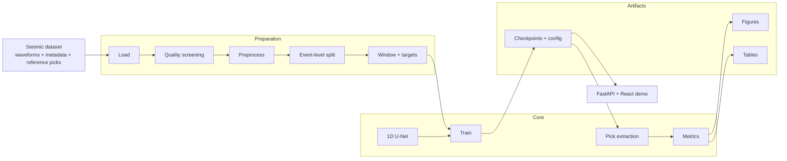
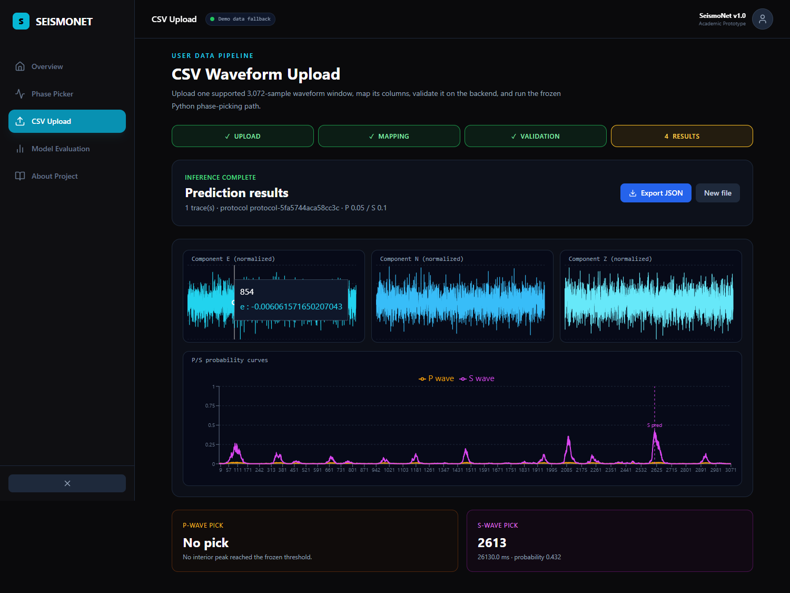
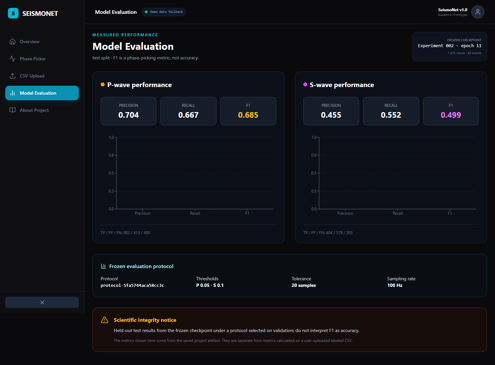

# SeismoNet

**Deep-learning seismic phase picking: predicting P-wave, S-wave and noise probabilities per time step from three-component seismic waveforms, using a 1D U-Net inspired by PhaseNet.**

SeismoNet is a research and educational prototype for automated seismic phase picking. Given a window of three-component waveform, it predicts, for every time sample, the probability that the sample belongs to a P-wave arrival, an S-wave arrival, or noise. Arrival times are extracted from those probability curves and evaluated against reference annotations using timing residuals plus precision, recall and F1 under an explicit tolerance.

**This is not an earthquake early-warning system, and it does not predict earthquakes.** Phase picking measures when a wave that has *already been recorded* arrived at a station. SeismoNet makes no claim of operational readiness, does not locate events, does not estimate magnitude, and does not process continuous real-time streams.

> ## Project status: implemented mini-project with verified held-out evaluation
>
> The pipeline, model, validation experiments, and unbiased held-out evaluation are fully implemented and verified.
> The reference checkpoint is `runs/experiment_002_p_training/best.pt` (epoch 11, `protocol-5fa5744aca58cc3c` `P 0.05 / S 0.10 / tol 20 @ 100 Hz`).
> * **Validation results (210 traces, 8 events):** P F1 `0.7241` (147/49/63), S F1 `0.5243` (81/82/65).
> * **Held-out test results (1,472 traces, 45 novel events):** **P F1 `0.6850`** (982/413/490, median timing error 110 ms) and **S F1 `0.4990`** (484/579/393, median timing error 140 ms). Zero event leakage (`splits/split.json` hash `aea671c76ce2`).
> Supervisor review & approval package: `docs/SUPERVISOR_APPROVAL_CHECKLIST.md` (fully approved items 1–6). Written mini-project report: [`docs/REPORT.md`](docs/REPORT.md). Demonstration: `scripts/demo_validation.py` (validation-only, frozen checkpoint).
> Browser demo: FastAPI backend + React UI, verified end to end in a headless browser (**14/14 steps, zero console errors**) — evidence in [`docs/screenshots/browser-2026-10-25/`](docs/screenshots/browser-2026-10-25/), demo script in [`docs/DEMO_WALKTHROUGH.md`](docs/DEMO_WALKTHROUGH.md).

---

## Try the demo in 60 seconds

```powershell
# Terminal 1 — API
.venv\Scripts\python.exe -m uvicorn backend.main:app --host 127.0.0.1 --port 8000

# Terminal 2 — UI
cd frontend
npm install
npm run dev
```

Then open <http://127.0.0.1:5173> → **CSV Upload** → upload
[`samples/demo_12traces_predict.csv`](samples/demo_12traces_predict.csv) → map **Trace ID → `trace_id`** →
**Validate CSV** → **Run real model analysis**.

That file holds **twelve independent 30.7 s windows** (36,864 rows, one `trace_id` per window), so the results
page offers a trace selector, three waveform panels and both probability curves per trace. A click-by-click
script for a live demonstration — the numbers to quote and the questions to expect — is in
[`docs/DEMO_WALKTHROUGH.md`](docs/DEMO_WALKTHROUGH.md).

> The sample windows are **generated**, not recorded field data, because the raw INSTANCE dataset is not
> shipped. They exercise the entire software path; the model's scientific numbers are the held-out test
> results on the Model Evaluation page. See [`samples/README.md`](samples/README.md).

## Problem statement

Identifying P-wave and S-wave arrival times is a routine but demanding step in earthquake analysis. Traditionally an analyst inspects waveforms by hand to decide where a phase onset begins. That work is slow relative to the volume of continuously recorded data, and it is subjective: different analysts, or the same analyst on different days, can select different onsets — especially for emergent onsets and for S waves, which arrive inside the coda of the P wave.

Classical automatic detectors such as STA/LTA are threshold-based and degrade as the signal-to-noise ratio falls, and they tend to time S waves poorly.

Deep-learning pickers exist and perform well in the literature, but a reported score is only meaningful together with the dataset it came from, the time tolerance used to call a pick correct, and the rule used to match a predicted pick to a reference pick. Two studies can report very different numbers for comparable models without either being wrong.

SeismoNet therefore treats a **transparent, reproducible evaluation protocol, frozen before results are inspected**, as a first-class deliverable — not an afterthought.

This project does not attempt to measure or claim any specific productivity gain from automation, and it does not assert any figure about the scale of the manual-picking problem.

## Key features

| Feature | Status |
|---|---|
| Load a seismic dataset with waveforms, sampling rate and reference P/S picks | ✓ streaming HDF5 + CSV loader |
| Data-quality screening (NaN, flat traces, missing picks, sampling-rate mismatch) | ✓ `validation.py` + `QualityReport` |
| Preprocessing: detrend/demean, normalisation, optional filtering, optional resampling | ✓ per-window demean/peak (`loader.py`) + windowing |
| Event-aware train/validation/test splitting, persisted and verified for zero event overlap | ✓ `split.py` + `splits/split.json aea671c76ce2` |
| Fixed-length windowing with randomised pick position, and Gaussian P/S target curves | ✓ `L 3072`, `σ 20`, `labels.make_targets` |
| Switchable, training-only augmentation with noise addition controlled separately | ✓ `augmentation.py` (disabled in experiments) |
| 1D U-Net emitting three per-sample class probabilities (P, S, noise) | ✓ `SeismoUnet1d base 16 depth 4` 678 k params |
| Reproducible training with seeds, validation monitoring, best-checkpoint saving and config capture | ✓ pilot (3 ep) + exp002 (20 ep, epoch 11 selected by `argmax P F1`) |
| Pick extraction with a configurable threshold selected on validation data only | ✓ `P 0.05 / S 0.10 / tol 20 @ 100 Hz` `protocol-5fa5744aca58cc3c` |
| Evaluation: residuals, precision, recall and F1, **reported separately for P and S** | ✓ validation `P 0.724 / S 0.524`; held-out test `P 0.685 / S 0.499` |
| Visualisation: waveform + reference picks + predicted picks + probability curves; residual histograms; failure gallery | ✓ P6 suite + `runs/eval_test_best/figures/` |
| Noise-robustness experiment with a documented noise-generation and SNR definition | Planned — (see `EXPERIMENT_PLAN.md` EX-4) |
| One-factor-at-a-time training-configuration study | ✓ pre-registered σ ablation EX-2 executed |
| Reproducibility packaging: pinned dependencies, saved splits, regeneration command | ✓ `.venv`, `requirements.lock`, `config_snapshot.yaml`, `run.json` |
| Minimal local demo | ✓ `scripts/demo_validation.py` (validation-only, frozen, `--list` to discover traces) |
| Browser demo | ✓ FastAPI backend + React/Vite frontend; deterministic trace fallback when ignored raw data is unavailable; CSV upload uses the frozen Python model |

## Scientific scope and limitations

**In scope.** Loading one supported dataset; preprocessing; label preparation; training a 1D U-Net; P/S inference; probability visualisation; quantitative evaluation on held-out events; noise-robustness and configuration experiments; reproducibility.

**Out of scope.** Predicting earthquakes before they occur; claiming guaranteed or operational early warning; issuing public alerts; real-time streaming and per-day false-alarm claims; multi-station association, location, magnitude or focal mechanisms; instrument-response removal; teleseismic and sub-phase (Pn/Pg, Sn/Sg) classification; novelty in architecture; any generalisation claim beyond the selected dataset.

**Limitations that will be carried into the report.** A single dataset means no evidence of generalisation elsewhere. Reference picks are analyst-derived and carry their own uncertainty, so a reported "error" partly reflects label noise. At most one P and one S pick is extracted per window, which is not representative of continuous multi-event data. Added-noise experiments use a controllable perturbation that is not realistic seismic noise. Precision, recall and F1 change with the tolerance and matching rule, so cross-paper comparison requires care. Full list: [`docs/REASONING_AND_DECISIONS.md`](docs/REASONING_AND_DECISIONS.md) and `PRD.md` §13.

## Architecture

Implemented research pipeline plus an optional FastAPI/React browser layer (see [`docs/TECHNICAL_ARCHITECTURE.md`](docs/TECHNICAL_ARCHITECTURE.md)):



The scientific pipeline remains a single-process Python program with no database, message queue or
container orchestration. The optional browser layer is a thin FastAPI service over that pipeline plus
a React/Vite client; data still flows through files on disk, and the event-level split is
version-controlled because the split is part of the result.

## Technology stack

Installed and verified in `.venv` (authoritative): `Python 3.14.3`, `torch 2.14.1+cu126 / cuda 12.6 / RTX 2050 4096 MiB`, `numpy 2.5.4`, `scipy 1.18.1`, `matplotlib 3.11.2`, `fastapi 0.161.1`, and `uvicorn 0.54.0`. The frontend uses React/Vite with TailwindCSS and Recharts. Not requested: `obspy`, `seisbench`, `streamlit`, `mlflow`. Full trade-offs: `docs/TECH_STACK.md`.

| Layer | Proposed tools |
|---|---|
| Core development | Python 3.11/3.12 (**note:** the machine currently has 3.14.3 — unresolved), Git/GitHub, a pinned lockfile |
| Scientific computing | NumPy, SciPy, pandas |
| Seismic data processing | ObsPy, SeisBench |
| Machine learning | PyTorch, a 1D U-Net, soft cross-entropy loss, Adam/AdamW, `ReduceLROnPlateau`, AMP where available |
| Evaluation | scikit-learn where suitable, plus custom seismic picking metrics |
| Visualisation | Matplotlib (static figures), optional Plotly |
| Configuration and experiments | YAML, recorded seeds, CSV/JSON exports, optional local MLflow |
| Testing | pytest, ruff, GitHub Actions with a tiny synthetic fixture |
| Optional demo | Streamlit (preferred) or Gradio |

Verified as already installed in the author's environment (from the audit, not from the project): Python 3.14.3, torch 2.13.0**+cpu**, numpy 2.4.3, pandas 3.0.1, scipy 1.17.1, scikit-learn 1.8.0, pytest 9.1.1, PyYAML 6.0.3, safetensors 0.8.0. **Not installed:** obspy, seisbench, matplotlib, streamlit, plotly, mlflow, ruff, pandera. Detail and trade-offs: [`docs/TECH_STACK.md`](docs/TECH_STACK.md). The original v0.1 stack recommendation is preserved at [`docs/archive/tech-v0.1-original.md`](docs/archive/tech-v0.1-original.md) and at [`tech.md`](tech.md).

## Repository structure

```text
SeismoNet/
├── README.md                      # this file
├── PRD.md                         # Product Requirements Document v1.0
├── pyproject.toml                 # pythonpath ["src"]
├── requirements.lock              # pinned .venv (torch 2.14.1+cu126)
├── configs/baseline.yaml          # source of truth for windowing/sigma/pure_noise
├── splits/                        # event-level 70/15/15 aea671c76ce2 (tracked)
├── samples/
│   ├── README.md                  # what the demo CSVs are — and are not
│   └── demo_12traces_predict.csv  # 12 × 3,072-sample windows for the web demo (2 MB)
├── scripts/
│   ├── run_experiment_002.py      # 20-epoch training (frozen task)
│   ├── run_test_evaluation.py     # one-time held-out evaluation
│   ├── run_ablation_ex2.py        # pre-registered σ ablation
│   ├── demo_validation.py         # validation-only CLI demo (frozen)
│   └── make_demo_csv.py           # regenerates samples/demo_12traces_predict.csv
├── src/seismonet/                 # loader, windowing, labels, dataset, model, losses, metrics, picking
├── backend/                       # FastAPI: health, traces, analysis, metrics, CSV validate/analyze
├── frontend/                      # React 18 + TypeScript + Vite + Tailwind UI (5 pages)
├── tests/                         # 190 passed, 36 skipped here; the 36 require the ignored raw sample
├── runs/                          # ignored — pilot, exp002 (epoch 11 best.pt), validation_*, eval_test_best, demo/
├── docs/
│   ├── DEMO_WALKTHROUGH.md        # judge-facing demonstration script
│   ├── REPORT.md                  # the written mini-project report (11 sections)
│   ├── SUPERVISOR_REVIEW_2026-10-18.md   # review package (B1–B10, approval checklist)
│   ├── PROJECT_STATUS.md          # authoritative status + verification evidence
│   ├── TECHNICAL_ARCHITECTURE.md etc.    # see docs/ listing in PROJECT_STATUS.md §9
│   ├── screenshots/browser-2026-10-25/   # browser verification evidence
│   └── change-log/
│       ├── CHANGELOG.md
│       ├── CURRENT_STATUS.md
│       ├── decisions/ (ADR-001, ADR-002)
│       └── entries/ (through 2026-10-25-006)
└── tech.md                        # original v0.1 stack note (preserved)
```

`src/`, `tests/`, `configs/`, `splits/`, `runs/`, and `.venv` are implemented — the “does not exist yet” note in `TECHNICAL_ARCHITECTURE.md §4` predates them.

## Environment setup

The project uses the existing `.venv` as captured in `requirements.lock` (Windows, `Python 3.14.3`, `torch 2.14.1+cu126 / cuda 12.6` on `RTX 2050 4096 MiB` — see `docs/REPRODUCIBILITY.md`).

```powershell
# Already done — to reproduce from a clean checkout:
python -m venv .venv
.venv\Scripts\Activate.ps1          # Windows PowerShell
# .venv\Scripts\pip install -r requirements.lock   # if reproducing from lockfile
.venv\Scripts\python -m pytest tests -q -rs   # -> 190 passed, 36 skipped when raw sample data is absent
```

`pyproject.toml` sets `pythonpath = ["src"]`. Do not install a separate global PyTorch.

## Dataset setup

Selected: **INSTANCE Counts** (`CC BY 4.0`, `doi:10.13127/instance` — `docs/DATASET_GUIDE.md §4.1`).
Local sample: `Instance_events_counts_10k.hdf5` (`ENZ/CW/(3,12000)` `100 Hz`, `115,9249` traces / `54,008` events) at the temp path recorded in `runs/*/run.json:dataset` — full archive NOT downloaded. Event-level splits `70/15/15` `aea671c76ce2` (`37806/8101/8101`, `0` overlap) in `splits/` are the result; without them the model cannot be evaluated on held-out events. See `ADR-002`.

Sources named in this repository, for orientation only, with all properties **unverified**:

- PhaseNet official repository — implementation and example workflows: <https://github.com/AI4EPS/PhaseNet>
- STEAD dataset resources: <https://github.com/smousavi05/STEAD>

Before any experiment: confirm the dataset's **licence and terms**, waveform format, sampling rate, component ordering, label conventions, event identifiers, and download requirements. Record the outcome in [`docs/DATASET_GUIDE.md`](docs/DATASET_GUIDE.md).

## Training — what was run

The training is **frozen** for this review. The recorded experiments are:

* **Pilot** — `runs/pilot_seed42/` (16 train / 8 val events, `492/210` traces, 3 epochs, `batch 4`, `Adam 1e-3`, `σ 20`) — pipeline check (`val 0.1318`, P F1 `0.0048`).
* **Experiment 002 (reference)** — `runs/experiment_002_p_training/` (same 16/8-event task, **20 epochs**, same hyper-params) — selection `argmax val P F1` → **epoch 11** `P 0.7241 / S 0.5243` (`p@P_ref≈0.44`), `val 0.0787`, `~199 s`, `49/72 MiB`. See `scripts/run_experiment_002.py`.

Reproduce training (only if approved to run again — writes a **new** `runs/` dir, never overwrites `best.pt`):

```powershell
.venv\Scripts\python scripts\run_experiment_002.py   # writes runs/experiment_002_p_training/
```

## Inference

Frozen checkpoint `runs/experiment_002_p_training/best.pt` + frozen protocol `protocol-5fa5744aca58cc3c` (`P 0.05 / S 0.10 / tol 20 @ 100 Hz`).

```powershell
# Validation-only (reproduces the reported 147/49/63 vs 81/82/65 — uses existing 210-trace val subset, never test)
.venv\Scripts\python -c "from pathlib import Path; import csv, json; print(json.loads(Path('runs/experiment_002_p_training/run.json').read_text())['picking_protocol'])"
# or the full inference entry point (as used for the figures):
.venv\Scripts\python -m seismonet.validation_inference --help
```

Behaviour: window validated (`3×3072`), `softmax(dim=1)` probabilities, `pick_phase_diagnostics` above `P/S` threshold, `min_peak_distance 20`, missing/out-of-window refs handled per protocol — if no peak exceeds threshold the output is **`no pick`**.

Held-out test inference is recorded in `runs/eval_test_best/` for 1,472 traces across 45 unseen
events. The browser demo uses the same frozen checkpoint metadata, but its interactive trace view
falls back to deterministic synthetic waveforms when the ignored raw HDF5 sample is unavailable.

## Evaluation

Frozen validation evaluation: `P 147/49/63 0.750/0.700/0.724` and `S 81/82/65 0.497/0.555/0.524` at `tol 20 (200 ms)`.
Held-out test evaluation: **P F1 0.6850** (`982/413/490`) and **S F1 0.4990**
(`484/579/393`) at the same tolerance; details are in `runs/eval_test_best/metrics.json`.
Every table states tolerance/threshold/matching/denominator.

## Demo

Minimal local, validation-only Python demo:

```powershell
.venv\Scripts\python scripts\demo_validation.py --list                          # 210 permitted validation traces
.venv\Scripts\python scripts\demo_validation.py --index 5
.venv\Scripts\python scripts\demo_validation.py --trace 11210661.IV.FDMO..HH --out runs/demo/demo_FDMO.png
```

Loads `best.pt` (`weights_only=True`), draws the three components + `P/S` probability curves with `P 0.05 / S 0.10` thresholds and reference/predicted arrivals for one permitted validation trace (`runs/demo/*.png`). Warning: small 10k-sample demo, not a generalisation claim.

### Browser demo

Start the API and frontend from the project root:

```powershell
# Terminal 1
.venv\Scripts\python.exe -m uvicorn backend.main:app --host 127.0.0.1 --port 8000

# Terminal 2
cd frontend
npm install
npm run dev -- --host 127.0.0.1 --port 5173
```

Open `http://127.0.0.1:5173`; API documentation is available at `http://127.0.0.1:8000/docs`.
The raw HDF5 sample is intentionally ignored and is not present in every checkout. If it is
missing, the API labels its deterministic synthetic trace responses as
`synthetic_demo_fallback`; it uses the bundled `backend/demo_traces.json` fixture (or local run
metadata when available) and automatically uses real model inference when the recorded HDF5 and
metadata files are available.

The demo has been verified in a real browser (2026-10-25): a headless Chrome walkthrough of all five
pages plus the CSV upload → validation → analysis → JSON export flow passed **14/14 steps with zero
console errors** against both the dev server and the production build (`npm run build` then
`npm run preview`). Screenshots and the machine-readable trace are in
[`docs/screenshots/browser-2026-10-25/`](docs/screenshots/browser-2026-10-25/). The production bundle
is split into an ~114 kB entry chunk plus cacheable `react` and `charts` chunks, so the build emits no
bundle-size warning.

The CSV page sends a UTF-8 multipart upload to `POST /api/csv/validate` and
`POST /api/csv/analyze`. The frozen web input contract is one 3,072-sample ENZ window per trace;
an explicitly supplied input rate may be resampled to the effective 100 Hz model rate only when
the resulting length is exactly 3,072 samples. A `trace_id` column is required to distinguish
multiple independent traces. CSV uploads are request data only: they are not added to any
training, validation, or test split. See [`docs/SEISMONET_DEVELOPMENT_GUIDE.md`](docs/SEISMONET_DEVELOPMENT_GUIDE.md)
for the local workflow and [`docs/SEISMONET_UI_ACTION_INVENTORY.md`](docs/SEISMONET_UI_ACTION_INVENTORY.md)
for the interaction map.

#### The five pages

| Page | What it does |
|---|---|
| **Overview** | Landing page showing the held-out headline numbers (P F1 `0.685`, S F1 `0.499`) read live from the saved metrics artefact. |
| **Phase Picker** | Select one stored trace and run picking. In a checkout without the raw dataset it returns a clearly-labelled `synthetic_demo_fallback` and shows an amber banner stating that the model is not running there. |
| **CSV Upload** | Four-step wizard — upload, column mapping, validation, results — with a staged walk-through of the pipeline (read → map → contract check → normalise → U-Net → threshold → draw), waveform and probability charts, upload metrics in comparison mode, and export of the full JSON. |
| **Model Evaluation** | The one-time held-out benchmark: precision/recall/F1, TP/FP/FN and the frozen protocol, badged *"held-out test set · not from your upload"*. |
| **About Project** | Scope, method, dataset, and the explicit "not earthquake prediction, not early warning" statement. |

Below the CSV charts, a **"What just happened?"** panel explains the run in plain language: what was uploaded,
how columns were mapped, what the model produced for every sample, a per-trace picks table, how to read
sample/ms/probability, and what the result does *not* mean.





Ready-made example figures (frozen checkpoint, frozen protocol, validation traces only):

| Figure | Trace | What it shows |
|---|---|---|
| `runs/demo/example_success_FDMO.png` | `11210661.IV.FDMO..HH` | correct P and S picks (P residual `0` samples, S residual `−16` samples) |
| `runs/demo/example_failure_MMO1_HN.png` | `11043661.IV.MMO1..HN` | P false pick `1621` samples from the reference, no S pick |
| `runs/demo/example_missing_s_APPI.png` | `1114321.IV.APPI..EH` | missing-S trace, P pick out of tolerance |

The demo is covered by `tests/test_demo_validation.py` (4 tests), including a guard test that a test-split trace is refused.

### Results and report scaffold

* **Validation (frozen):** `P F1 0.7241 (147/49/63)` / `S F1 0.5243 (81/82/65)` — `runs/experiment_002_p_training/` (biased — epoch and thresholds both selected on val).
* **Per-event (val):** `0.50–0.86` P F1 across 8 events (`analysis/event_breakdown.json`) — no single event dominates (largest `43.5 %` of P TP proportional to `77` traces).
* **Report:** [`docs/REPORT.md`](docs/REPORT.md) — the written mini-project report (introduction → references, 11 sections, verification-only figures).
* **Report scaffold:** `docs/REPORT_SCAFFOLD.md` (11 sections `1–11`) citing only verified sections.
* **Supervisor package:** `docs/SUPERVISOR_REVIEW_2026-10-18.md` (abstract … conclusion, approval checklist §B10).
* **Audit:** `docs/AUDIT_2026-10-18-EXPERIMENT-002.md`.

## Testing

```powershell
.venv\Scripts\python -m pytest tests -q -rs   # -> 190 passed, 36 skipped in this checkout
```

Covers labels, windowing, loaders, augmentation, metrics (`classify_picks` with `TP ⇔ |pred−ref| ≤ 20`, missing/out-of-window handling), `SeismoUnet1d` shape, `soft_cross_entropy` over soft Gaussian targets, validation-inference diagnostics, and the validation-only demo (including its test-split guard). See `docs/TESTING_STRATEGY.md`.

## Documentation

| Document | What it covers |
|---|---|
| [`PRD.md`](PRD.md) | Requirements: functional, non-functional, scientific, dataset, metrics, acceptance criteria, open questions |
| [`docs/AUDIT_REPORT.md`](docs/AUDIT_REPORT.md) | What actually exists in the repository, and what does not |
| [`docs/PROJECT_STATUS.md`](docs/PROJECT_STATUS.md) | Authoritative status, blockers and verification evidence |
| [`docs/TECHNICAL_ARCHITECTURE.md`](docs/TECHNICAL_ARCHITECTURE.md) | Components, contracts, data flow, config, errors, storage, testing, deployment tiers |
| [`docs/REASONING_AND_DECISIONS.md`](docs/REASONING_AND_DECISIONS.md) | Why each design decision was made, its alternatives, risks and evidence needs |
| [`docs/TECH_STACK.md`](docs/TECH_STACK.md) | Layered technology stack, installed vs proposed, trade-offs |
| [`docs/SYSTEM_FLOW.md`](docs/SYSTEM_FLOW.md) | Training, inference, evaluation and demo workflows with edge-case handling |
| [`docs/TESTING_STRATEGY.md`](docs/TESTING_STRATEGY.md) | Test levels, the 66-test catalogue, fixtures, CI plan |
| [`docs/EXPERIMENT_PLAN.md`](docs/EXPERIMENT_PLAN.md) | Hypotheses, controls, metrics and result templates for every planned experiment |
| [`docs/DATASET_GUIDE.md`](docs/DATASET_GUIDE.md) | Dataset acquisition, licensing, formats, validation and reproducible preparation |
| [`docs/DEVELOPMENT_ROADMAP.md`](docs/DEVELOPMENT_ROADMAP.md) | Phases P0-P9 with dependencies, exit criteria and effort estimates |
| [`docs/REPRODUCIBILITY.md`](docs/REPRODUCIBILITY.md) | Environment, seeds, splits, configs, checkpoints, regeneration, naming |
| [`docs/DOCUMENTATION_QC_REPORT.md`](docs/DOCUMENTATION_QC_REPORT.md) | Documentation quality-control results and known discrepancies |
| [`docs/change-log/README.md`](docs/change-log/README.md) | Change documentation rules and the mandatory report template |
| [`docs/REPORT.md`](docs/REPORT.md) | The written mini-project report (11 sections), verification-only numbers |
| [`docs/DEMO_WALKTHROUGH.md`](docs/DEMO_WALKTHROUGH.md) | Judge-facing demo script: pitch, click order, numbers to quote, claims to avoid, likely questions |
| [`samples/README.md`](samples/README.md) | The demo upload files, and exactly what they do and do not demonstrate |
| [`docs/change-log/CHANGELOG.md`](docs/change-log/CHANGELOG.md) | Chronological change summary |
| [`docs/change-log/CURRENT_STATUS.md`](docs/change-log/CURRENT_STATUS.md) | Short current-state snapshot |

## Known limitations

1. Only `16` train / `8` val events (`492/210` traces, `10k` sample) — traces from one event are not independent.
2. Full archive (`1.1 M` traces, `54,008` events) not downloaded — window/`σ` decisions stay provisional.
3. Validation subset is small (`210` traces, smallest event `4` traces); per-event numbers on tiny events are noisy.
4. **Validation-based selection bias:** best epoch (`11`) and thresholds (`0.05/0.10`) both maximise the same `210`-trace val set, so `P F1 0.7241` is optimistically biased — not a generalisation number.
5. Held-out test metrics are available in `runs/eval_test_best/metrics.json`; they remain separate from validation-selected model development and from user-uploaded CSV metrics.
6. S remains moderate (`0.52`); reported F1 values are at `tol 20 (200 ms)` only — other tolerances not reported.
7. Single dataset, so no evidence of generalisation to other regions/networks/instruments.
8. Reference picks are not absolute truth; reported error partly reflects label noise.
9. One pick per phase per window; behaviour on continuous multi-event data untested.
10. Added-noise experiments (not run) would not represent real coloured seismic noise.
11. Sub-phases / teleseismic phases not distinguished; instrument response not handled.

## Contributing and change documentation

Every meaningful change must be documented in [`docs/change-log/entries/`](docs/change-log/entries/) using the mandatory template, and [`docs/change-log/CHANGELOG.md`](docs/change-log/CHANGELOG.md) and [`docs/change-log/CURRENT_STATUS.md`](docs/change-log/CURRENT_STATUS.md) must be updated in the same session. Significant architectural or scientific decisions require an ADR in [`docs/change-log/decisions/`](docs/change-log/decisions/). Historical entries are never deleted or rewritten; corrections are made transparently in a new entry.

## References

Sources named in the project documentation, none of which has been verified in a literature search:

- PhaseNet — U-Net on three-component waveforms emitting P/S/noise probability curves: <https://github.com/AI4EPS/PhaseNet>
- STEAD — Stanford Earthquake Dataset resources: <https://github.com/smousavi05/STEAD>

**All citations and dataset statistics in this repository are unverified.** The original documentation states that no live literature search or database lookup was performed. Verify every citation and every dataset property before quoting it in a report. See `PRD.md` §4.7 and §11.3.

## Project status

Implemented through Experiment 002 and the recorded one-time held-out evaluation — frozen reference `epoch 11` (`P validation F1 0.724 / S validation F1 0.524`; test artifact `P F1 0.685 / S F1 0.499`). The browser repair preserves those artifacts and adds a local multipart CSV demonstration path. The optional raw HDF5/metadata sample is absent in this checkout, so the trace browser uses its labelled deterministic fallback; uploaded CSV inference still loads the frozen checkpoint.
