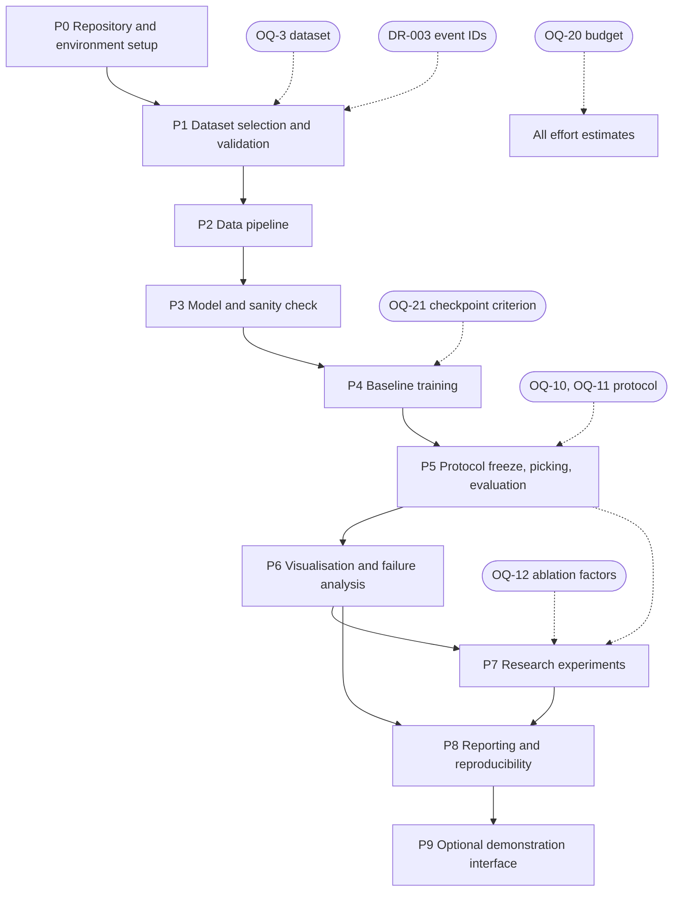

# SeismoNet — Development Roadmap

| Field | Value |
|---|---|
| Document ID | ROADMAP-001 |
| Version | 1.0 |
| Date | 2026-10-17 |
| Status | Draft for review. Nothing in this roadmap has been executed. All effort figures are ESTIMATE ranges and depend on the unresolved budget question `OQ-20`. |

Related documents: `../PRD.md` (§15 milestones, §17 open questions, §16 acceptance criteria), `TECHNICAL_ARCHITECTURE.md`, `TECH_STACK.md`, `SYSTEM_FLOW.md`, `REASONING_AND_DECISIONS.md`, `TESTING_STRATEGY.md`, `EXPERIMENT_PLAN.md`, `DATASET_GUIDE.md`, `REPRODUCIBILITY.md`, `PROJECT_STATUS.md`, `change-log/CURRENT_STATUS.md`, and `AUDIT_REPORT.md`.

---

## 1. Purpose, scope and status

### 1.1 Purpose

This document is the prioritized implementation plan for SeismoNet. It converts the requirements in `../PRD.md` into an ordered sequence of phases, each with a defined objective, prerequisite, task list, deliverable, measurable exit criteria, the requirement IDs it covers, the risks it addresses and an estimated effort range. It also defines the critical path, what to cut under budget pressure, and what must never be cut.

### 1.2 Scope

In scope: the ordering and content of the eleven phases `P0`–`P9`; their dependencies; a headline summary table; a per-phase breakdown; a Mermaid dependency graph; a cut list; risk-adjusted sequencing; a traceability table proving coverage of every mandatory functional requirement (`FR-001`–`FR-084`, Must priority) and every success criterion (`SC-1`–`SC-10`); a per-phase definition of done; and the immediate next task.

Out of scope: the detailed content of the technical architecture, the stack choices, the experiment protocols and the dataset properties. Those live in their own documents and are cross-referenced, not duplicated. No code, environment or dataset is created by this document.

### 1.3 Status

**Nothing is implemented.** The repository at the time of writing is a specification-only repository: `PRD.md`, `README.md`, `tech.md` and `docs/`. There is no source code, no test, no data, no dataset, no `requirements.txt`, no `.gitignore`, no `LICENSE` and no CI. Implementation completeness is 0 (see `AUDIT_REPORT.md` §4). No phase in this roadmap is started.

The phase names `P0`–`P9` match PRD §15 and were expanded from the v0.1 milestones `M1`–`M8` (`docs/archive/PRD-v0.1-original.md` §16). Where the PRD and this roadmap differ in granularity, this roadmap is the operative plan and the PRD §15 table remains the summary.

---

## 2. How to read this roadmap

Each phase `P0`–`P9` corresponds one-to-one to the phase of the same name in PRD §15. For every phase this document states:

- **Objective** — the single outcome the phase exists to produce.
- **Prerequisite** — the explicit prior state or closed decision required before the phase starts. A phase may not start with an open prerequisite.
- **Tasks** — a checklist of concrete work items.
- **Deliverables** — the artifacts that must exist when the phase ends.
- **Exit criteria** — measurable conditions; a phase is not "done" until each holds.
- **Requirements covered** — the functional (`FR`), non-functional (`NFR`), scientific (`SR`) and dataset (`DR`) requirement IDs concentrated in the phase. A requirement may legitimately span phases; the traceability table in §8 records the primary phase for each.
- **Risks addressed** — the `R-xx` risk IDs the phase mitigates, from PRD §14.
- **Effort estimate** — an **ESTIMATE** expressed as a range. Every estimate depends on the unresolved budget and compute question `OQ-20` and on the outcome of dataset property verification; the estimates are planning aids, not commitments. They assume a part-time single contributor.

**Conventions used throughout.** `[PROPOSED]`, `[OPEN]`, `[GIVEN]` and `[DERIVED]` retain the meaning defined in PRD §1. Requirement IDs are written exactly as in the PRD. An open question is written `OQ-n`. A closed question is described as "closed". Nothing in this roadmap asserts a dataset, a dataset property or a measured result.

---

## 3. Phase summary table

| Phase | Objective | Key deliverables | Exit criteria (measurable) | Depends on | Requirement IDs | Effort estimate (ESTIMATE; depends on `OQ-20`) |
|---|---|---|---|---|---|---|
| P0 | Establish a safe repository and a workable environment | `.gitignore`, dependency spec, `src/` + `tests/` skeleton, resolved Python version, GPU strategy, dataset licence/access record, LICENSE decision | Clean clone installs from the pinned spec; a trivial test passes; `.gitignore` blocks `data/` and `models/`; Python version resolved with evidence | — | FR-048, FR-082, FR-083, DR-005, DR-006, NFR-013 | 1–3 working days |
| P1 | Select and validate the dataset, and freeze the event-level split | Dataset chosen; data-quality log; event-level split files; zero-overlap check; dataset guide updated | `OQ-3` closed; `DR-001`–`DR-003` verified with evidence; split files on disk; zero-overlap check passes; `OQ-4`, `OQ-5` closed | P0 | DR-001–DR-007, FR-004, FR-005, FR-006, FR-010, FR-025, FR-026, FR-027 | 2–5 working days (longer if registration is required) |
| P2 | Build the full data path | Loader, screening, preprocessing, windowing, target generation, augmentation, `Dataset`/`DataLoader` | Unit tests for labels, conversion, shapes, augmentation alignment pass; zero-overlap test passes; sample figures show reference picks where physically expected | P1 | FR-001–FR-024, SR-002–SR-006, NFR-009, NFR-010 | 4–8 working days |
| P3 | Implement the model and sanity-check it | 1D U-Net; shape/softmax/depth assertions; tiny-batch overfit test | Model constructs; `[3,L]→[3,L]`; softmax sums to 1; depth/length assertion raises clearly; tiny batch overfits to near-zero loss; parameter count reported | P2 | FR-032–FR-038, FR-044, SR-008, NFR-010 | 2–4 working days |
| P4 | Train the baseline reproducibly | Checkpoint + config snapshot + seed + loss curves | Best checkpoint saved by a pre-declared criterion; same seed reproduces results within stated tolerance; loss curves inspected for collapse | P3 | FR-039–FR-048, SR-009, SR-010, OQ-21 | 2–5 working days (plus compute wall-clock, budget-dependent) |
| P5 | Freeze the evaluation protocol, then pick and evaluate | Frozen protocol; P/S metrics and residuals on validation, then test | `OQ-10`, `OQ-11` closed **before** any test evaluation; threshold selected on validation only; test metrics produced once from a frozen config | P4 | FR-049–FR-063, SR-011, SR-012, SR-013–SR-015, SR-016, OQ-10, OQ-11 | 2–4 working days |
| P6 | Produce visualisation and failure analysis | Waveform+picks+probability figures; residual histograms; failure gallery | Figures regenerate from artifacts by command; each failure entry carries a hypothesis explicitly flagged, or an "unexplained" label | P5 | FR-064–FR-068, SC-3 | 1–3 working days |
| P7 | Run the research experiments | Noise-robustness table/plot; one-factor ablation table; seed variability | Control variables held fixed; noise method and SNR definition documented; ablation rows differ in exactly one factor; each run recorded per the change-log rules | P6 | FR-069–FR-075, SR-017, EX-1–EX-7, SC-4, SC-5 | 3–8 working days (dominated by compute; `OQ-20`) |
| P8 | Package the report and reproducibility | Final report; updated README; regeneration command; status documents | A third party regenerates the reported tables/figures from a clean checkout following documented steps; limitations section complete; no deployment claim anywhere | P7 | FR-076–FR-084, SC-1, SC-2, SC-6, SC-7, SC-9, SC-10, SCF-1–SCF-8, NFR-001, NFR-002, NFR-011, NFR-012, NFR-014 | 2–5 working days |
| P9 | Optional demonstration interface | Streamlit/Gradio app | Starts with one documented command; renders waveform, picks and probability curves; adjustable threshold; core work was not blocked by it | P8, `O-Opt5` | FR-079–FR-081, SCO-5 | 2–4 working days (optional) |

---

## 4. Detailed phase breakdown

### P0 — Repository and environment setup

**Objective.** Establish a safe, reproducible repository skeleton and resolve the three environment discrepancies in `AUDIT_REPORT.md` §7.3 so that no pipeline code is written against a broken environment.

**Prerequisite.** None. P0 is the entry point.

**Tasks**

- [ ] Add `.gitignore` **first**, before any other file, excluding `data/`, `models/`, checkpoints, logs and large artifacts (`FR-048`, `R-16`).
- [ ] Resolve the Python version question: create a 3.11 or 3.12 environment as `tech.md` recommends and confirm that the required libraries install; record the outcome and the reason in `REPRODUCIBILITY.md` (`AUDIT_REPORT.md` §7.3 discrepancy 1, `R-15`, `A-11`). The machine currently has Python 3.14.3, which is the version `tech.md` does **not** recommend.
- [ ] Decide the GPU strategy given that the installed PyTorch is CPU-only (`torch 2.13.0+cpu`, CUDA unavailable) despite a physical RTX 2050 with 4096 MiB VRAM. Options are a CUDA build locally, a free-tier GPU, or a CPU fallback with a dataset subset (`R-06`, `A-06`).
- [ ] Create the dependency specification (`requirements.txt` or `pyproject.toml`) with the pinned versions that the resolved environment actually contains (`FR-082`). Do not pin versions that have not been installed and verified.
- [ ] Record the chosen dataset's licence and access procedure in `DATASET_GUIDE.md` once a candidate is inspected (`DR-005`, `DR-006`). At P0 this task records the *procedure*, not a choice.
- [ ] Create the `src/` and `tests/` skeleton with an importable package and one trivial passing test (`FR-083`, `NFR-010`).
- [ ] Record the LICENSE decision (`OQ-23`): confirm with the owner whether a licence file and a CI workflow are wanted; recommended.
- [ ] Confirm the purpose of README instructions against the repository's actual state so no command is shown as working when it is not (`FR-083`).

**Deliverables.** `.gitignore`; dependency specification; `src/` and `tests/` skeleton with a passing placeholder test; a written Python-version and GPU-strategy decision; a dataset licence/access-record template; a LICENSE decision.

**Exit criteria.** A clean clone installs from the pinned spec on the author's Windows machine and (later) Linux; a trivial test passes; `.gitignore` demonstrably prevents `data/` and `models/` content from being tracked; the Python version and GPU strategy are resolved and documented; the dataset licence/access procedure is recorded.

**Requirements covered.** FR-048, FR-082, FR-083, DR-005, DR-006, NFR-013, NFR-014.

**Risks addressed.** R-06 (compute), R-15 (environment incompatibility), R-16 (accidental commit).

**Effort estimate.** 1–3 working days — **ESTIMATE**, dependent on `OQ-20`. Installing a CUDA PyTorch build or a 3.11/3.12 environment may extend this range.

---

### P1 — Dataset selection and exploration

**Objective.** Close `OQ-3` by selecting one dataset whose properties are verified against its own documentation, produce the data-quality log, and freeze the event-level split.

**Prerequisite.** P0 complete: `.gitignore` in place, a working environment, and the dataset licence/access procedure recorded.

**Gate.** P1 **must not be considered complete** until `OQ-3` is closed *and* `DR-001`, `DR-002` and `DR-003` are each verified **with evidence** (a citation to the dataset's own documentation, plus a recorded inspection of the actual files). `DR-003` (event identifier present or constructible) is a hard gate: if it cannot be satisfied, the dataset choice must be revisited and the split strategy redesigned.

**Tasks**

- [ ] Inspect each candidate in `DATASET_GUIDE.md` against the verification checklist; record findings as verified or "UNVERIFIED — must be checked against the dataset's own documentation".
- [ ] Verify and record: component set and sampling rate(s) (`DR-001`); presence of P **and** S reference picks (`DR-002`); presence of an event identifier or reconstructible equivalent (`DR-003`); licence and citation terms (`DR-005`); format and access procedure (`DR-006`); noise-only constructibility (`DR-007`).
- [ ] Close `OQ-3` (dataset selected), `OQ-4` (window length and sampling rate) and `OQ-5` (split ratios) with the evidence that justifies them, writing the outcome into `DATASET_GUIDE.md` and `REASONING_AND_DECISIONS.md`.
- [ ] Build the data-quality log from PRD §11.5: component/rate consistency, P and S pick presence, S strictly after P, finite non-flat values, event-ID coverage, duplicate detection (`FR-003`).
- [ ] Build the event-level split (`FR-004`, `FR-010`) and persist it in an inspectable, diff-able format (`FR-005`), deterministic given a recorded seed and the input metadata (`FR-026`).
- [ ] Run and record the automated **zero-overlap check** asserting no event ID appears in more than one split (`FR-025`); this is the project's primary defence against inflated results.
- [ ] Document split ratios and rationale and record them with each experiment (`FR-006`, `FR-027`).

**Deliverables.** A selected dataset with a completed verification record; a machine-readable data-quality log; persisted train/validation/test split files; a zero-overlap check result; updated `DATASET_GUIDE.md`.

**Exit criteria.** `OQ-3` closed; `DR-001`–`DR-003` verified with evidence; split files on disk and re-loadable; zero-overlap check passes; `OQ-4`, `OQ-5` closed; split ratios documented.

**Requirements covered.** DR-001, DR-002, DR-003, DR-004, DR-005, DR-006, DR-007, FR-004, FR-005, FR-006, FR-010, FR-025, FR-026, FR-027, NFR-003, NFR-009, NFR-013, SC-8, SC-9.

**Risks addressed.** R-01 (access/licensing), R-02 (label quality), R-03 (event leakage), R-12 (rate conversion), R-18 (unverified citations).

**Effort estimate.** 2–5 working days — **ESTIMATE**, dependent on `OQ-20`. Silent or registration-gated access can extend this substantially, because `DR-006` requires that the access procedure be reproducible.

---

### P2 — Data pipeline

**Objective.** Implement the complete data path from a loaded trace to a labelled, augmented training window, with no model code.

**Prerequisite.** P1 complete: dataset selected and verified, split files frozen, `OQ-4`/`OQ-5` closed.

**Tasks**

- [ ] Loader exposing three-component waveform, sampling rate and reference P/S pick indices, with magnitude/distance/SNR where available (`FR-001`).
- [ ] Dataset summary statistics: trace count, pick availability, sampling-rate distribution, and metadata distributions where available (`FR-002`).
- [ ] Quality screening and a machine-readable data-quality log with a count and reason per exclusion (`FR-003`).
- [ ] Input validation at the boundary: exactly three components, expected sampling rate, expected window length, finite values, non-flat signal; reject or explicitly handle, never silently accept (`FR-008`, `FR-009`, `SR-002`).
- [ ] Metadata processing: event-identifier construction where required (`FR-010`); stratified reporting hooks where fields exist (`FR-011`); a per-trace record of the metadata used in preprocessing and evaluation (`FR-012`).
- [ ] Preprocessing: detrend and demean per component (`FR-013`); per-window amplitude normalisation that cannot divide by zero (`FR-014`); optional bandpass with a recorded decision either way (`FR-015`); anti-aliased resampling to a common rate if rates differ (`FR-016`, `SR-003`).
- [ ] Windowing: fixed-length windows (`FR-017`, `SR-004`); randomised training-window offsets so pick position varies (`FR-018`); configurable pure-noise fraction (`FR-019`); identical preprocessing at train and evaluation time (`FR-020`, `SR-005`).
- [ ] Target generation: per-sample P/S/noise curves (`FR-021`); Gaussian-shaped P/S targets with configurable σ (`FR-022`, `SR-006`); three targets summing to 1 per sample (`FR-023`); all-zero target where a phase is absent (`FR-024`).
- [ ] Augmentation: each independently switchable (`FR-028`); noise addition separable (`FR-029`); training-only (`FR-030`); labels kept consistent with the signal under shift/scale (`FR-031`).
- [ ] `Dataset`/`DataLoader` wiring plus a synthetic-fixture end-to-end test (`NFR-010`).

**Deliverables.** Loader, screening, preprocessing, windowing, target generation, augmentation and data-loading modules; unit tests; a synthetic waveform fixture; sample figures.

**Exit criteria.** Unit tests for label generation, sample-index conversion, shapes and augmentation-to-label alignment pass; the zero-overlap test passes as a guard; sample figures show reference P preceding reference S where physically expected.

**Requirements covered.** FR-001–FR-024, SR-002–SR-006, NFR-009, NFR-010. (FR-004, FR-005, FR-006 and FR-010 originate in P1 and are consumed here.)

**Risks addressed.** R-02, R-04 (position learning), R-12 (rate conversion), R-08 (class imbalance), R-16.

**Effort estimate.** 4–8 working days — **ESTIMATE**, dependent on `OQ-20` and on the dataset's actual format heterogeneity.

---

### P3 — Model and sanity check

**Objective.** Implement the 1D U-Net and prove, before any real training, that the data-to-model path can learn.

**Prerequisite.** P2 complete: the full data path is unit-tested and the synthetic fixture drives an end-to-end run.

**Tasks**

- [ ] Implement the 1D U-Net with encoder, decoder and skip connections (`FR-032`).
- [ ] Accept a three-component window and output three channels per time step (`FR-033`); output length equals input length (`FR-034`).
- [ ] Make depth, base channel count and kernel size configurable (`FR-035`, `SR-008`).
- [ ] Assert window length is compatible with depth (`2^depth`) and fail with a specific readable message otherwise (`FR-036`).
- [ ] Apply softmax over the three channels so probabilities sum to 1 per sample (`FR-037`).
- [ ] Report the parameter count (`FR-038`).
- [ ] Add the automated **overfit-a-tiny-batch** sanity check that drives loss to near zero on a handful of samples (`FR-044`).

**Deliverables.** Model module; shape/softmax/depth assertions; tiny-batch overfit script or test; structure described in `TECHNICAL_ARCHITECTURE.md`.

**Exit criteria.** Model constructs without error; `[3,L]→[3,L]` holds for several valid `L`; softmax sums to 1 within tolerance; an incompatible length raises the specific error; a tiny fixed batch overfits to a low final loss; the parameter count is reported.

**Requirements covered.** FR-032–FR-038, FR-044, SR-008, NFR-010.

**Risks addressed.** R-04, R-06 (small model to fit the budget), R-10 (overfitting, addressed by keeping the baseline small and configurable).

**Effort estimate.** 2–4 working days — **ESTIMATE**, dependent on `OQ-20`.

---

### P4 — Baseline training

**Objective.** Train the baseline model reproducibly and produce a checkpoint with a complete, documented provenance record.

**Prerequisite.** P3 complete: the model overfits a tiny batch, so the architecture and data path are known to be capable of learning.

**Gate.** The checkpoint-selection criterion (`OQ-21`, `SR-010`) must be fixed **before the first training run**, so that "best" cannot be redefined after seeing results.

**Tasks**

- [ ] Implement training with a per-sample probability loss against the target curves; record the loss choice (`FR-039`, `SR-007`).
- [ ] Log training and validation loss per epoch and save the best checkpoint by the pre-declared criterion (`FR-040`).
- [ ] Set and record seeds for Python, NumPy and PyTorch (`FR-041`).
- [ ] Save the full run configuration alongside each checkpoint (`FR-042`).
- [ ] Support early stopping (`FR-043`).
- [ ] State clearly whether a result came from training/fine-tuning in this project or from pretrained inference only (`FR-045`).
- [ ] Save checkpoints in a safe weights-only format with a documented naming convention (`FR-046`).
- [ ] Record with each checkpoint the config hash/snapshot, seed, dataset/split identifier and the selecting validation metric (`FR-047`).
- [ ] Keep artifacts in the documented, gitignored layout (`FR-048`).
- [ ] Close `OQ-21` with the chosen criterion and record the rationale (`SR-010`).

**Deliverables.** Trained checkpoint; config snapshot; seed record; loss curves; run log.

**Exit criteria.** Best checkpoint saved per the pre-declared criterion; the run is reproducible under the same seed within a stated tolerance; loss curves are inspected for all-noise collapse (`E30`); the checkpoint directory alone recovers all four provenance fields of `FR-047`.

**Requirements covered.** FR-039–FR-048, SR-007, SR-009, SR-010, OQ-21, NFR-001, NFR-015.

**Risks addressed.** R-06, R-08 (collapse monitoring), R-10 (overfitting), R-14 (reproducibility).

**Effort estimate.** 2–5 working days of engineering — **ESTIMATE**, dependent on `OQ-20`. Total wall-clock is dominated by compute and by the dataset subset size (`FR-007`), which is itself budget-dependent.

---

### P5 — Protocol freeze, picking and evaluation (critical)

**Objective.** Freeze the evaluation protocol, then extract picks and evaluate P and S separately on validation and, only afterwards, on test. This phase is the scientific centre of the project.

**Prerequisite.** P4 complete: a checkpoint exists that was selected by a criterion fixed in advance.

**Critical ordering rule.** The tolerance (`OQ-11`), the inference threshold and multi-peak rule (`OQ-10`), and the matching rule must be fixed **before any test-set evaluation**. Test metrics are computed **once**, from a frozen config, after model selection and threshold selection are complete (`FR-061`, `SR-016`, `NFR-003`). A test-set number produced before the freeze is not a result.

**Tasks**

- [ ] Produce per-sample P/S/noise probability curves from a trained checkpoint (`FR-049`).
- [ ] Derive one P and one S arrival time per window using a documented threshold plus peak rule (`FR-050`, `SR-012`).
- [ ] Make the threshold configurable and select it on validation data only (`FR-051`, `SR-011`).
- [ ] Apply a documented deterministic rule when several peaks exceed threshold (`FR-052`).
- [ ] Convert picks to seconds and, where available, to absolute time from the trace start (`FR-053`, `SR-014`).
- [ ] Report how often multiple peaks, "no pick", and P-after-S occur instead of discarding them (`FR-054`, `SR-013`, `SR-015`).
- [ ] Compute residuals (predicted minus reference) for P and S separately with a stated sign convention (`FR-055`).
- [ ] Report residual mean, standard deviation, median and MAE per phase (`FR-056`).
- [ ] Compute precision, recall and F1 under at least one stated tolerance (`FR-057`).
- [ ] Make the tolerance configurable and state it in every results table (`FR-058`, `SR-016`).
- [ ] Define the TP/FP/FN matching rule in the report, including the treatment of out-of-tolerance picks (`FR-059`).
- [ ] Evaluate P and S separately; never report a combined-only score (`FR-060`).
- [ ] Compute final test metrics only after selection is complete (`FR-061`).
- [ ] Handle zero-denominator metric cases with a defined value and a reported denominator (`FR-062`).
- [ ] State the one-pick-per-phase assumption as a limitation (`FR-063`).
- [ ] Close `OQ-10` and `OQ-11` and write both into the frozen protocol in `REASONING_AND_DECISIONS.md`.

**Deliverables.** A frozen evaluation protocol; P/S metrics and residual statistics on validation and test; the matching-rule statement.

**Exit criteria.** `OQ-10` and `OQ-11` closed **before** test evaluation; the reported threshold is the one selected on validation and used unchanged on test; test metrics emitted once from a frozen config; every results table carries tolerance, threshold, matching rule, split identifier, checkpoint identifier and denominator.

**Requirements covered.** FR-049–FR-063, SR-011, SR-012, SR-013, SR-014, SR-015, SR-016, OQ-10, OQ-11, NFR-002, NFR-003.

**Risks addressed.** R-03 (leakage, via `E34`), R-05 (S hidden), R-13 (post-hoc protocol choices), R-17 (over-claiming).

**Effort estimate.** 2–4 working days — **ESTIMATE**, dependent on `OQ-20`.

---

### P6 — Visualisation and failure analysis

**Objective.** Turn the frozen evaluation outputs into figures a seismologist can judge, including an explicit, honest failure analysis.

**Prerequisite.** P5 complete: predictions and metrics exist under the frozen protocol.

**Tasks**

- [x] Plot the three-component waveform with reference and predicted picks overlaid for any chosen sample (`FR-064`).
- [x] Show P, S and noise probability curves and the applied threshold on the same figure (`FR-065`).
- [x] Produce residual histograms for P and S (`FR-066`).
- [x] Produce example galleries of successes and failures (`FR-067`).
- [x] For each failure case, present a short cause hypothesis explicitly flagged as a hypothesis, or an explicit "unexplained" label (`FR-068`).

**Status 2026-10-18 (validation-only):** all five tasks are implemented and verified on the
candidate-protocol validation outputs — six figures plus `failure_analysis.md` under
`runs/validation_inference_p6_seed42/`, regenerated by the documented command in
[`REPRODUCIBILITY.md`](REPRODUCIBILITY.md) §9.2, with both P and S represented in the galleries.
P6 is still gated on P5 for test-set figures; no test data was loaded.

**Deliverables.** Reusable plotting function; success and failure galleries; residual histograms; written failure hypotheses.

**Exit criteria.** Figures regenerate from stored artifacts by a documented command; every failure-gallery entry carries a flagged hypothesis or an "unexplained" label; S is represented in the gallery, not only P.

**Requirements covered.** FR-064–FR-068, SC-3, SCF-5.

**Risks addressed.** R-05 (S hidden), R-17.

**Effort estimate.** 1–3 working days — **ESTIMATE**, dependent on `OQ-20`.

---

### P7 — Research experiments

**Objective.** Execute the pre-registered experiments and record every run honestly.

**Prerequisite.** P6 complete: the frozen protocol, a baseline checkpoint and the analysis figures exist. Running experiments before the protocol freeze is prohibited.

**Tasks**

- [ ] EX-1 baseline metrics recorded per the register in `EXPERIMENT_PLAN.md` (`FR-069` context).
- [ ] EX-4 noise-robustness sweep on a fixed model and fixed test set; document the noise type and SNR definition (`FR-069`, `FR-070`, `OQ-18`); fix the noise seed (`FR-071`).
- [ ] Support a noise-augmentation on/off comparison (`FR-072`).
- [ ] EX-2 one-factor-at-a-time ablation from the documented baseline (`FR-073`, `SR-017`, `OQ-12`), with resource cost reported per row.
- [ ] EX-5 multi-seed runs to establish the seed-variability noise floor (`FR-074`).
- [ ] EX-3 training-data-fraction learning curve on nested subsets of the training split.
- [ ] EX-6 failure-case categorisation feeding the P6 gallery.
- [ ] EX-7 optional STA/LTA (`O-Opt1`) and optional pretrained-picker reference (`O-Opt2`), with the stated caveats.
- [ ] Record every run with hypothesis, configuration, seed, dataset/split identity, metrics and interpretation per `EXPERIMENT_PLAN.md` and the change-log rules (`FR-075`).

**Deliverables.** Noise-robustness table/plot; ablation table with a baseline row; seed-variability report; learning-curve table; per-run experiment records.

**Exit criteria.** Control variables held fixed in every comparison; the SNR definition documented; ablation rows differ in exactly one factor; differences smaller than the EX-5 noise floor are not claimed as real; every run recorded.

**Requirements covered.** FR-069–FR-075, SR-017, EX-1–EX-7, OQ-12, OQ-18, OQ-19, SC-4, SC-5, SCF-1, SCF-2, SCF-3, SCF-6.

**Risks addressed.** R-07 (time shortage), R-09 (noisy waveforms), R-13, R-17 (synthetic-noise over-claiming).

**Effort estimate.** 3–8 working days — **ESTIMATE**, dependent on `OQ-20`. This range is dominated by the number of training runs affordable; if compute is tight, the cut list in §6 applies.

---

### P8 — Reporting and reproducibility packaging

**Objective.** Produce a report and repository from which a third party can regenerate every reported table and figure, and state the limitations honestly.

**Prerequisite.** P7 complete: experiments run and recorded.

**Tasks**

- [ ] Export results (per-sample predictions and aggregate metrics) to machine-readable CSV/JSON, carrying the tolerance and threshold used (`FR-076`).
- [ ] Drive training, evaluation and experiments from configuration files rather than hard-coded values (`FR-077`).
- [ ] Provide a single documented command sequence that regenerates the reported tables and figures from saved artifacts (`FR-078`).
- [ ] Provide the optional interface only after core validation (see P9) (`FR-079`–`FR-081`).
- [ ] Maintain the pinned dependency specification (`FR-082`).
- [ ] Provide a README whose commands match the repository's actual state and are marked implemented or planned (`FR-083`).
- [ ] Document environment, seeds, splits, config snapshots, checkpoints, evaluation commands and artifact naming in `REPRODUCIBILITY.md` (`FR-084`).
- [ ] Write the limitations section covering L1–L9, and verify that no document claims deployment or early-warning readiness (`NFR-014`).
- [ ] Complete the success-criteria evidence for `SC-1`–`SC-10` and the full-project criteria `SCF-1`–`SCF-8`.
- [ ] Update `PROJECT_STATUS.md` and `change-log/CURRENT_STATUS.md`.

**Deliverables.** Final report; updated README; regeneration command; `REPRODUCIBILITY.md`; updated status and change-log documents.

**Exit criteria.** A third party regenerates the reported tables and figures from a clean checkout following documented steps; `SC-1`–`SC-10` each have traceable evidence; `FR-084` covers all seven topics; zero deployment or early-warning claims exist anywhere in the deliverables.

**Requirements covered.** FR-076–FR-084, SC-1–SC-10, SCF-1–SCF-8, NFR-001, NFR-002, NFR-011, NFR-012, NFR-014.

**Risks addressed.** R-14 (reproducibility failure), R-18 (unverified citations — verified before quoting).

**Effort estimate.** 2–5 working days — **ESTIMATE**, dependent on `OQ-20`.

---

### P9 — Optional demonstration interface

**Objective.** Provide a lightweight interactive viewer for browsing samples and adjusting the threshold.

**Prerequisite.** P8 complete, and **all core validation is finished**. This phase is explicitly gated after core validation (`FR-081`, `SC-7`, `SCO-5`). It must never block or delay P0–P8.

**Tasks**

- [ ] Build a Streamlit or Gradio interface that renders waveform, reference picks, predicted picks and probability curves for a selected sample (`FR-079`).
- [ ] Allow the pick threshold to be adjusted interactively (`FR-079`).
- [ ] Show or export a result without persisting uploads by default (`FR-080`).
- [ ] Document a single start command.

**Deliverables.** Optional app directory; documented start command.

**Exit criteria.** The app starts with one documented command and renders the four elements for a selected sample; no core work was blocked by it; no upload data is persisted by default.

**Requirements covered.** FR-079, FR-080, FR-081, SCO-5.

**Risks addressed.** R-07 (scope).

**Effort estimate.** 2–4 working days — **ESTIMATE**, dependent on `OQ-20`. Optional; drop first under budget pressure.

---

## 5. Critical path and dependency graph

The critical path is: **P0 → P1 → P2 → P3 → P4 → P5 → P7 → P8**. P6 and P9 are off the critical path; P6 is a thin layer over P5 and P9 is explicitly optional and last.

The dashed edges mark decisions that gate a phase. An open decision on a gating edge blocks the phase, not merely slows it.

---

## 6. Cut list under budget pressure

If the budget is tighter than `OQ-20` assumes, items are dropped in the order below. Dropping is recorded as a documented scope reduction, never hidden.

**Drop in this order, first to last:**

1. **P9 demonstration interface** (`SCO-5`, `FR-079`–`FR-081`). Optional by construction; drop first.
2. **EX-7 optional baselines** (`O-Opt1`, `O-Opt2`, `SCO-1`, `SCO-2`). Reference points only; not mandatory.
3. **EX-3 learning curve and EX-5 multi-seed study.** If fewer than three seeds are affordable, state the single-seed limitation explicitly rather than dropping silently (`E33`, `SCF-3`).
4. **Breadth of EX-2 ablation.** Reduce the number of ablated factors to the smallest informative set; keep the baseline row and at least one changed factor per reported row (`FR-073`). Record `OQ-12` accordingly.
5. **Optional `FR-011` stratified reporting** and the `FR-067`/`FR-068` gallery breadth, keeping at least the residual histograms (`FR-066`).
6. **Dataset subset size** (`FR-007`), reduced so the baseline still trains within the remaining compute.

**Never drop, at any budget:**

- The **evaluation protocol freeze** (`P5`, `FR-061`, `SR-016`, `NFR-003`). Without it, every reported number is tunable after the fact and the project has no scientific value.
- The **leakage check** (`FR-025`, `SC-8`). A single leaked event inflates results and is the most common way a picking mini-project reaches a false conclusion.
- **Honest limitations** (`R-05`, `NFR-014`, L1–L9). The limitations section is a deliverable, not an appendix.
- **P/S separation** in every table (`FR-060`). An averaged score hides the systematic S-wave weakness this project exists to quantify.

---

## 7. Risk-adjusted sequencing

Two ordering decisions carry most of the risk reduction; both are deliberate and both are worth stating explicitly.

**Why the data path (P2) precedes the model (P3).** The data path is the highest-risk and highest-information area of the project: format heterogeneity, missing S picks, sampling-rate mismatches, event-identifier gaps and label-quality problems all surface here. Every one of these can invalidate the model before a single weight is trained. Building and unit-testing the data path first — against a synthetic fixture with fully trusted ground truth — means the model is developed against a known-correct input, and it front-loads the discovery of dataset defects while there is still time to change the dataset. The `AUDIT_REPORT.md` §13 ordering places "build the data path only" before model work for exactly this reason.

**Why the protocol freeze (P5) precedes the experiments (P7).** If the tolerance, threshold or matching rule can still change after results are seen, then any later comparison is a search over protocol settings rather than a measurement, and the reported difference cannot be attributed to the model (`R-13`, `NFR-003`). Freezing first converts the experiments into pre-registered tests with a fixed decision rule, so that a difference between two configurations is evidence, not a choice. This is why `OQ-10` and `OQ-11` are closed in P5 and why the exit criteria state that test metrics are produced once, after the freeze.

Additional sequencing notes: `OQ-21` is fixed before the first training run in P4, so the "best" checkpoint cannot be redefined after results are seen. `OQ-3` and `DR-003` gate P1, because an event-identifier gap discovered late invalidates the whole split strategy. The GPU strategy is decided in P0, because a CPU-only environment changes the affordable dataset subset and therefore every later effort estimate.

---

## 8. Traceability

### 8.1 Functional requirements `FR-001`–`FR-084`

Each row lists the phase that primarily covers the requirement and its MoSCoW priority from PRD §8. Every **Must** requirement is covered by at least one phase. Should/Could requirements are listed for completeness.

| FR | Pri | Phase | FR | Pri | Phase |
|---|---|---|---|---|---|
| FR-001 | M | P2 | FR-043 | S | P4 |
| FR-002 | M | P2 | FR-044 | M | P3, P4 |
| FR-003 | M | P2 | FR-045 | M | P4 |
| FR-004 | M | P1, P2 | FR-046 | M | P4 |
| FR-005 | M | P1, P2 | FR-047 | M | P4 |
| FR-006 | S | P1 | FR-048 | M | P0, P4 |
| FR-007 | S | P2 | FR-049 | M | P5 |
| FR-008 | M | P2 | FR-050 | M | P5 |
| FR-009 | M | P2, P5 | FR-051 | M | P5 |
| FR-010 | M | P1, P2 | FR-052 | M | P5 |
| FR-011 | S | P2 | FR-053 | M | P5 |
| FR-012 | M | P2 | FR-054 | S | P5 |
| FR-013 | M | P2 | FR-055 | M | P5 |
| FR-014 | M | P2 | FR-056 | M | P5 |
| FR-015 | S | P2 | FR-057 | M | P5 |
| FR-016 | S | P2 | FR-058 | M | P5 |
| FR-017 | M | P2 | FR-059 | M | P5 |
| FR-018 | M | P2 | FR-060 | M | P5 |
| FR-019 | S | P2 | FR-061 | M | P5 |
| FR-020 | M | P2 | FR-062 | M | P5 |
| FR-021 | M | P2 | FR-063 | M | P5 |
| FR-022 | M | P2 | FR-064 | M | P6 |
| FR-023 | M | P2 | FR-065 | M | P6 |
| FR-024 | M | P2 | FR-066 | M | P6 |
| FR-025 | M | **P1** | FR-067 | S | P6 |
| FR-026 | M | **P1** | FR-068 | S | P6 |
| FR-027 | M | **P1** | FR-069 | M | P7 |
| FR-028 | M | P2 | FR-070 | M | P7 |
| FR-029 | M | P2 | FR-071 | M | P7 |
| FR-030 | M | P2 | FR-072 | S | P7 |
| FR-031 | M | P2 | FR-073 | M | P7 |
| FR-032 | M | P3 | FR-074 | S | P7 |
| FR-033 | M | P3 | FR-075 | M | P7 |
| FR-034 | M | P3 | FR-076 | M | P8 |
| FR-035 | M | P3 | FR-077 | M | P8 |
| FR-036 | M | P3 | FR-078 | M | P8 |
| FR-037 | M | P3 | FR-079 | C | P9 |
| FR-038 | S | P3 | FR-080 | C | P9 |
| FR-039 | M | P4 | FR-081 | C | P9 |
| FR-040 | M | P4 | FR-082 | M | P0 |
| FR-041 | M | P4 | FR-083 | M | P0, P8 |
| FR-042 | M | P4 | FR-084 | M | P8 |

Bold entries (`FR-025`, `FR-026`, `FR-027`) are the dataset-splitting requirements, placed in P1 because P1's deliverable is the event-level split files and the zero-overlap check; they are consumed and re-tested in P2 alongside `FR-001`–`FR-024`.

**Gap check.** Every Must requirement in `FR-001`–`FR-084` is covered by at least one phase. **No mandatory functional requirement is left uncovered.**

### 8.2 Success criteria `SC-1`–`SC-10`

| SC | Primary phase(s) | Evidence at phase exit |
|---|---|---|
| SC-1 | P4, P5 | Checkpoint + saved config + seed + probability outputs on held-out test events |
| SC-2 | P5 | Results table with tolerance, threshold, matching rule and denominators, P and S separate |
| SC-3 | P6 | Waveform+picks+probability figures and success/failure galleries, regenerable by command |
| SC-4 | P7 | P/S metrics versus noise level with the SNR definition stated |
| SC-5 | P7 | Ablation table with a baseline row and one changed factor per row |
| SC-6 | P8 | Documented command sequence followed end-to-end on a clean checkout |
| SC-7 | P8 | Limitations section present; zero deployment/early-warning claims |
| SC-8 | P1 | Automated check output showing zero shared event IDs |
| SC-9 | P1 | Data-quality log with counts and reasons |
| SC-10 | P8 | Every table/figure traced to a config + checkpoint + split |

### 8.3 Scientific and dataset requirements

| Requirement | Phase | Requirement | Phase |
|---|---|---|---|
| SR-001 | P2 | SR-010 | P4 |
| SR-002 | P2 | SR-011 | P5 |
| SR-003 | P2 | SR-012 | P5 |
| SR-004 | P2 | SR-013 | P5 |
| SR-005 | P2 | SR-014 | P5 |
| SR-006 | P2 | SR-015 | P5 |
| SR-007 | P4 | SR-016 | P5 |
| SR-008 | P3 | SR-017 | P7 |
| SR-009 | P4 | DR-001–DR-007 | P1 (DR-005/DR-006 recorded in P0) |

### 8.4 Non-functional requirements

`NFR-001`, `NFR-002`, `NFR-011`, `NFR-012`, `NFR-014` are confirmed in P8. `NFR-003` is enforced from P1 (split) through P5 (protocol). `NFR-004` is enforced in P2 and P3. `NFR-006`, `NFR-007` and `NFR-009` are measured in P4. `NFR-015` is enforced in P4 (weights-only checkpoints). `NFR-010` is enforced in P2–P3.

---

## 9. Definition of done per phase

A phase is done only when its exit criteria in §4 hold **and** the phase's result is recorded in `change-log/CURRENT_STATUS.md` and a dated entry in `change-log/entries/`. Recording is part of done, not a follow-up.

| Phase | Done when |
|---|---|
| P0 | `.gitignore` blocks `data/` and `models/`; clean clone installs from the pinned spec; trivial test passes; Python version and GPU strategy documented; licence/access procedure recorded; LICENSE decision recorded. |
| P1 | `OQ-3`, `OQ-4`, `OQ-5` closed; `DR-001`–`DR-003` verified with evidence; split files on disk; zero-overlap check passes; quality log written. |
| P2 | Data-path unit tests pass; zero-overlap guard passes; synthetic fixture runs end-to-end; sample figures show reference P before reference S. |
| P3 | Shape/softmax/depth assertions pass; tiny batch overfits to near-zero loss; parameter count reported. |
| P4 | Checkpoint saved by the pre-declared criterion; run reproducible under the same seed within tolerance; provenance fields recoverable; loss curves inspected. |
| P5 | `OQ-10`, `OQ-11` closed before test evaluation; threshold selected on validation only; test metrics produced once from a frozen config; every table carries tolerance, threshold, matching rule and denominator. |
| P6 | Figures regenerate from artifacts by command; every failure entry carries a flagged hypothesis or "unexplained". |
| P7 | Control variables fixed; SNR definition documented; ablation rows differ in one factor; every run recorded in the change-log. |
| P8 | A third party regenerates the reported tables/figures from a clean checkout; `SC-1`–`SC-10` have traceable evidence; limitations complete; no deployment claim. |
| P9 | App starts with one command and renders the four elements; no core work was blocked; no upload persisted by default. |

`change-log/CURRENT_STATUS.md` is the single authoritative record of what is done. A change-log entry is created when the phase content changes, not only when the phase closes.

---

## 10. Immediate next task recommendation

The single next task is **P0, task 1: add `.gitignore` before creating any other file.** It is trivial, it takes minutes, and it prevents the one irreversible class of mistake this repository is currently exposed to — committing a dataset or a checkpoint into Git history (`R-16`, `FR-048`). Removing such a file from history after the fact is far more expensive than never committing it.

Immediately following, still within P0, the highest-value decision is **resolving the Python version question** (`AUDIT_REPORT.md` §7.3 discrepancy 1). `tech.md` recommends Python 3.11 or 3.12, the machine runs 3.14.3, and SeisBench and ObsPy wheel availability on 3.14 is unverified. This must be settled before any pipeline code exists, because re-targeting the environment after the data path is written wastes the most expensive work in the plan. The GPU strategy should be decided in the same sitting, since a CPU-only environment changes the affordable dataset subset and therefore every effort estimate in this document.

Only after these P0 items is it safe to begin P1, where the dataset decision (`OQ-3`) and the verification of `DR-001`–`DR-003` gate everything downstream. Detailed per-experiment and per-dataset procedures are in `EXPERIMENT_PLAN.md` and `DATASET_GUIDE.md`.
