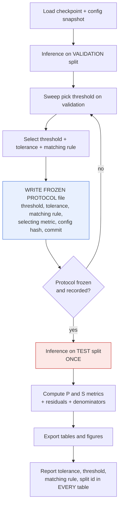
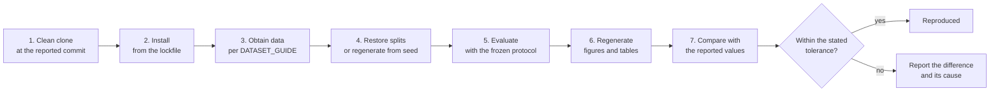

# SeismoNet — Reproducibility Guide

| Field | Value |
|---|---|
| **Document ID** | REPRO-001 |
| **Version** | 1.0 |
| **Date** | 2026-10-18 |
| **Status** | Working guide updated after the bounded pilot, the validation-only protocol candidate and the validation-only figure suite. Executed commands and remaining planned steps are labelled separately. |
| **Purpose** | Everything needed to reproduce a reported SeismoNet result. |
| **Governing requirements** | [`FR-084`](../PRD.md) (document environment, seeds, splits, config snapshots, checkpoints, evaluation commands and artifact naming in one place) and [`NFR-001`](../PRD.md) (results reproducible from a recorded configuration + seed + saved split, on the same hardware class, within stated hardware non-determinism) |
| **Supporting requirements** | [`FR-005`](../PRD.md), [`FR-025`](../PRD.md), [`FR-026`](../PRD.md), [`FR-041`](../PRD.md), [`FR-042`](../PRD.md), [`FR-046`](../PRD.md), [`FR-047`](../PRD.md), [`FR-048`](../PRD.md), [`FR-061`](../PRD.md), [`FR-071`](../PRD.md), [`FR-078`](../PRD.md), [`FR-082`](../PRD.md), [`NFR-002`](../PRD.md), [`NFR-003`](../PRD.md), [`NFR-015`](../PRD.md), [`SR-010`](../PRD.md), [`SR-011`](../PRD.md), `SC-6`, `SC-8`, `SC-10` |
| **Predecessor** | [`../tech.md`](../tech.md) §6 — the original packaging proposal, preserved unmodified. |
| **Companion documents** | [TECH_STACK.md](TECH_STACK.md), [TECHNICAL_ARCHITECTURE.md](TECHNICAL_ARCHITECTURE.md), [SYSTEM_FLOW.md](SYSTEM_FLOW.md), [DEVELOPMENT_ROADMAP.md](DEVELOPMENT_ROADMAP.md), [TESTING_STRATEGY.md](TESTING_STRATEGY.md), [EXPERIMENT_PLAN.md](EXPERIMENT_PLAN.md), [DATASET_GUIDE.md](DATASET_GUIDE.md), [REASONING_AND_DECISIONS.md](REASONING_AND_DECISIONS.md), [PROJECT_STATUS.md](PROJECT_STATUS.md), [AUDIT_REPORT.md](AUDIT_REPORT.md), [change-log/CURRENT_STATUS.md](change-log/CURRENT_STATUS.md) |

**Convention used in this document.** Every command block is prefixed with a status line. `EXECUTED` records a command run against the current working tree and its observed result. `PLANNED` means the command describes an interface that is not yet verified. A validation-only protocol candidate is not a scientific test result.

---

## 1. Purpose and scope

### 1.1 What "reproducible" means here

A SeismoNet result is **reproducible** when a person who did not produce it can take the repository at a stated commit, install the declared environment, obtain the documented dataset, and regenerate the **reported table or figure** — with any residual difference attributable to stated, documented causes rather than to unrecorded choices.

That obligation is set by the PRD, not by this document:

- [`NFR-001`](../PRD.md): *"Results shall be reproducible from a recorded configuration + seed + saved split, on the same hardware class, to within stated hardware non-determinism."* Target: reproduce the headline table on CPU within a documented tolerance; GPU variation disclosed.
- [`FR-084`](../PRD.md): *"Document, in one place, the environment, seeds, splits, config snapshots, checkpoints, evaluation commands and artifact naming."* This document is that place.
- `SC-6` is the acceptance test: *"Another person can regenerate the reported tables and figures from the repository."*

### 1.2 What "reproducible" does **not** mean here

- It does **not** mean bit-identical floating-point results on different hardware. [`NFR-001`](../PRD.md) explicitly allows *stated* hardware non-determinism ([§5](#5-determinism-and-random-seeds)).
- It does **not** mean the same score as a published paper. No comparison to a published number is claimed anywhere in SeismoNet ([PRD §12.5](../PRD.md)).
- It does **not** mean any claim of deployment readiness or operational validity ([`NFR-014`](../PRD.md), `NG1`).
- It does **not** cover the optional demonstration interface (`O-Opt5`, `FR-079`–`FR-081`); that is gated to roadmap phase P9.

### 1.3 Scope of this document

In scope: environment, dependency pinning, seeding, splits, config snapshots, checkpoints, evaluation command order, artifact layout, and the end-to-end regeneration procedure. Out of scope (cross-referenced, not duplicated): code architecture ([TECHNICAL_ARCHITECTURE.md](TECHNICAL_ARCHITECTURE.md)), execution flows ([SYSTEM_FLOW.md](SYSTEM_FLOW.md)), the test catalogue ([TESTING_STRATEGY.md](TESTING_STRATEGY.md)), experiment definitions ([EXPERIMENT_PLAN.md](EXPERIMENT_PLAN.md)), dataset acquisition ([DATASET_GUIDE.md](DATASET_GUIDE.md)), and rationale for scientific parameters ([REASONING_AND_DECISIONS.md](REASONING_AND_DECISIONS.md)).

---

## 2. Current reproducibility status

**Honest position at 2026-10-18.** The implementation now includes the P2 data path, the small U-Net, a bounded pilot, and validation-only inference. The real waveform data and pilot outputs are local/ignored artifacts; the test split has not been loaded. The candidate protocol artifact is reproducible on the current Windows `.venv`, but it is not a scientific test result.

| Reproducibility element | Required by | Exists today? | Evidence / note |
|---|---|---|---|
| A trained model to reproduce | `SC-1` | **Partially — bounded pilot** | `runs/pilot_seed42/` contains state-dict checkpoints and config metadata; it is not a scientific baseline |
| A reported table or figure | `SC-2`, `SC-3` | **Partially — validation-only** | `runs/validation_protocol_candidate_seed42/` contains metrics, predictions, report and figures |
| Dependency lockfile with exact versions | [`FR-082`](../PRD.md) | **Yes — Windows verified** | `requirements.lock`; CUDA `.venv` verified |
| `.gitignore` excluding large artifacts | [`FR-048`](../PRD.md) | **Yes** | `data/`, `runs/`, checkpoints and `.venv` are ignored |
| Recorded seeds in config and run log | [`FR-041`](../PRD.md) | **Yes — pilot** | `runs/pilot_seed42/run.json` and config snapshot |
| Split files persisted on disk | [`FR-005`](../PRD.md) | **Yes** | `splits/train.csv`, `validation.csv`, `test.csv`, `split.json` |
| Zero-overlap split check | [`FR-025`](../PRD.md), `SC-8` | **Yes** | Split utility, tests and recorded real split verification |
| Config snapshot per run | [`FR-042`](../PRD.md) | **Yes — pilot** | `runs/pilot_seed42/config_snapshot.yaml` |
| Config hash recorded | [`FR-047`](../PRD.md) | **Partially** | Split hashes are recorded; the pilot checkpoint is state-dict-only and not a standalone hashed metadata bundle |
| Checkpoint metadata block | [`FR-047`](../PRD.md) | **Partially — pilot manifest** | Seed, split identity and selecting loss are in the pilot manifest; scientific-baseline eligibility is false |
| Frozen evaluation protocol before test | [`FR-061`](../PRD.md), [`SR-011`](../PRD.md) | **Candidate only** | `protocol.json` is immutable and validation-only; `test_evaluation_allowed: false` until review |
| Regeneration command sequence | [`FR-078`](../PRD.md), `SC-6` | **Partially — validation command** | `.venv\Scripts\python.exe -m seismonet.validation_inference` is executed; clean-checkout regeneration is not yet verified |
| Documented environment | [`FR-084`](../PRD.md) | **Yes — Windows** | `.venv`, lockfile, CUDA device and test command recorded |
| CI on a tiny fixture | `SCO-7`, [`OQ-23`](../PRD.md) | **No** | No `.github/workflows/` |
| Dataset licence recorded | [`DR-005`](../PRD.md), [`NFR-013`](../PRD.md) | **Yes — INSTANCE Counts** | Recorded in `DATASET_GUIDE.md`; local artifact access remains separately scoped |

**Summary:** the implementation has reproducible bounded-pilot and validation-only evidence on Windows, but the scientific baseline, cross-platform regeneration and test evaluation remain incomplete.

---

## 3. Environment setup

### 3.1 The Python version decision — resolved to 3.14 for this milestone

| Item | Value |
|---|---|
| Recommended by `tech.md` §1 | Python **3.11 or 3.12** |
| Verified on this host (global) | Python **3.14.3 (64-bit)** at `C:\Python314\python.exe` — `torch 2.13.0+cpu` (CPU-only) |
| Verified in the isolated venv | Python **3.14.3** at `SeismoNet/.venv/Scripts/python.exe` — same patch, `numpy 2.5.4` / `scipy 1.18.1` / `scikit-learn 1.9.1` / `pytest 9.1.1` / `PyYAML 6.0.3`; **no `torch` installed inside the venv in this milestone** (see below) |
| Status | **RESOLVED to 3.14 for the current milestone** — `R-15`/`A-11` downgrade deemed unnecessary. `ENV-001` §2 proved via PyPI metadata that `obspy 1.5.1` advertises `Python :: 3.14` and `seisbench >=3.10` / `matplotlib >=3.11` / `torch >=3.10` are declared compatible; the venv reproduces the skeleton on 3.14 without installing seismic packages yet. |
| Why 3.11/3.12 was not installed | The host has only 3.14 on `PATH` (verified `py -3.12`/`py -3.11` not present); a parallel 3.11/3.12 interpreter would require a separate download outside the milestone's scope. `ENV-001` §2 already establishes downgrade as a **fallback** if a 3.14 wheel refuses to install — a condition not yet met. |
| What is verified | 3.14.3 hosts the skeleton + `.venv` (60 tests pass in both interpreters); `torch` remains available on the **global** interpreter (`2.13.0+cpu`); `h5py`/`obspy`/`seisbench` are **not installed** in either interpreter in this milestone. |
| What is **not** verified | Whether `obspy`/`seisbench`/`matplotlib` import on 3.14 *at install time* — to be proved when `h5py` is installed for HDF5 waveform verification (Stage 2). |
| Closure route | `R-15`/`A-11` are resolved to 3.14 for P1/P2. If a future Stage 2 `pip install h5py` or later seismic-stack install fails on 3.14, record the failure and revisit the downgrade then — do not silently proceed with a broken stack. |

### 3.2 Windows setup — as executed in this milestone

The isolated venv is project-local `SeismoNet/.venv` (ignored by `.gitignore` entry 005). Global `C:\Python314` was not modified.

```powershell
# Executed 2026-10-17 — creates an isolated copy of C:\Python314\python.exe (3.14.3)
C:\Python314\python.exe -m venv "C:\Users\Tanish\dlrl miniproject\SeismoNet\.venv"
# Verify (call the venv's interpreter directly; no shell activation required)
.\.venv\Scripts\python.exe --version   # -> Python 3.14.3
.\.venv\Scripts\python.exe -c "import sys; print(sys.executable)"
# -> C:\Users\Tanish\dlrl miniproject\SeismoNet\.venv\Scripts\python.exe
.\.venv\Scripts\python.exe -m pip install -q setuptools
.\.venv\Scripts\python.exe -m pip install -q "numpy>=1.24" "scipy>=1.10" "PyYAML>=6.0" "pytest>=7" "scikit-learn>=1.3"
.\.venv\Scripts\python.exe -m pip install -e . --no-build-isolation   # makes seismonet importable via src/ layout
.\.venv\Scripts\python.exe -m pip freeze > requirements.lock
.\.venv\Scripts\python.exe -m pytest -q   # -> 60 passed
```

Actual `requirements.lock` pinned in this milestone (venv freeze, `6d9b6f60255b` prefix after CUDA swap): includes `h5py 3.16.0`, `matplotlib 3.11.2` and `torch 2.14.1+cu126` (CUDA 12.6) alongside `numpy 2.5.4` / `scipy 1.18.1` / `scikit-learn 1.9.1` / `PyYAML 6.0.3` / `pytest 9.1.1`; `obspy`/`seisbench` remain not pinned.

Verification inside the venv (post-CUDA swap): `torch 2.14.1+cu126` (`torch.version.cuda 12.6`, `torch.cuda.is_available() True`, GPU NVIDIA GeForce RTX 2050, 4096 MiB), `h5py 3.16.0`, `matplotlib 3.11.2` and `python -m pytest tests -q` **188 passed, 1 skipped** (authoritative). Global `C:\Python314` remains `torch 2.13.0+cpu` (`cuda_available False`) — global untouched.

### 3.3 Linux setup (the CI and reviewer platform)

Not executed in this milestone — Windows verification only. Linux claim per [`NFR-008`](../PRD.md) remains untested.

```bash
# PLANNED shape (same venv pattern, Linux launcher)
python3.14 -m venv .venv
source .venv/bin/activate
python -m pip install --upgrade pip
python -m pip install -r requirements.lock
python -m pytest -q   # expected 60 passed once Linux has the same direct deps
```

Linux matters because [`NFR-008`](../PRD.md) requires Windows **and** Linux. The `requirements.lock` above is platform-declared for Windows; Linux will need its own run once a CI image hosts 3.14.

### 3.4 Dependency installation

There is **nothing to install from yet**. The intended coverage, from [TECH_STACK.md](TECH_STACK.md):

| Group | Intended members | Install state |
|---|---|---|
| Scientific computing | NumPy, SciPy, pandas | Installed (verified) in the audit environment, but not declared in any project file |
| Machine learning | PyTorch (`+cpu` build installed; CUDA build unresolved) | Installed (verified) — CPU-only |
| Seismic | ObsPy, SeisBench | Declared in documentation, **not installed** |
| Visualisation | Matplotlib (Plotly optional) | Declared in documentation, **not installed** |
| Config / experiments | PyYAML (installed); MLflow optional | Partially installed; not declared |
| Testing / linting | pytest (installed); ruff (**not installed**); pandera, hypothesis (optional) | Partially installed; not declared |
| Packaging | uv / pip-tools, Docker, Makefile/just | **Proposed** — not verified as installed, and no repository artifact exists |

**Critical distinction.** An item being *importable on this machine* is not the same as it being *part of the project*. Until the lockfile exists, the audited environment is a personal machine state, not a project environment ([TECH_STACK.md](TECH_STACK.md), "Environment reality check").

---

## 4. Dependency version pinning policy

1. **Pin exact versions for direct and transitive dependencies** at Phase P0 ([`FR-082`](../PRD.md): *"a dependency file lists pinned versions; a fresh environment installs from it"*).
2. **Resolve, then freeze.** Generate the lock from the chosen interpreter with a resolver (`uv lock` or `pip-compile`), not from `pip freeze` of a working environment — a freeze captures unrelated packages and cannot be regenerated.
3. **Record the interpreter itself**: exact Python version (for example `3.14.3`), the exact patch level, and the platform used to generate the lock.
4. **Record platform-specific pins separately** where they differ (the CPU-only versus CUDA PyTorch builds are different artefacts with different version strings).
5. **Never guess a version.** Where this document needs a version that has not been verified, it says **"pin at implementation time"**.
6. **Re-pin deliberately.** Any change to the lock is a recorded change with a reason, referenced from [change-log/CURRENT_STATUS.md](change-log/CURRENT_STATUS.md); it invalidates the environment identity of previously reported runs.
7. **The environment is part of the result.** A reported table names the lockfile (by content hash) that produced it, so a later re-pin does not retroactively apply.
8. **CPU-only versus CUDA PyTorch must be stated for every reported run.** [`NFR-001`](../PRD.md) permits hardware differences only if they are disclosed. The venv now hosts `torch 2.14.1+cu126` (`torch.version.cuda 12.6`, `torch.cuda.is_available() True`, GPU RTX 2050 4096 MiB); global `C:\Python314` remains `torch 2.13.0+cpu` (`cuda_available False`) — global untouched; the host GPU (RTX 2050, CUDA 13.1) stays unchanged.

**Current lockfile:** `requirements.lock` (generated by `pip freeze --exclude-editable` inside `.venv` on `C:\Python314` 3.14.3, sha256 prefix `6d9b6f60255b`, 371 bytes; `torch 2.14.1+cu126` / `h5py 3.16.0` / `matplotlib 3.11.2` included). See `requirements.lock` for exact pins. Lockfile is **not gitignored** — it is a committed artifact per `FR-082`.

**Status of other artifacts:** `requirements.txt` — not used (superseded by `requirements.lock`); `pyproject.toml` — present; resolver lock (`uv.lock` / `pip-compile` output) — deferred; transitive-pinned lock with `h5py` already present via `requirements.lock`.

---

## 5. Determinism and random seeds

### 5.1 Requirement

[`FR-041`](../PRD.md): *"Set and record random seeds for Python, NumPy and PyTorch."* Acceptance: seeds appear in config and in the run log; a determinism test on CPU reproduces results within a stated tolerance. [`FR-026`](../PRD.md) extends this to splitting, and [`FR-071`](../PRD.md) to the noise-realisation seed of the robustness experiment.

### 5.2 Intended seeding obligation

```text
PLANNED — NOT YET IMPLEMENTED. No seeding function exists.
```

The intended shape (a single recorded integer driving every generator the pipeline uses):

```python
# PLANNED — illustrative shape only; no such module exists
import random
import numpy as np
import torch

def seed_everything(seed: int) -> None:
    random.seed(seed)
    np.random.seed(seed)
    torch.manual_seed(seed)
    torch.cuda.manual_seed_all(seed)   # no-op on a CPU-only build
```

Additional intended measures, each to be **justified and recorded** rather than copied blindly at P0:

- DataLoader worker seeding (`worker_init_fn`) and generator seeding, so shuffling is reproducible;
- `torch.use_deterministic_algorithms(True)` and the corresponding CUBLAS workspace setting **if and when** a CUDA build is installed — with the caveat that this can raise on operations with no deterministic kernel and can cost throughput;
- cuDNN benchmark off, and an explicit cuDNN determinism flag, for GPU runs;
- the seed recorded in the config file **and** in the run log **and** in the checkpoint metadata block (§8).

### 5.3 What remains non-deterministic

| Source | Effect | Mitigation / disclosure |
|---|---|---|
| GPU reductions and atomics | Run-to-run differences at the last bits, amplified by training | Disclose as hardware non-determinism ([`NFR-001`](../PRD.md)); reproduce on CPU for the headline table |
| cuDNN algorithm selection | Different kernels chosen run to run | Deterministic flags, at a throughput cost — decision at P0 |
| Mixed precision (AMP) | fp16/bf16 rounding differs from fp32 | AMP is **Proposed and currently unusable** (CPU-only torch); if adopted, report AMP on/off per run |
| Thread-count-dependent reductions (CPU BLAS) | Small differences across machines | Record thread settings with the run; state tolerance (§5.4) |
| Non-deterministic kernels with no deterministic implementation | Outright failure under strict determinism mode | Fall back to allowing that operation and disclosing it |
| Library version drift | Different numerics after a re-pin | Environment identity recorded in the checkpoint metadata (§8) |

**Note on the current environment:** with a CPU-only PyTorch build, the CUDA-specific sources above do not apply *today*, and CPU execution is the easier case to reproduce. This is the one accidental advantage of the current setup — it is not a reason to keep it, because [`NFR-006`](../PRD.md)/[`NFR-007`](../PRD.md) still require a workable compute path ([TECH_STACK.md](TECH_STACK.md)).

### 5.4 The documented tolerance approach

[`NFR-001`](../PRD.md) requires reproducibility "to within stated hardware non-determinism". The document must therefore state, **before** results are reported:

1. **What is compared** — the reported aggregate metrics (P and S F1 at the frozen tolerance, residual mean/std/MedAE/MAE) and, where relevant, per-pick residual sets.
2. **The comparison tolerance** — a numeric bound on the acceptable difference between two runs on the same hardware class. **The value is not set in this document**; it is decided at P0/implementation time and recorded here, because no measurement exists to justify a number. Inventing one would violate the project's "no fabricated numbers" policy.
3. **The hardware class** — CPU versus a named GPU model, stated per run.
4. **What is reported when the tolerance is exceeded** — the difference is reported as a finding, not smoothed away. `SC-10` requires every reported number to trace to an artifact.

### 5.5 The determinism test to add

A test to be written (catalogue: [TESTING_STRATEGY.md](TESTING_STRATEGY.md)), **Not present** today:

```text
PLANNED — NOT YET IMPLEMENTED.
```

| Aspect | Intended assertion |
|---|---|
| Scope | A fixed tiny synthetic fixture, a fixed seed, a fixed config, a few training steps on CPU |
| Assertion 1 | Two runs with the same seed produce identical split files (byte-identical) |
| Assertion 2 | Two runs with the same seed produce identical per-pick outputs on the fixture |
| Assertion 3 | Metric values differ by no more than the stated tolerance (§5.4) |
| Assertion 4 | A different seed produces a *different* result, proving the seed is actually wired through |
| GPU variant | The same test on GPU, with the tolerance-based comparison and a recorded hardware class — **cannot be run today: CUDA unavailable** |

---

## 6. Data splits

### 6.1 Obligations

| Requirement | Obligation |
|---|---|
| [`FR-004`](../PRD.md) | Split **by event identifier**, never by trace alone. |
| [`FR-005`](../PRD.md) | Persist split membership to disk in an **inspectable, diff-able** format; re-loadable; same inputs reproduce the same split given the same seed. |
| [`FR-025`](../PRD.md) | Automated check that **no event appears in more than one split**, failing loudly; run as a test *and* as a guard at training start. |
| [`FR-026`](../PRD.md) | Split is **deterministic** given a recorded seed and the input metadata; two runs with the same seed produce **byte-identical** split files. |
| [`FR-027`](../PRD.md) | Split ratios and rationale documented and recorded with each experiment. |
| `SC-8` | Zero-overlap output is an acceptance criterion. |

### 6.2 Status

**NOT YET IMPLEMENTED.** No split files, no split code, no leakage test, and the dataset itself is not selected (`OQ-3`, [`DR-003`](../PRD.md)). Split ratios are still `OQ-5` (an earlier plan suggested roughly 70/15/15).

### 6.3 Recommended split file format (Proposed)

Recommendation: **one CSV per split listing event identifiers, one row per event**, plus a small JSON sidecar recording how the split was made.

| File | Contents | Why this format |
|---|---|---|
| `splits/<split_id>/train.csv` | Column `event_id` (plus optionally `n_traces`) | Plain text; diff-able in Git; human-inspectable; trivially loadable in pandas; satisfies "inspectable" in [`FR-005`](../PRD.md) |
| `splits/<split_id>/val.csv` | As above | Same |
| `splits/<split_id>/test.csv` | As above | Same |
| `splits/<split_id>/split.json` | seed, ratios, source metadata file + its hash, creation timestamp, code commit, split algorithm name/version | Makes [`FR-026`](../PRD.md) checkable and [`FR-027`](../PRD.md) auditable |

**Alternatives considered:** Parquet (better typed, compresses well, but not diff-able and needs a reader); archive of per-trace indices (rejected: couples splits to a preprocessing version); storing splits inside the HDF5 dataset (rejected: hides them and complicates re-splitting). Discussion lives in [REASONING_AND_DECISIONS.md](REASONING_AND_DECISIONS.md); dataset-specific layout is in [DATASET_GUIDE.md](DATASET_GUIDE.md).

### 6.4 Zero-overlap verification

```text
PLANNED — NOT YET IMPLEMENTED.
```

Intended: a pytest test that loads the three split files, intersects their event-ID sets, and asserts the intersections are empty; the same check runs as a hard guard at training start so that a bad split cannot silently train. Failure must be loud and specific ([`NFR-004`](../PRD.md): never silently degrade). The check is one of the two cheapest pieces of engineering insurance in the project ([AUDIT_REPORT.md](AUDIT_REPORT.md) §16 item 6) and is on the critical path, not a finishing touch.

---

## 7. Configuration snapshots

### 7.1 Obligations

[`FR-042`](../PRD.md): *"Save the full run configuration alongside each checkpoint."* Acceptance: a config snapshot sits beside the checkpoint and reloads to the same values. [`FR-047`](../PRD.md) additionally requires a **config hash or snapshot** to be recoverable from the checkpoint directory alone. [`FR-077`](../PRD.md) requires every parameter to come from config, not code.

### 7.2 Intended layout

```text
PLANNED — NOT YET IMPLEMENTED. No config files exist.
```

| Artifact | Location | Notes |
|---|---|---|
| The run's config snapshot | `models/<run_id>/config.yaml` (copied, not symlinked) | A copy, so deleting or editing the source config cannot change what a checkpoint means |
| The config hash | field in `models/<run_id>/run.json` and in the checkpoint metadata | See below |
| The source config | `configs/<name>.yaml` | The file a human edits; declared by [`FR-077`](../PRD.md) |

### 7.3 Config hashing (Proposed, pin at implementation time)

- **What is hashed:** the **normalised serialised config** — keys sorted, whitespace normalised, resolved values only (no unresolved template variables) — so that cosmetic edits do not appear to change the experiment.
- **Algorithm:** a cryptographic digest (SHA-256 is the natural default). **The exact algorithm and normalisation rules must be written down at implementation time**; a hash is only meaningful if the normalisation is fixed and documented, otherwise two identical runs can appear different.
- **Where it is recorded:** in `run.json`, in the checkpoint metadata block (§8), and in every exported results table header ([`NFR-002`](../PRD.md)).
- **What the hash does *not* cover:** the code commit (recorded separately), the dataset version (recorded as the dataset/split identifier), and the environment (recorded as the lockfile hash). [`FR-047`](../PRD.md) requires all four fields together.
- **Rule:** if any of these four change, the run is a different run, even if the config hash is unchanged.

---

## 8. Checkpoints

### 8.1 Obligations

| Requirement | Obligation |
|---|---|
| [`FR-046`](../PRD.md) | Save checkpoints in a **safe serialisation format (weights only, not arbitrary pickle)** with a documented naming convention; the convention is documented *here*. |
| [`FR-047`](../PRD.md) | Record with each checkpoint: **config hash or snapshot, seed, dataset/split identifier, and the validation metric that selected it** — all four recoverable from the checkpoint directory alone. |
| [`NFR-015`](../PRD.md) | Downloaded checkpoints shall not be loaded in unsafe pickle mode; no secrets committed. |
| [`SR-010`](../PRD.md) | The checkpoint-selection criterion is stated **in advance** (baseline proposal: lowest validation loss; alternative: best validation P/S F1 at the frozen tolerance; see `OQ-21`). |
| [`FR-045`](../PRD.md) | Checkpoint metadata must distinguish **trained-from-scratch**, **fine-tuned**, and **pretrained-inference-only**. |

### 8.2 Safe serialisation

`safetensors` 0.8.0 is **Installed (verified)** in the audit environment, but **no code uses it** and no checkpoint exists. It is proposed as the weights container because it stores tensors only and avoids the arbitrary-code-execution risk of pickle-based formats ([`FR-046`](../PRD.md), [`NFR-015`](../PRD.md), `tech.md` §7). Where a legacy format must be read, `torch.load(..., weights_only=True)` is the fallback — never `weights_only=False`.

**Consequence to state:** a safetensors file holds **weights only**. Optimiser state, epoch counter and scheduler state — if needed to resume training — are separate artefacts and must be named as such, not silently mixed into the weights file. Whether resuming training is in scope is not required by the PRD; checkpoints are needed for *evaluation*, which weights-only supports.

### 8.3 Proposed naming convention

```text
PLANNED — illustrative proposal; must be fixed in writing at implementation time.
```

```text
models/<run_id>/best.safetensors        # weights selected by the pre-declared criterion
models/<run_id>/last.safetensors        # end-of-training weights (optional, for debugging)
models/<run_id>/config.yaml             # exact config snapshot (FR-042)
models/<run_id>/run.json                # metadata block (FR-047), machine-readable
models/<run_id>/train.log               # per-epoch loss and LR
```

Proposed `<run_id>` (human-sortable, collision-resistant, and traceable without opening files):

```text
<YYYYMMDD-HHMMSS>_<config_hash_prefix_8>_seed<seed>
e.g. 20261018-141502_9f3ac1b2_seed42
```

Rationale for each component: timestamp sorts chronologically; the config-hash prefix makes two runs of *different* configs visually distinct without reading metadata; the seed makes a multi-seed sweep (`EX-5`) self-describing. `best`/`last` must never be overwritten by a different run — a run_id names a directory, and a directory is append-only in practice.

### 8.4 Required metadata beside each checkpoint

`run.json` must contain at least the following, so that [`FR-047`](../PRD.md) is satisfied from the checkpoint directory alone:

| Field | Purpose | Requirement |
|---|---|---|
| `run_id` | Identity of the run | [`FR-046`](../PRD.md) |
| `config_path` + `config_hash` | Which configuration produced these weights | [`FR-047`](../PRD.md), [`FR-042`](../PRD.md) |
| `seed` | Reproduce the run | [`FR-041`](../PRD.md), [`FR-047`](../PRD.md) |
| `split_id` + split-file hashes | Which events were used, unambiguously | [`FR-005`](../PRD.md), [`FR-047`](../PRD.md) |
| `dataset_id` and dataset version/access record | Which data | [`DR-006`](../PRD.md) |
| `selecting_metric`, `value`, `epoch` | *Why this checkpoint is "best"* | [`SR-010`](../PRD.md), [`FR-047`](../PRD.md) |
| `code_commit` (Git SHA) + dirty-tree flag | Which code | [`SC-10`](../PRD.md) |
| `python_version`, `torch_version`, `torch_cuda_available`, `device` | Environment identity; CPU-vs-GPU disclosure | [`NFR-001`](../PRD.md), [`NFR-006`](../PRD.md) |
| `lockfile_hash` | Environment identity beyond the interpreter | [`FR-082`](../PRD.md), [`NFR-001`](../PRD.md) |
| `training_origin` ∈ {from-scratch, fine-tuned, pretrained-inference-only} | Honesty about what was actually trained | [`FR-045`](../PRD.md) |
| `window_length`, `sampling_rate`, `channels` | Input contract of the model | [`SR-001`](../PRD.md), [`SR-003`](../PRD.md), [`SR-004`](../PRD.md) |

A "dirty-tree flag" is included deliberately: a checkpoint produced from uncommitted code is still traceable, but must not be presented as reproducible from the commit alone.

---

## 9. Evaluation commands

### 9.1 The order of operations (frozen before test is touched)

[`FR-061`](../PRD.md) and [`SR-011`](../PRD.md) require that the threshold be selected on validation data, frozen, and then applied **unchanged** to the test set. [`NFR-003`](../PRD.md) forbids any tuning decision from touching the test split; [`R-13`](../PRD.md) names the failure mode: invalid conclusions from protocol choices made after seeing results.



Rules that must hold, and are testable:

1. The threshold is chosen **on validation only** ([`SR-011`](../PRD.md), [`FR-051`](../PRD.md)); the candidate sweep is recorded, while `OQ-10` remains open for scientific-baseline approval.
2. The candidate tolerance and matching rule are pre-declared ([`SR-016`](../PRD.md), [PRD §12.2](../PRD.md)); `OQ-11` remains open for owner/supervisor review.
3. The candidate protocol is written to `protocol.json` before any future test evaluator could run, and results reference its content-addressed ID ([`FR-059`](../PRD.md), [`NFR-002`](../PRD.md)).
4. Test inference is not authorized by the current candidate (`test_evaluation_allowed: false`). Once approved, it must run **once** per frozen protocol. Re-running after changing the threshold is a new experiment with a new record, not a silent retry.
5. P and S are never aggregated into a single headline number ([`FR-060`](../PRD.md)).
6. Every table states tolerance, threshold, matching rule, split id, checkpoint id and denominator ([`NFR-002`](../PRD.md)).

### 9.2 Executed validation command and intended test shape

```text
EXECUTED — validation-only candidate protocol and report
```

```bash
# EXECUTED — Windows `.venv`, from the repository root
.venv\Scripts\python.exe -m seismonet.validation_inference \
    --out runs/validation_protocol_candidate_seed42

# EXECUTED — validation-only figure suite (FR-065 thresholds, FR-066 residual histograms,
# FR-067/FR-068 galleries and flagged failure hypotheses); a fresh output directory is required
# because the entry point refuses to write into a non-empty one
.venv\Scripts\python.exe -m seismonet.validation_inference --out runs/validation_inference_p6_seed42

# PLANNED — after owner/supervisor approval of the candidate protocol and a new baseline checkpoint
# Step 1: evaluate on validation and select the threshold
python -m seismonet.select_threshold \
    --config configs/baseline.yaml \
    --checkpoint models/<run_id>/best.safetensors \
    --split splits/<split_id>/val.csv \
    --out runs/<run_id>/protocol.json

# Step 2: FREEZE — protocol.json holds threshold, tolerance, matching rule and
#         validation evidence. Review it before step 3.

# Step 3: evaluate ONCE on test with the frozen protocol
python -m seismonet.evaluate \
    --config configs/baseline.yaml \
    --checkpoint models/<run_id>/best.safetensors \
    --split splits/<split_id>/test.csv \
    --protocol runs/<run_id>/protocol.json \
    --out results/<run_id>/
```

Notes: the package name, the CLI framework (argparse versus a config-driven runner, or a `make` target) and the exact flag names are **decisions for implementation time**, consistent with [TECHNICAL_ARCHITECTURE.md](TECHNICAL_ARCHITECTURE.md) and [SYSTEM_FLOW.md](SYSTEM_FLOW.md). The sequence itself is not negotiable, because it is what [`FR-061`](../PRD.md) requires. The same sequence for the experiment runs is defined in [EXPERIMENT_PLAN.md](EXPERIMENT_PLAN.md).

---

## 10. Artifact naming and directory layout

### 10.1 Relationship to the README's planned structure

`README.md` (planned-scope README, **not modified by this document**) already proposes `data/`, `notebooks/`, `src/`, `models/`, `results/`, `reports/`, `app/`, `requirements.txt` and `.gitignore`. This document keeps that top-level shape and adds the *inside* of the artifact directories, because `SC-6` and [`FR-078`](../PRD.md) need a layout precise enough to be regenerated by command.

### 10.2 Proposed layout

```text
PLANNED — none of these directories exists today (verified by file listing;
the repository contains only PRD.md, README.md, tech.md, docs/*).
```

```text
SeismoNet/
├── data/                     # raw/interim dataset — NOT tracked by Git (FR-048)
│   ├── raw/
│   └── interim/
├── splits/<split_id>/        # train.csv, val.csv, test.csv, split.json (FR-005)
├── configs/                  # one YAML per experiment (FR-077)
├── src/
│   └── seismonet/            # package name is a proposal
│       ├── data/             # loading, screening, preprocessing, windowing, labels
│       ├── models/           # 1D U-Net, losses, optimisers
│       ├── train/            # training loop, checkpointing, early stopping
│       ├── inference/        # probability curves, peak picking, timestamps
│       ├── evaluation/       # residual + precision/recall/F1 metrics, matching rule
│       ├── visualisation/    # waveform/pick/probability figures, histograms
│       └── experiments/      # noise sweep, ablation drivers, run records
├── tests/                    # pytest: unit, integration, leakage, determinism, overfit
├── models/<run_id>/          # best.safetensors, last.safetensors, config.yaml,
│                             # run.json, train.log                     (FR-046/FR-047)
├── results/<run_id>/         # metrics.csv, metrics.json, picks.csv,
│   │                         # residuals.csv, protocol.json
│   └── figures/              # waveform+picks+probability, residual histograms,
│                             # success/failure galleries        (FR-064–FR-068)
├── reports/<run_id>/         # experiment record (FR-075) + narrative per run
├── app/                      # optional demo (FR-079) — gated to P9
├── requirements.lock.txt     # proposed lockfile name (FR-082)      [Not present]
├── pyproject.toml            # direct dependencies + tool config     [Not present]
├── .gitignore                # excludes data/, models/, results/ …   [Not present]
├── Makefile or justfile      # entry points (FR-078)                 [Not present]
└── README.md
```

**Naming rules (proposed):**

- Directory names are derived from `run_id` (§8.3) so a reader can go from a reported table to its checkpoint, config, split and code commit without a search.
- Every exported table carries its `<run_id>` in a column or in the file's companion JSON, satisfying `SC-10` traceability.
- Figures are named after what they show and the run that produced them (`residual_hist_P_<run_id>.png`), not `figure1.png`.
- Raw data is read-only and never overwritten ([`NFR-009`](../PRD.md)); derived data goes to `data/interim/` or `results/`.
- `data/`, `models/`, `results/` contents are treated as large, regenerable artefacts, not source.

### 10.3 `.gitignore`

**`.gitignore` does not exist yet** (verified: `Test-Path .gitignore` → `False`, audit §2). It is required by [`FR-048`](../PRD.md) ("` .gitignore` excludes large artifacts; layout documented") and named as risk [`R-16`](../PRD.md) (accidental commit of datasets/checkpoints) and audit §13 item 5 (severity High).

It must be created **before** the first data download or training run, and must exclude at least: `data/`, `models/`, `results/`, `runs/`, `*.safetensors`, `*.pt`, `*.pth`, `*.hdf5`, `*.npy`, `*.npz`, `.venv/`, `__pycache__/`, and any local secrets file ([`NFR-015`](../PRD.md)). The exact patterns are an implementation-time decision; the *fact* that the exclusion exists is an [`FR-048`](../PRD.md) requirement.

---

## 11. Reproducing a reported table or figure

### 11.1 Status

```text
PLANNED — NOT YET IMPLEMENTED. There is no reported table or figure to
reproduce, and no command exists to reproduce one.
```

### 11.2 The chain



### 11.3 Numbered procedure

1. **Clean clone at the reported commit.** Obtain the repository and check out the code commit recorded in the run's `run.json` (§8.4). Do not use a newer commit and assume equivalence.
2. **Install from the pinned lockfile.** Create the interpreter version recorded in the lockfile (§3.1), create a virtual environment, install the lock. **PLANNED:** the lockfile does not exist yet.
3. **Obtain the dataset.** Follow [DATASET_GUIDE.md](DATASET_GUIDE.md) for the dataset recorded in `run.json`; note that some candidate datasets require registration, which affects automation ([`DR-006`](../PRD.md), [`R-01`](../PRD.md)). Verify the dataset identifier matches the one in `run.json`; if it does not, stop — a different dataset is a different experiment.
4. **Restore the split.** Either copy the recorded `splits/<split_id>/` files, or regenerate them from the recorded seed and metadata and confirm they are byte-identical to the recorded files ([`FR-026`](../PRD.md), [`FR-005`](../PRD.md)). Run the zero-overlap check ([`FR-025`](../PRD.md), `SC-8`) before proceeding.
5. **Evaluate with the frozen protocol.** Use the recorded `protocol.json` (threshold, tolerance, matching rule) unchanged ([`FR-061`](../PRD.md)). Do not re-select the threshold on test.
6. **Regenerate the tables and figures** from the exported predictions and metrics:
   ```text
   PLANNED — NOT YET IMPLEMENTED. Intended single documented entry point:
       make figures        (or: just figures)
   ```
   This is the command [`FR-078`](../PRD.md) requires: *"Provide a single documented command sequence that regenerates the reported tables and figures from saved artifacts."* Figure generation reads saved artefacts and must not re-run training or re-run inference.
7. **Compare with the reported values** and record the comparison. If the reproduced numbers agree within the tolerance stated per §5.4, the result is reproduced. If they do not, report the difference and investigate — do not adjust the protocol to close the gap, and do not re-run the test split repeatedly hoping for a better number.

### 11.4 What a reproduction report must state

- Code commit reproduced; dataset identifier and access date; lockfile hash; interpreter version; device and whether CUDA was available.
- The tolerance used to judge "reproduced" (§5.4), and the observed differences.
- Any step that could not be carried out, stated plainly ([`NFR-014`](../PRD.md): nothing overstated).

---

## 12. Known reproducibility risks

Drawn from the PRD risk register (§14) and the audit (§7.3, §13). Severity is the audit's assessment where given.

| # | Risk | Requirement link | Consequence | Mitigation | Current status |
|---|---|---|---|---|---|
| 1 | **No lockfile exists.** Dependency versions are undocumented. | [`FR-082`](../PRD.md), [`NFR-001`](../PRD.md), `R-14` | A second machine cannot reach the same environment; results are not reproducible. | Generate and commit a resolver lock with exact pins at P0. | **Resolved for the verified Windows `.venv`; Linux remains unverified** |
| 2 | **Python version mismatch (3.14.3 present vs 3.11/3.12 recommended).** | `A-11`, `R-15` | Wheel availability for ObsPy/SeisBench on 3.14 unverified; possible hard install failure. | Fix the interpreter at P0; attempt installs and record outcomes. | **Resolved to 3.14 for current stack; fallback remains documented** |
| 3 | **CPU-only PyTorch despite a physical GPU (RTX 2050, 4096 MiB, driver 592.27).** | [`NFR-006`](../PRD.md), [`NFR-007`](../PRD.md), `R-15`, `A-06` | Training is CPU-bound; AMP has nothing to accelerate. Installing a CUDA build changes the environment and hence the baseline. | Decide CPU vs CUDA at P0; record the build; disclose per run. | **Resolved in the project `.venv`; global interpreter remains untouched** |
| 4 | **GPU non-determinism.** | [`NFR-001`](../PRD.md) | Run-to-run bit differences on GPU; a "reproduction" can differ slightly for legitimate reasons. | CPU reproduction of the headline table; deterministic flags where possible; documented tolerance; disclose hardware class. | **Active limitation; CUDA hardware and versions are recorded per pilot** |
| 5 | **No `.gitignore`.** | [`FR-048`](../PRD.md), `R-16` | Accidental commit of datasets/checkpoints; polluted history; large, irretrievable blobs. | Create `.gitignore` before any download or training run. | **Resolved; ignored data, runs, checkpoints and environment verified** |
| 6 | **Dataset access requires registration.** | [`DR-006`](../PRD.md), [`R-01`](../PRD.md), [`NFR-013`](../PRD.md) | Full automation of the reproduction chain may be impossible; a reviewer must register manually. | Document the access route and licence; prefer an openly downloadable dataset; state the manual step. | **Selected INSTANCE Counts; local 10k sample access is recorded, full dataset is out of scope** |
| 7 | **Dataset not selected or verified.** | [`DR-001`](../PRD.md)–[`DR-003`](../PRD.md), `A-09` | Blocks split design, window parameters and the whole data path; a late discovery that event IDs or S picks are missing invalidates the strategy. | Close `OQ-3` and verify `DR-003` before implementation. | **Resolved for current INSTANCE artifacts; full-dataset scope remains separate** |
| 8 | **Tolerance and threshold still open.** | [`SR-011`](../PRD.md), [`SR-016`](../PRD.md), `OQ-10`, `OQ-11` | Metrics are meaningless or re-tunable after seeing results; [`NFR-003`](../PRD.md) violated. | Freeze both on validation before any test evaluation. | **Candidate protocol exists; scientific approval and test authorization remain open** |
| 9 | **No `.gitignore`-covered data version record.** | [`DR-006`](../PRD.md), `SC-10` | Two runs against different dataset snapshots can be compared as if identical. | Record dataset identifier, access date and a content hash in `run.json`. | **Open — no data present** |
| 10 | **Unpinned environment falls back to "the author's laptop".** | [`NFR-001`](../PRD.md), `R-14` | A library re-install silently changes numerics; reported numbers become untraceable. | Lockfile hash recorded in every run; re-pin only deliberately and record it. | **Open** |
| 11 | **Non-determinism from thread counts / BLAS backends.** | [`NFR-001`](../PRD.md) | Small numeric differences across machines with the same wheels. | Record thread configuration with each run; compare within a stated tolerance rather than bit-for-bit. | **Open** |
| 12 | **Unverified citations and dataset statistics propagating into reports.** | [`NFR-011`](../PRD.md), `R-18` | A reproduction claim cannot be checked against a source that was never verified. | Verify every citation and dataset statistic before quoting (PRD §4.7, §11.3). | **Open** |

---

## 13. Checklist for a reproducibility audit

An auditor can use this list verbatim. "Evidence" is what the auditor should demand. Current rows distinguish verified bounded-pilot evidence, partial implementation, and remaining scientific or cross-platform gaps.

| # | Check | Requirement | Evidence required | Status today |
|---|---|---|---|---|
| 1 | A dependency lockfile exists and pins **exact** versions, direct and transitive. | [`FR-082`](../PRD.md) | The lockfile committed to Git | **Pass — `requirements.lock` for verified Windows environment** |
| 2 | A fresh environment installs from the lockfile on Windows and Linux. | [`NFR-008`](../PRD.md), `NFR-012` | Install log for each platform | **Fail — not attempted** |
| 3 | The interpreter version is fixed and recorded, and the 3.14-versus-3.11/3.12 discrepancy is resolved. | `A-11`, `R-15` | Recorded decision with the install result | **Pass — Python 3.14.3 in `.venv`; fallback documented** |
| 4 | The PyTorch build (CPU-only or CUDA) and device per run are recorded. | [`NFR-001`](../PRD.md), [`NFR-006`](../PRD.md) | `run.json` in the checkpoint directory | **Pass — pilot and validation run metadata** |
| 5 | `.gitignore` exists and excludes data, checkpoints, results and secrets. | [`FR-048`](../PRD.md), [`NFR-015`](../PRD.md) | The `.gitignore` file; `git status` clean after a training run | **Pass — ignore rules verified** |
| 6 | Seeds for Python, NumPy and PyTorch are recorded in config, run log and checkpoint metadata. | [`FR-041`](../PRD.md) | Config snapshot + `run.json` | **Partial — pilot config/run metadata; no standalone checkpoint metadata bundle** |
| 7 | A determinism test exists and passes on CPU within a **stated** tolerance. | [`FR-041`](../PRD.md), [`NFR-001`](../PRD.md) | Test code + passing run output + the tolerance value | **Fail — no test** |
| 8 | Split membership is persisted in an inspectable, diff-able format. | [`FR-005`](../PRD.md) | `splits/<split_id>/` files | **Pass — `splits/*.csv` and `split.json`** |
| 9 | Re-running the split with the recorded seed reproduces byte-identical split files. | [`FR-026`](../PRD.md) | Two file hashes compared | **Fail** |
| 10 | The zero-overlap event check runs and passes, as a test **and** as a training guard. | [`FR-025`](../PRD.md), `SC-8` | Check output showing empty intersections | **Pass — utility/tests and real split verification** |
| 11 | Split ratios and their rationale are recorded with each experiment. | [`FR-027`](../PRD.md) | Config snapshot + experiment record | **Fail** |
| 12 | A config snapshot sits beside each checkpoint and reloads to identical values. | [`FR-042`](../PRD.md) | `models/<run_id>/config.yaml` | **Fail** |
| 13 | The config hash and the dataset/split identifier are recoverable from the checkpoint directory alone. | [`FR-047`](../PRD.md) | `run.json` fields | **Fail** |
| 14 | Checkpoints are weights-only and load without pickle execution. | [`FR-046`](../PRD.md), [`NFR-015`](../PRD.md) | `best.safetensors` + loading code | **Fail** |
| 15 | The checkpoint naming convention is documented and followed. | [`FR-046`](../PRD.md) | This document §8.3 + the directory listing | **Partially — documented as Proposed, not followed** |
| 16 | The checkpoint-selection criterion was fixed **before** training. | [`SR-010`](../PRD.md) | Protocol/record with the criterion and the selecting metric value | **Fail for scientific baseline — pilot recorded criterion after run** |
| 17 | Whether the model was trained from scratch, fine-tuned, or only pretrained is stated. | [`FR-045`](../PRD.md) | `training_origin` in `run.json`; statement in the report | **Fail** |
| 18 | The threshold was selected on validation, frozen, and applied unchanged to test. | [`SR-011`](../PRD.md), [`FR-061`](../PRD.md) | `protocol.json` with a timestamp before test evaluation | **Candidate only — test evaluation explicitly disabled** |
| 19 | The tolerance and matching rule are pre-declared and appear in every table. | [`SR-016`](../PRD.md), [`NFR-002`](../PRD.md) | Protocol file + every results table | **Candidate validation artifact; scientific approval open** |
| 20 | Test metrics were produced **once**, from a frozen config. | [`FR-061`](../PRD.md), [`NFR-003`](../PRD.md) | Run log; no repeated test tuning | **Not run — test split intentionally untouched** |
| 21 | Every reported result is exported as machine-readable CSV/JSON and carries its tolerance and threshold. | [`FR-076`](../PRD.md) | Files in `results/<run_id>/` | **Fail** |
| 22 | A single documented command regenerates the reported tables and figures from saved artefacts. | [`FR-078`](../PRD.md), `SC-6` | The command, run once end-to-end on a clean checkout | **Fail — no entry points** |
| 23 | Every table/figure traces to a config + checkpoint + split (no fabricated numbers). | `SC-10` | Traceability table | **Fail — nothing to trace** |
| 24 | The dataset licence and access procedure are recorded. | [`DR-005`](../PRD.md), [`DR-006`](../PRD.md), [`NFR-013`](../PRD.md) | [DATASET_GUIDE.md](DATASET_GUIDE.md) entry | **Fail — dataset not selected** |
| 25 | CI runs lint and tests on a synthetic fixture without downloading the dataset. | `SCO-7`, [`OQ-23`](../PRD.md) | Workflow file + a green run | **Fail — no CI** |
| 26 | This document is up to date with the environment actually used. | [`FR-084`](../PRD.md) | Reviewer re-runs the §11 procedure against this document | **Fail — environment unresolved (§3)** |

**Overall reproducibility-readiness: 0 of 26 checks pass.** The two that come closest (15, and 1/3 of the environment documentation) are documented proposals rather than implemented facts. This checklist should be re-run at the end of Phase **P0** and again before Phase **P8** (reporting and reproducibility packaging), per [DEVELOPMENT_ROADMAP.md](DEVELOPMENT_ROADMAP.md).

---

*End of REPRO-001 v1.0. Status changes for this document are recorded in [change-log/CURRENT_STATUS.md](change-log/CURRENT_STATUS.md) and [PROJECT_STATUS.md](PROJECT_STATUS.md).*
