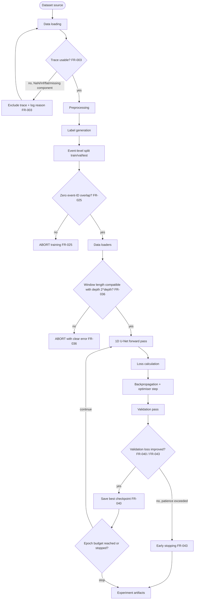
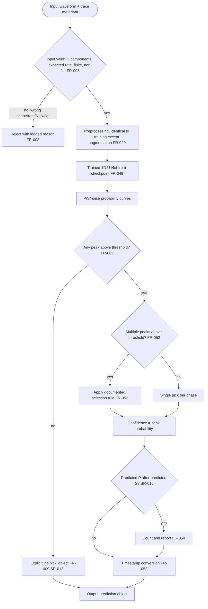
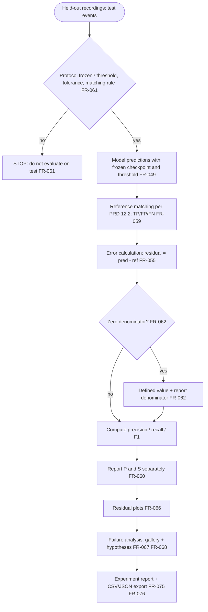
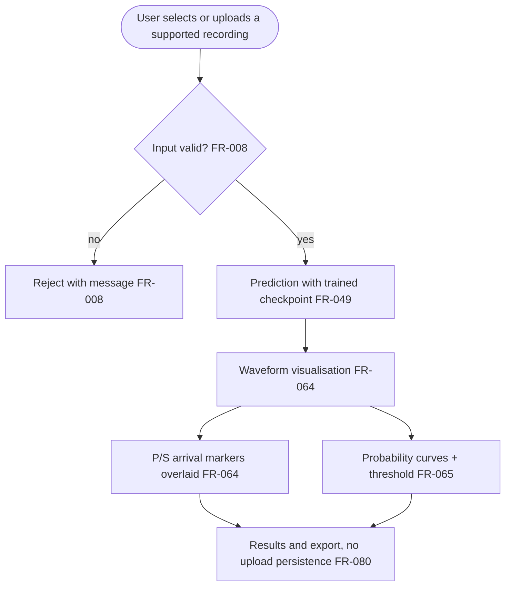
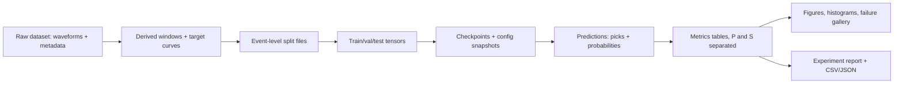

# SeismoNet — System Flow Specification

**Document ID:** FLOW-001
**Version:** 1.0
**Date:** 2026-10-17
**Status:** Draft for approval — specification only, no implementation exists

---

## 0. Status statement — read this first

> **The SeismoNet repository contains no code.** There is no `src/`, no `tests/`, no notebooks, no `requirements.txt`, no `data/`, and no model artifacts. The verified repository contents at the time of writing are the documents `PRD.md`, `README.md`, `tech.md`, this documentation set under `docs/`, and nothing executable. This is established by `AUDIT_REPORT.md` (see its §3 and §4).
>
> **Everything in this document is a specification of what should be built, not a description of what exists.** Every workflow diagram below is a *proposed* execution flow. Every module path is a *proposed* path. Every configuration key is a *proposed* key. No workflow in this document has been executed, no stage has been run, and no output shown here has been produced.
>
> **Component labelling rule used throughout.** Each component is either **EXISTING** or **PROPOSED**. The single EXISTING category in this repository is the documentation itself. Therefore **every pipeline stage, module, config key, decision node, and artifact in this document is PROPOSED**, and that is stated here once rather than repeated on every row. Where the word EXISTING does appear below it refers only to a document.

This document must be read together with [`../PRD.md`](../PRD.md) (requirements), [`TECHNICAL_ARCHITECTURE.md`](TECHNICAL_ARCHITECTURE.md) (module boundaries and interfaces), [`DEVELOPMENT_ROADMAP.md`](DEVELOPMENT_ROADMAP.md) (phasing P0–P9), [`EXPERIMENT_PLAN.md`](EXPERIMENT_PLAN.md) (research runs), [`REPRODUCIBILITY.md`](REPRODUCIBILITY.md) (artifact policy) and [`TESTING_STRATEGY.md`](TESTING_STRATEGY.md) (how each stage is verified). It does not restate those documents' content; it references them.

---

## 1. Purpose, scope and status

### 1.1 Purpose

This document is the **complete execution-flow specification** for SeismoNet. It defines, for each pipeline workflow, the ordered stages, the decisions taken at each branch point, the input and output of every stage, the proposed module responsible for it, the configuration keys that control it, and the requirement identifiers each stage will satisfy when implemented.

Its purpose is to give implementation a fixed target: a stage in the eventual code can be checked against the stage here, and any requirement that owns no stage is a gap.

### 1.2 Scope

Four workflows are specified:

- **Workflow A — Training** (§3).
- **Workflow B — Inference** (§4).
- **Workflow C — Evaluation** (§5).
- **Workflow D — Optional demonstration interface** (§6), marked OPTIONAL and dependent on core validation.

Plus the cross-cutting data-and-artifact flow (§7) and the edge-case coverage map (§8).

### 1.3 Status

- **Implementation status: none.** There is no runnable pipeline in any of these workflows. Verified by `AUDIT_REPORT.md` §4 (implementation completeness: 0 of 13 layers).
- **Data status: no dataset selected.** `OQ-3` remains open (`../PRD.md` §17.2). Every "dataset source" stage is a placeholder for a decision not yet made.
- **Protocol status: not frozen.** The threshold (`SR-011`), the tolerance (`SR-016`) and the matching rule (`../PRD.md` §12.2) are proposals or open questions. Workflow C cannot be executed on test data until they are frozen (`FR-061`).
- **Verification of these flows: manual inspection only.** Because nothing is built, the only current verification method for this document is INSP (inspection against the PRD).

### 1.4 Relationship to other documents

| Topic | Authoritative document | This document provides |
|---|---|---|
| What the system must do | [`../PRD.md`](../PRD.md) | The stage-by-stage execution order that satisfies it |
| Module decomposition, interfaces, config schema | [`TECHNICAL_ARCHITECTURE.md`](TECHNICAL_ARCHITECTURE.md) | The runtime ordering of those modules |
| Libraries and versions | [`TECH_STACK.md`](TECH_STACK.md) | Which stage uses which library class (by reference) |
| Parameter rationale | [`REASONING_AND_DECISIONS.md`](REASONING_AND_DECISIONS.md) | The stage where each parameter is applied |
| When each stage is built | [`DEVELOPMENT_ROADMAP.md`](DEVELOPMENT_ROADMAP.md) | The stage's owning phase P0–P9 |
| How each stage is verified | [`TESTING_STRATEGY.md`](TESTING_STRATEGY.md) | The requirement each stage must satisfy |

---

## 2. Notation used

### 2.1 Stage notation

Every stage is written as:

```text
Stage name
  input:      what the stage consumes
  output:     what the stage produces
  module:     the proposed code path responsible for it (PROPOSED)
  config:     the proposed configuration keys that control it (PROPOSED)
  requires:   the requirement IDs the stage satisfies (FR-*, SR-*, NFR-*, DR-*)
  edges:      the edge case IDs (E1–E38, from PRD v0.1 §9) the stage is expected to handle
```

### 2.2 Requirement identifiers

- `FR-001` … `FR-084` — functional requirements, `../PRD.md` §8.
- `NFR-001` … `NFR-015` — non-functional requirements, `../PRD.md` §9.
- `SR-001` … `SR-017` — scientific and model requirements, `../PRD.md` §10.
- `DR-001` … `DR-007` — dataset requirements, `../PRD.md` §11.
- `E1` … `E38` — edge cases, defined in `archive/PRD-v0.1-original.md` §9 and **not restated** in the v1.0 PRD. §8 of this document maps each to a stage.
- `OQ-*` — open questions, `../PRD.md` §17.2.
- `SC-*`, `SCF-*` — acceptance criteria, `../PRD.md` §16.
- `O-Opt*` — optional objectives, `../PRD.md` §5.2.
- `P0` … `P9` — milestone phases, `../PRD.md` §15 and `DEVELOPMENT_ROADMAP.md`.

### 2.3 Diagram conventions

- Rounded nodes (`([...])`) are start/end terminals.
- Rectangular nodes (`[...]`) are processing stages.
- Diamond nodes (`{...}`) are decisions.
- Edges labelled `ABORT` terminate the workflow and must fail loudly (`NFR-004`); no silent continuation is permitted.
- Edge labels `no`/`yes` reflect the decision text, not a claim about observed behaviour.

### 2.4 Proposed module paths used in this document

The paths below are the **proposed** locations referenced by the stage tables. The authoritative module boundary and interface definitions belong to [`TECHNICAL_ARCHITECTURE.md`](TECHNICAL_ARCHITECTURE.md); this document uses them only to name the owner of each stage.

| Proposed path | Concern |
|---|---|
| `src/data/source.py` | Dataset acquisition / cache handle |
| `src/data/load_dataset.py` | Trace loading, streaming, metadata attachment |
| `src/data/validate.py` | Schema and signal-quality screening |
| `src/data/preprocess.py` | Detrend, demean, normalise, filter, resample, window |
| `src/data/labels.py` | P/S/noise target-curve generation |
| `src/data/split.py` | Event-level train/val/test splitting |
| `src/data/dataset.py` | `Dataset` and `DataLoader` construction |
| `src/model/unet1d.py` | 1D U-Net definition and shape assertions |
| `src/train/losses.py` | Loss functions |
| `src/train/train.py` | Training loop, validation, run orchestration |
| `src/train/checkpoint.py` | Checkpoint save/load, selection, early stopping |
| `src/infer/predict.py` | Inference entry point and output objects |
| `src/infer/pick.py` | Peak extraction, threshold, ordering, counts |
| `src/infer/timestamp.py` | Sample-index ↔ seconds ↔ absolute time |
| `src/eval/metrics.py` | Residuals, TP/FP/FN, precision/recall/F1 |
| `src/eval/failure_analysis.py` | Failure categorisation |
| `src/eval/report.py` | Tables and experiment records |
| `src/eval/export.py` | CSV/JSON export |
| `src/viz/plots.py` | Waveform, picks, probability, residual figures |
| `src/experiments/run.py` | Configuration-driven experiment driver |
| `app/streamlit_app.py` | Optional demonstration interface (Tier 2) |

### 2.5 Proposed configuration keys

Configuration is expected to be YAML, one file per experiment, snapshotted beside each checkpoint (`FR-042`, `FR-077`). The proposed schema below is referenced by the stage tables; the authoritative schema belongs to [`TECHNICAL_ARCHITECTURE.md`](TECHNICAL_ARCHITECTURE.md) and the choice of libraries to [`TECH_STACK.md`](TECH_STACK.md).

| Config key (proposed) | Meaning | Owning requirement |
|---|---|---|
| `data.dataset` | Selected dataset identifier | `DR-001`–`DR-007`, `OQ-3` |
| `data.root` | Local dataset root | `FR-001` |
| `data.limit` | Max traces for a subset run | `FR-007` |
| `data.expected_components` | Expected channel count (`3`) | `FR-008`, `SR-001` |
| `data.expected_sampling_rate` | Common rate (default 100 Hz proposed) | `SR-003`, `OQ-4` |
| `data.channel_order` | Expected order `(Z, N, E)` | `SR-002` |
| `preprocess.detrend` / `preprocess.demean` | Per-component detrend/demean | `FR-013` |
| `preprocess.normalisation` | Amplitude-normalisation method | `FR-014`, `SR-005` |
| `preprocess.bandpass.enabled` / `.low` / `.high` | Optional filter | `FR-015`, `OQ-6` |
| `preprocess.resample.target_rate` | Target rate for resampling | `FR-016`, `SR-003` |
| `data.window_length` | Fixed window length `L` (default 3072 proposed) | `FR-017`, `SR-004` |
| `data.randomise_window_start` | Random training offsets | `FR-018` |
| `labels.sigma` | Gaussian label width σ (default 10 samples proposed) | `FR-022`, `SR-006`, `OQ-8` |
| `labels.pure_noise_fraction` | Fraction of pure-noise windows | `FR-019`, `OQ-7` |
| `split.ratios` / `split.seed` / `split.strategy` | Split proportions, seed, strategy | `FR-006`, `FR-026`, `FR-027`, `OQ-5` |
| `augment.*` (per-augmentation switch) | Independently switchable augmentations | `FR-028`, `FR-029` |
| `model.depth` / `.base_channels` / `.kernel_size` | Architecture parameters | `FR-035`, `SR-008`, `OQ-12` |
| `train.loss` | Loss function name | `FR-039`, `SR-007`, `OQ-9` |
| `train.optimizer` / `train.lr` / `train.scheduler` | Optimisation | `SR-009` |
| `train.batch_size` / `train.epochs` / `train.amp` | Budget and precision | `SR-009`, `NFR-006` |
| `train.seed` | Random seed | `FR-041`, `NFR-001` |
| `train.checkpoint_criterion` | Selection criterion | `FR-040`, `SR-010`, `OQ-21` |
| `train.early_stopping.patience` | Early-stopping patience | `FR-043` |
| `inference.checkpoint` | Checkpoint to load (weights-only) | `FR-046`, `NFR-015` |
| `inference.threshold` | Peak-detection threshold | `FR-051`, `SR-011`, `OQ-10` |
| `inference.peak_rule` / `.min_separation` | Multi-peak selection rule | `FR-052`, `SR-012`, `OQ-10` |
| `eval.tolerance` | Evaluation tolerance (strict and lenient proposed) | `FR-058`, `SR-016`, `OQ-11` |
| `experiment.name` / `.tags` | Experiment identity | `FR-075` |

---

## 3. Workflow A — Training

### 3.1 Diagram



The chain traced is exactly: dataset source → data loading → validation → preprocessing → label generation → event-level splitting → data loaders → 1D U-Net → loss → backpropagation → validation → checkpoint selection → experiment artifacts. Four decision nodes are explicit: invalid/excluded traces (`FR-003`), event-overlap failure which must abort (`FR-025`), window-length/depth incompatibility which must abort (`FR-036`), and validation-loss non-improvement driving checkpoint selection (`FR-040`) and early stopping (`FR-043`).

### 3.2 Stage specification

**A0 — Dataset source**

| Field | Value |
|---|---|
| Input | A dataset selected per `DR-001`–`DR-007` (none selected; `OQ-3` open). |
| Output | A handle or cache path to the raw waveforms and metadata. |
| Module (PROPOSED) | `src/data/source.py` |
| Config keys | `data.dataset`, `data.root`, `data.limit` |
| Requirements | `FR-001`, `FR-007`, `DR-001`…`DR-007` |
| Edge cases | `E19` (heterogeneous instruments), `E20` (timing errors) are inherited here. |
| Notes | Access procedure and licence recorded in [`DATASET_GUIDE.md`](DATASET_GUIDE.md). Raw data is read-only (`NFR-009`). |

**A1 — Data loading**

| Field | Value |
|---|---|
| Input | Raw storage from A0. |
| Output | Per-trace objects: three-component waveform, sampling rate, reference P/S pick indices, available metadata (magnitude, distance, SNR). |
| Module (PROPOSED) | `src/data/load_dataset.py` |
| Config keys | `data.dataset`, `data.channel_order`, `data.expected_sampling_rate`, `data.limit` |
| Requirements | `FR-001`, `FR-012`, `SR-001`, `SR-002` |
| Edge cases | `E12` (missing component) surfaces here. |
| Notes | If the dataset supplies no event identifier, `FR-010` constructs one from metadata. |

**A2 — Validation (screening)**

| Field | Value |
|---|---|
| Input | Per-trace objects from A1. |
| Output | Accepted traces plus a machine-readable data-quality log (trace ID, exclusion reason, count). |
| Module (PROPOSED) | `src/data/validate.py` |
| Config keys | `data.expected_components`, `data.expected_sampling_rate`, `data.min_variance` |
| Requirements | `FR-003`, `FR-010`, `NFR-004`, `NFR-009` |
| Edge cases | `E5`, `E10`, `E11`, `E12`, `E13`, `E15` |
| Decision (FR-003) | If a trace is NaN/Inf, zero-variance, missing a required reference pick, or at an inconsistent sampling rate, it is **excluded and logged** — never silently accepted. |
| Notes | The count and reason for each exclusion are persisted. Policy for a single dead component is `[OPEN]` (`OQ-15`, `E11`, `E12`). |

**A3 — Preprocessing**

| Field | Value |
|---|---|
| Input | Accepted traces from A2. |
| Output | Detrended, demeaned, normalised, optionally filtered/resampled, fixed-length windows. |
| Module (PROPOSED) | `src/data/preprocess.py` |
| Config keys | `preprocess.detrend`, `preprocess.demean`, `preprocess.normalisation`, `preprocess.bandpass.*`, `preprocess.resample.target_rate`, `data.window_length`, `data.randomise_window_start` |
| Requirements | `FR-013`…`FR-020`, `SR-003`, `SR-005` |
| Edge cases | `E11` (normalisation must not divide by zero, `FR-014`), `E18` (anti-aliasing before downsample, `FR-016`), `E16` (low SNR is *not* excluded here). |
| Notes | Statistics are computed per window only, so train/test preprocessing are decoupled (`SR-005`, `FR-020`). |

**A4 — Label generation**

| Field | Value |
|---|---|
| Input | Windows plus reference P/S pick indices from A3. |
| Output | P, S and noise per-sample target curves with the same length as the window. |
| Module (PROPOSED) | `src/data/labels.py` |
| Config keys | `labels.sigma`, `labels.pure_noise_fraction` |
| Requirements | `FR-021`, `FR-022`, `FR-023`, `FR-024`, `SR-006`, `SR-013` |
| Edge cases | `E1`, `E2` (absent phase → all-zero that phase's target), `E3` (pure noise → both zero), `E4` (overlapping P/S Gaussians, noise remainder clipped), `E6` (pick near window edge truncates the Gaussian; admissibility `[OPEN]` `OQ-14`), `E7` (missing reference pick → phase excluded from that task). |
| Notes | P + S + noise = 1 per sample (`FR-023`) including the overlap case (`E4`). |

**A5 — Event-level splitting**

| Field | Value |
|---|---|
| Input | Windowed traces carrying event identifiers. |
| Output | Persisted train / validation / test split files, diff-able and re-loadable. |
| Module (PROPOSED) | `src/data/split.py` |
| Config keys | `split.ratios`, `split.seed`, `split.strategy` |
| Requirements | `FR-004`, `FR-005`, `FR-006`, `FR-007`, `FR-010`, `FR-025`, `FR-026`, `FR-027`, `DR-003`, `NFR-003` |
| Edge cases | `E25` (same event at multiple stations never split across sets), `E21`/`E22` (multi-event windows handled per `OQ-16`). |
| Decision (FR-025) | If any event ID appears in more than one split, the workflow **aborts** (`ABORT training`). This check is also run as a guard at training start (`FR-025`, `SC-8`). |
| Notes | Splitting is by **event**, never by trace. Ratios are configurable and recorded; ~70/15/15 is an earlier suggestion (`OQ-5`). |

**A6 — Data loaders**

| Field | Value |
|---|---|
| Input | Split membership, preprocessed windows, target curves. |
| Output | Batched tensors `[batch, 3, L]` (inputs) and `[batch, 3, L]` (targets), on device. |
| Module (PROPOSED) | `src/data/dataset.py` |
| Config keys | `data.batch_size`, `data.num_workers`, `augment.*`, `data.randomise_window_start` |
| Requirements | `FR-017`, `FR-018`, `FR-019`, `FR-028`…`FR-031`, `SR-001` |
| Edge cases | `E3` (pure-noise windows sampled per `FR-019`). |
| Notes | Augmentation applies to training only (`FR-030`); any signal-moving augmentation moves the targets identically (`FR-031`). |

**A7 — 1D U-Net forward pass**

| Field | Value |
|---|---|
| Input | `[batch, 3, L]` windows. |
| Output | `[batch, 3, L]` per-sample class probabilities (softmax over P/S/noise). |
| Module (PROPOSED) | `src/model/unet1d.py` |
| Config keys | `model.depth`, `model.base_channels`, `model.kernel_size`, `model.dropout` |
| Requirements | `FR-032`…`FR-038`, `SR-008` |
| Edge cases | `E30` (all-noise collapse detected via logs and per-class statistics), `E31` (class imbalance monitored via P/S metrics). |
| Decision (FR-036) | Before the forward pass, if `L` is not divisible by `2^depth`, the workflow **aborts with a specific, readable error** (`ABORT`). |
| Notes | Output length equals input length (`FR-034`). |

**A8 — Loss calculation**

| Field | Value |
|---|---|
| Input | Predicted probabilities from A7 and target curves from A6. |
| Output | A scalar loss for the batch. |
| Module (PROPOSED) | `src/train/losses.py` |
| Config keys | `train.loss`, `train.class_weight` (only if collapse observed) |
| Requirements | `FR-039`, `SR-007` |
| Edge cases | `E30`, `E31`, `E32` (zero-denominator metric handling belongs to evaluation, not the loss). |
| Notes | Proposed baseline is soft cross-entropy against Gaussian targets; MSE is an ablation (`OQ-9`). |

**A9 — Backpropagation and optimiser step**

| Field | Value |
|---|---|
| Input | Loss and model parameters. |
| Output | Updated parameters. |
| Module (PROPOSED) | `src/train/train.py` |
| Config keys | `train.optimizer`, `train.lr`, `train.scheduler`, `train.amp`, `train.epochs`, `train.batch_size` |
| Requirements | `SR-009` |
| Edge cases | — |
| Notes | Adam/AdamW with a validation-monitored schedule is the proposal (`SR-009`). |

**A10 — Validation pass**

| Field | Value |
|---|---|
| Input | The validation split (never augmented). |
| Output | Validation loss (and optionally validation P/S F1 at the frozen tolerance). |
| Module (PROPOSED) | `src/train/train.py` |
| Config keys | `train.val_cadence`, `train.checkpoint_criterion` |
| Requirements | `FR-040`, `SR-010` |
| Edge cases | `E34` (test > validation without explanation is treated as a leakage prompt, not a success). |
| Notes | Validation data is used for model selection and threshold selection only; test data is never touched here (`NFR-003`). |

**A11 — Checkpoint selection and early stopping**

| Field | Value |
|---|---|
| Input | Validation-metric history. |
| Output | The single best checkpoint, or a stop signal. |
| Module (PROPOSED) | `src/train/checkpoint.py` |
| Config keys | `train.checkpoint_criterion`, `train.early_stopping.patience` |
| Requirements | `FR-040`, `FR-043`, `FR-046`, `FR-047`, `SR-010`, `OQ-21` |
| Edge cases | `E33` (seed variability) is quantified by the seed study, not here. |
| Decisions | (1) If validation loss improves, save the best checkpoint (`FR-040`). (2) If validation loss does not improve for `patience` epochs, halt training (`FR-043`). |
| Notes | The criterion is fixed before the first run (`SR-010`, `OQ-21`). Checkpoints are weights-only (`FR-046`, `NFR-015`). |

**A12 — Experiment artifacts**

| Field | Value |
|---|---|
| Input | Best checkpoint, run configuration, loss history, seeds. |
| Output | Checkpoint, config snapshot, loss logs, and a per-run experiment record. |
| Module (PROPOSED) | `src/train/train.py`, `src/experiments/run.py` |
| Config keys | `experiment.name`, `experiment.tags`, `train.seed` |
| Requirements | `FR-041`, `FR-042`, `FR-046`, `FR-047`, `FR-048`, `FR-075`, `FR-077` |
| Edge cases | — |
| Notes | Artifact layout and the gitignored paths are defined in [`REPRODUCIBILITY.md`](REPRODUCIBILITY.md); experiment records follow [`EXPERIMENT_PLAN.md`](EXPERIMENT_PLAN.md). |

---

## 4. Workflow B — Inference

### 4.1 Diagram



### 4.2 Stage specification

**B0 — Input waveform**

| Field | Value |
|---|---|
| Input | A three-component window plus, where available, a trace start time. |
| Output | A candidate input object. |
| Module (PROPOSED) | `src/infer/predict.py` |
| Config keys | — |
| Requirements | `FR-049` |

**B1 — Input validation (decision, FR-008)**

| Field | Value |
|---|---|
| Input | Candidate input from B0. |
| Output | Either an accepted, validated input or a rejection with reason. |
| Module (PROPOSED) | `src/data/validate.py` (shared with A2) |
| Config keys | `data.expected_components`, `data.expected_sampling_rate`, `data.window_length`, `data.channel_order` |
| Requirements | `FR-008`, `SR-001`, `SR-002`, `SR-003` |
| Edge cases | `E10` (NaN/Inf), `E11` (flat), `E12` (missing component), `E18` (wrong rate → reject or explicit resample). |
| Decision | Wrong shape, wrong rate, NaN/Inf, or flat signal → **reject** (`BX`); the input is never silently accepted and never silently coerced. |
| Notes | Same validation logic as training screening, so inference cannot accept inputs training would have excluded. |

**B2 — Preprocessing**

| Field | Value |
|---|---|
| Input | Validated input from B1. |
| Output | A preprocessed window identical to what training would have produced. |
| Module (PROPOSED) | `src/data/preprocess.py` (shared) |
| Config keys | `preprocess.*`, `data.window_length` |
| Requirements | `FR-020`, `FR-013`…`FR-016`, `SR-003`, `SR-005` |
| Edge cases | `E18` (rate handling), `E19` (unit heterogeneity reduced by per-window normalisation). |
| Notes | The single shared preprocessing function is the mechanism that guarantees train/eval parity (`FR-020`). |

**B3 — Trained model**

| Field | Value |
|---|---|
| Input | Preprocessed window `[3, L]`. |
| Output | `[3, L]` P/S/noise probabilities. |
| Module (PROPOSED) | `src/model/unet1d.py`; checkpoint loaded via `src/train/checkpoint.py` |
| Config keys | `inference.checkpoint`, `model.*` |
| Requirements | `FR-049`, `FR-046`, `NFR-015` |
| Edge cases | — |
| Notes | Checkpoints are loaded weights-only, never in an unsafe pickle mode (`FR-046`, `NFR-015`). |

**B4 — P/S/noise probability curves**

| Field | Value |
|---|---|
| Input | Model output from B3. |
| Output | Three probability curves of length `L` (P, S, noise). |
| Module (PROPOSED) | `src/infer/predict.py` |
| Config keys | — |
| Requirements | `FR-049` |

**B5 — Peak extraction and missing-pick decision**

| Field | Value |
|---|---|
| Input | P and S probability curves. |
| Output | Candidate peaks above threshold, or an explicit "no pick". |
| Module (PROPOSED) | `src/infer/pick.py` |
| Config keys | `inference.threshold`, `inference.peak_rule`, `inference.min_separation` |
| Requirements | `FR-050`, `FR-051`, `FR-052`, `FR-054`, `SR-011`, `SR-012`, `SR-013` |
| Edge cases | `E26` (no peak → "no pick"; FN if a reference exists), `E27` (several peaks → documented rule), `E28` (broad/double peak → the peak location is the pick). |
| Decisions | (1) **No peak above threshold (`FR-009`)** → return an explicit "no pick" object, never a fabricated or placeholder number. (2) **Multiple peaks above threshold (`FR-052`)** → apply the documented deterministic selection rule and return exactly one pick per phase per window. |
| Notes | The threshold is selected on validation data only and then frozen (`FR-051`, `SR-011`). The proposed baseline rule is the highest peak above threshold (`SR-012`, `OQ-10`). |

**B6 — Confidence and missing-pick handling**

| Field | Value |
|---|---|
| Input | Selected peak(s) or the "no pick" state. |
| Output | A prediction object carrying, per phase: pick index (or "no pick"), peak probability as a confidence value, and the count of the three outcome conditions. |
| Module (PROPOSED) | `src/infer/pick.py` |
| Config keys | `inference.threshold` |
| Requirements | `FR-009`, `FR-054`, `SR-013` |
| Edge cases | `E28` (peak width is usable as uncertainty only under optional `O-Opt4`). |
| Notes | Counts of no-pick, multi-peak and P-after-S are reported, never silently discarded (`FR-054`). |

**B7 — Ordering check (decision, SR-015)**

| Field | Value |
|---|---|
| Input | Predicted P pick and predicted S pick. |
| Output | The predictions, plus a recorded count when P follows S. |
| Module (PROPOSED) | `src/infer/pick.py` |
| Config keys | `inference.enforce_ordering` (`[OPEN]` `OQ-17`) |
| Requirements | `SR-015`, `FR-054` |
| Edge cases | `E29` |
| Decision | If predicted P occurs after predicted S, **count and report** it. Enforcement of ordering is `[OPEN]` (`OQ-17`); if adopted, both variants must be reported. |

**B8 — Timestamp conversion**

| Field | Value |
|---|---|
| Input | Pick sample indices. |
| Output | Pick times in seconds, and in absolute time where a trace start time exists. |
| Module (PROPOSED) | `src/infer/timestamp.py` |
| Config keys | `data.expected_sampling_rate` |
| Requirements | `FR-053`, `SR-014` |
| Edge cases | The rate is validated in B1 so a rate/index mismatch cannot silently survive. |
| Formula | `seconds = sample_index / sampling_rate` and `absolute_time = trace_start_time + seconds`. |
| Notes | A window cut from a trace must carry its reference time origin, or absolute time cannot be recovered (PRD §4.4). |

**B9 — Output predictions**

| Field | Value |
|---|---|
| Input | Pick objects with indices, seconds and absolute times. |
| Output | A machine-readable predictions record (and probability curves where requested). |
| Module (PROPOSED) | `src/infer/predict.py`, `src/eval/export.py` |
| Config keys | `eval.output_dir` |
| Requirements | `FR-076` |
| Notes | Exported files carry the threshold and checkpoint identifier so a prediction is traceable to its source (`FR-047`, `FR-076`). |

---

## 5. Workflow C — Evaluation

### 5.1 Diagram



### 5.2 Stage specification

**C0 — Held-out recordings**

| Field | Value |
|---|---|
| Input | Test split events persisted by A5. |
| Output | The set of test windows on which final metrics will be computed. |
| Module (PROPOSED) | `src/eval/evaluate.py` |
| Config keys | `eval.split` (e.g., `test`), `data.dataset` |
| Requirements | `FR-061`, `DR-001`, `DR-002` |
| Edge cases | `E16` (difficult windows are **not** excluded from test for being difficult). |
| Notes | The test split is used exactly once with the frozen configuration (`FR-061`, `NFR-003`). |

**C1 — Protocol freeze gate (decision)**

| Field | Value |
|---|---|
| Input | The proposed threshold, tolerance and matching rule. |
| Output | Either a frozen protocol or a stop. |
| Module (PROPOSED) | configuration snapshot (no code stage) |
| Config keys | `inference.threshold`, `eval.tolerance`, matching rule as documented |
| Requirements | `FR-061`, `SR-011`, `SR-016`, `NFR-003` |
| Decisions | If the threshold, tolerance and matching rule are **not** yet frozen, the workflow **stops**: test evaluation does not run. |
| Notes | The threshold is chosen on validation data; the tolerance is `[OPEN]` (`OQ-11`) with a strict and a lenient value proposed. |

**C2 — Model predictions**

| Field | Value |
|---|---|
| Input | Frozen checkpoint and frozen threshold. |
| Output | Pick predictions for each test window, plus the per-window outcome counts from Workflow B. |
| Module (PROPOSED) | `src/infer/predict.py` |
| Config keys | `inference.checkpoint`, `inference.threshold`, `inference.peak_rule` |
| Requirements | `FR-049`, `FR-050`, `FR-061` |
| Edge cases | `E26`, `E27`, `E29` are already recorded as counts by Workflow B and feed the failure summary. |

**C3 — Reference matching**

| Field | Value |
|---|---|
| Input | Predictions and reference picks. |
| Output | Per-phase outcomes classified as TP, FP or FN. |
| Module (PROPOSED) | `src/eval/metrics.py` |
| Config keys | `eval.tolerance` |
| Requirements | `FR-059`, `FR-061` |
| Edge cases | `E3` (a pick in a no-reference window is an FP), `E7` (windows excluded from a phase's evaluation are counted and stated, never silently dropped). |
| Matching rule (PRD §12.2, proposed and pre-declared) | **TP** — a reference phase exists, a pick exists, and `abs(pred − ref) ≤ tol`. **FP** — a pick exists but no reference phase exists, or the pick lies outside `tol`. **FN** — a reference phase exists but no pick was made, or the pick lies outside `tol`. |
| Caveat to carry into the report | Under this rule a single out-of-tolerance pick counts as **both** an FP and an FN. This must be stated, and results must not be compared with papers whose matching rule differs (`../PRD.md` §12.2). |

**C4 — Error calculation**

| Field | Value |
|---|---|
| Input | Predicted and reference times. |
| Output | Residuals `pred − ref` for P and S separately. |
| Module (PROPOSED) | `src/eval/metrics.py` |
| Config keys | `eval.tolerance` |
| Requirements | `FR-055`, `FR-056`, `SR-014` |
| Edge cases | — |
| Notes | Residuals are reported **in seconds** as the primary unit, with sample counts supplementary (PRD §12.1). |

**C5 — Zero-denominator handling**

| Field | Value |
|---|---|
| Input | Outcome counts. |
| Output | Defined metric values with their denominators reported. |
| Module (PROPOSED) | `src/eval/metrics.py` |
| Config keys | — |
| Requirements | `FR-062` |
| Edge cases | `E32` |
| Decision | If a denominator is zero, return a **defined value** and report the zero denominator. F1 is undefined when precision + recall = 0. |

**C6 — P and S metrics**

| Field | Value |
|---|---|
| Input | Outcome counts and residuals. |
| Output | Precision, recall, F1, residual mean, standard deviation, median and MAE — for P and S separately. |
| Module (PROPOSED) | `src/eval/metrics.py` |
| Config keys | `eval.tolerance` |
| Requirements | `FR-057`, `FR-058`, `FR-060`, `NFR-002` |
| Edge cases | `E24` (S hidden in the P coda — S is reported separately precisely so this is visible). |
| Notes | **P and S are never aggregated into a single headline number** (`FR-060`). Every table states tolerance, threshold, matching rule, dataset/split identity, checkpoint identity and windows evaluated (`NFR-002`). |

**C7 — Residual plots**

| Field | Value |
|---|---|
| Input | P and S residual arrays. |
| Output | Residual histograms (two panels or two figures). |
| Module (PROPOSED) | `src/viz/plots.py` |
| Config keys | `eval.output_dir` |
| Requirements | `FR-066` |
| Edge cases | — |
| Notes | Distributions reveal structure (bimodality, tails) that summary statistics hide. |

**C8 — Failure analysis**

| Field | Value |
|---|---|
| Input | The worst residuals and a sample of false picks, with their waveform, reference, prediction and probability curves. |
| Output | A failure gallery and a per-case cause hypothesis explicitly flagged as a hypothesis. |
| Module (PROPOSED) | `src/eval/failure_analysis.py`, `src/viz/plots.py` |
| Config keys | `eval.output_dir` |
| Requirements | `FR-067`, `FR-068` |
| Edge cases | `E14` (glitches as false-pick sources), `E15` (clipping), `E17` (anthropogenic transients), `E24` (emergent S). |
| Notes | A category is only called systematic if its count is non-trivial and the mechanism is visible; single examples are described, not generalised. |

**C9 — Experiment report and export**

| Field | Value |
|---|---|
| Input | Metrics tables, residual plots, failure gallery, run metadata. |
| Output | A per-run experiment report and machine-readable CSV/JSON. |
| Module (PROPOSED) | `src/eval/report.py`, `src/eval/export.py` |
| Config keys | `experiment.name`, `experiment.tags`, `eval.output_dir` |
| Requirements | `FR-075`, `FR-076`, `NFR-002` |
| Notes | Exported files load cleanly and contain the tolerance and threshold used (`FR-076`). |

---

## 6. Workflow D — Optional demonstration interface

> **Status: OPTIONAL and DEPENDENT.** This entire workflow is an optional objective (`O-Opt5`, `US-12`) and must be built **only after core validation is complete** (`FR-081`). No core work may be blocked by it. It is specified here so that, if it is built, its flow is fixed rather than improvised.

### 6.1 Diagram



### 6.2 Stage specification

**D0 — Select or upload a supported recording**

| Field | Value |
|---|---|
| Input | A recording the user selects or uploads. |
| Output | A candidate input object. |
| Module (PROPOSED) | `app/streamlit_app.py` |
| Config keys | `app.max_payload`, `app.supported_formats` |
| Requirements | `FR-079`, `O-Opt5` |
| Notes | Only formats the pipeline supports are accepted; unknown formats are rejected (tech.md §7). |

**D1 — Input validation (decision)**

| Field | Value |
|---|---|
| Input | Candidate input from D0. |
| Output | Accepted input or rejection. |
| Module (PROPOSED) | `src/data/validate.py` (shared with A2/B1) |
| Config keys | `data.expected_components`, `data.expected_sampling_rate`, `data.window_length` |
| Requirements | `FR-008`, `FR-080` |
| Edge cases | `E10`, `E11`, `E12`, `E18`. |
| Notes | The same validation is used as in inference so the demo cannot accept inputs the model was never meant to see. |

**D2 — Prediction**

| Field | Value |
|---|---|
| Input | Validated input. |
| Output | P/S/noise probabilities and picks. |
| Module (PROPOSED) | `src/infer/predict.py` |
| Config keys | `inference.checkpoint`, `inference.threshold` |
| Requirements | `FR-049` |

**D3 — Waveform visualisation and markers**

| Field | Value |
|---|---|
| Input | Waveform and picks. |
| Output | A waveform figure with reference and predicted P/S markers overlaid. |
| Module (PROPOSED) | `src/viz/plots.py` |
| Config keys | `app.plot_library` |
| Requirements | `FR-064` |

**D4 — Probability curves**

| Field | Value |
|---|---|
| Input | P/S/noise curves and the applied threshold. |
| Output | A probability figure with the threshold line. |
| Module (PROPOSED) | `src/viz/plots.py` |
| Config keys | `inference.threshold` |
| Requirements | `FR-065` |

**D5 — Results and export**

| Field | Value |
|---|---|
| Input | Picks, probabilities and figures. |
| Output | A rendered result the user can view or export. |
| Module (PROPOSED) | `app/streamlit_app.py` |
| Config keys | `app.export_format` |
| Requirements | `FR-080` |
| Notes | **No uploads are persisted by default** (`FR-080`). Uploaded data is not stored unless explicitly required; the default is in-memory only (tech.md §7). |

---

## 7. Cross-cutting data and artifact flow

This single diagram shows how data moves from raw storage to reported results, and marks what is proposed to be version-controlled versus gitignored. The authoritative artifact policy lives in [`REPRODUCIBILITY.md`](REPRODUCIBILITY.md); the classification below is a **PROPOSED** default consistent with `FR-048`.



| Artifact | Produced by | Version control | Rationale |
|---|---|---|---|
| Raw dataset | A0 | **Gitignored** (never committed) | Large; licence-restricted; must be re-obtainable (`DR-005`, `DR-006`) |
| Derived windows / targets | A3, A4 | **Gitignored** | Regenerable from raw data plus code plus config |
| Split files | A5 | **Version-controlled (PROPOSED)** | Small, diff-able; the reproducibility anchor for `FR-005`, `FR-025`; whether to commit them is a policy decision to confirm (`OQ-23`) |
| Train/val/test tensors | A6 | **Gitignored / in-memory** | Regenerable; large |
| Checkpoints | A11, A12 | **Gitignored** | Large binary artifacts (`FR-048`); weights-only format (`FR-046`) |
| Config snapshots | A12 | **Version-controlled (PROPOSED)** for the committed baseline; otherwise gitignored with the run | Small; carries `FR-042` metadata |
| Predictions | B9, C2 | **Gitignored** | Regenerable from a checkpoint |
| Metrics tables | C6, C9 | **Gitignored** | Regenerable by the documented command (`FR-078`); every number traces to a checkpoint and config |
| Figures / gallery | C7, C8 | **Gitignored** | Regenerable (`FR-078`) |
| Experiment reports | C9 | **Gitignored** | Regenerable |
| Uploaded recordings (demo) | D0 | **Never persisted** | `FR-080` |
| Code, configs, docs, regeneration commands, synthetic fixtures | — | **Version-controlled** | Everything a reader needs to reproduce, without the large artifacts |

> **Note.** There is currently no `.gitignore` in the repository (`AUDIT_REPORT.md` §8). Until one exists, nothing above is actually protected; adding `.gitignore` first is recommended (`FR-048`, `R-16`).

---

## 8. Edge-case coverage table (E1–E38)

Each edge case from `archive/PRD-v0.1-original.md` §9 is mapped to the workflow stage of this document where it is expected to be handled. Where the handling is not decided, the governing open question is named.

| Edge case | Short description | Workflow stage | Requirement | Status |
|---|---|---|---|---|
| E1 | Window has P but not S | A4 Label generation; C3 matching | `FR-024`, `FR-059` | Handled by design: S target all-zero; an S pick is an FP |
| E2 | Window has S but not P | A4; C3 | `FR-024` | Symmetric with E1 |
| E3 | Window has neither (pure noise) | A4; A6 sampling; C3 | `FR-019`, `FR-024`, `FR-059` | Handled: any pick is an FP |
| E4 | Very short S-P time (overlap) | A4 | `FR-023`, `SR-006` | Handled: targets overlap, noise remainder clipped |
| E5 | Reference S ≤ P (invalid ordering) | A2 Validation | `FR-003` | Handled: flagged/excluded and logged |
| E6 | Pick at/near window edge | A4; label admissibility | `FR-022` | **OPEN** — `OQ-14` |
| E7 | Missing reference pick | A2; C3 | `FR-003`, `FR-059` | Handled: phase excluded from its task, counted |
| E8 | Low-quality / high-uncertainty reference | A2; tolerance choice | `FR-003`, `SR-016` | **OPEN** — `OQ-13` |
| E9 | Sub-phase identity ambiguity | A0/A3 (dataset convention inherited) | `DR-001` | Limitation, not handled |
| E10 | NaN/Inf samples | A2; B1 | `FR-003`, `FR-008` | Handled: excluded/rejected and logged |
| E11 | Flat / dead channel | A2; A3 normalisation; B1 | `FR-003`, `FR-014`, `FR-008` | Handled: all-dead excluded; single-dead policy **OPEN** — `OQ-15` |
| E12 | Missing component | A2; B1 | `FR-003`, `FR-008` | Handled by exclusion; zero-fill policy **OPEN** — `OQ-15` |
| E13 | Data gaps / zero padding | A2 | `FR-003` | Detected/flagged; handling **OPEN** |
| E14 | Spikes / glitches | C8 Failure analysis | `FR-067`, `FR-068` | Analysed, not removed |
| E15 | Clipped / saturated signal | A2 flag; C8 | `FR-003`, `FR-068` | Flagged and reported as a limitation |
| E16 | Very low SNR / emergent | A2 (not excluded); C0 test | `FR-069` | Studied, never excluded from test for difficulty |
| E17 | Anthropogenic / non-tectonic transients | C8 | `FR-068` | Treated as ordinary noise; discussed in failure analysis |
| E18 | Different sampling rates | A3; B1 | `FR-016`, `FR-008` | Handled: resample with anti-aliasing or exclude |
| E19 | Different instrument types / units | A3 normalisation | `FR-014` | Reduced, not removed; limitation |
| E20 | Timing errors / clock drift | Not detectable | — | Limitation inherited as label noise |
| E21 | Two or more events in one window | A5; A6 windowing | `FR-004`, `FR-063` | **OPEN** — `OQ-16` |
| E22 | Long coda masks a following event | A5 (same as E21) | `FR-004` | **OPEN** — `OQ-16` |
| E23 | Teleseismic events | Out of scope | `NG6`, §7.2 | Out of scope unless dataset says otherwise |
| E24 | S onset hidden in P coda | C6 (S reported separately) | `FR-060` | Handled by separate S reporting |
| E25 | Same event, multiple stations | A5 splitting | `FR-004` | Handled: event-level split, never across sets |
| E26 | No peak above threshold | B5; C3 | `FR-009`, `FR-059` | Handled: explicit "no pick"; FN if reference exists |
| E27 | Several peaks above threshold | B5 | `FR-052`, `FR-054` | Handled: documented rule; occurrence reported |
| E28 | Broad / double peak | B6 | `FR-050` | Peak location is the pick; width only under `O-Opt4` |
| E29 | Predicted P after predicted S | B7 | `SR-015`, `FR-054` | Counted and reported; enforcement **OPEN** — `OQ-17` |
| E30 | Model collapses to all-noise | A10 logs; A12 artifacts | `FR-040` | Detected via logs and per-class statistics; training failure |
| E31 | Strong class imbalance | A4 label design; C6 metrics | `FR-023`, `FR-060` | Handled: monitor P/S metrics, not overall accuracy |
| E32 | Undefined metric (zero denominator) | C5 | `FR-062` | Handled: defined value + reported denominator |
| E33 | Large seed-to-seed variability | Experiment workflow (EX-5) | `FR-074` | Handled outside A–D; see [`EXPERIMENT_PLAN.md`](EXPERIMENT_PLAN.md) |
| E34 | Test > validation without explanation | A10/A11 guard; C1 | `FR-025`, `FR-061` | Treated as a leakage prompt, not a result |
| E35 | Added noise is not realistic | Experiment workflow (EX-4) | `FR-070` | Limitation stated explicitly |
| E36 | Window already noisy; SNR definition | Experiment workflow (EX-4) | `FR-070` | **OPEN** — `OQ-18` |
| E37 | Noise level relative to a mostly-noise window | Experiment workflow (EX-4) | `FR-070` | **OPEN** — `OQ-18` |
| E38 | Re-adding noise changes the draw | Experiment workflow (EX-4) | `FR-071` | Handled: fixed noise seed |

**Summary.** Edge cases `E6`, `E8`, `E13`, `E21`, `E22`, `E23`, `E29`, `E36`, `E37` are not fully closed; `E6` (`OQ-14`), `E8` (`OQ-13`), `E11`/`E12` (`OQ-15`), `E21`/`E22` (`OQ-16`), `E29` (`OQ-17`) and `E36`/`E37` (`OQ-18`) are the open questions named in `../PRD.md` §17.2. `E23` is out of scope by `NG6`. `E33`, `E35`, `E36`, `E37`, `E38` belong to the experiment workflow specified in [`EXPERIMENT_PLAN.md`](EXPERIMENT_PLAN.md), not to Workflows A–D.

---

## 9. Relationship between these diagrams and the code

1. **None of this is implemented.** There is no code corresponding to any node, edge, module path or config key in this document. Every stage names the requirements it will satisfy so that, when implementation begins, the code can be checked against this specification.

2. **Each stage is a contract.** When a stage is implemented, it must accept the stated input, produce the stated output, be owned by a module at (or explicitly mapped from) the stated path, and be controlled by the stated configuration keys. A stage that behaves differently from its row is either a bug or a specification change that must be recorded in [`REASONING_AND_DECISIONS.md`](REASONING_AND_DECISIONS.md) and the change log.

3. **Two-way traceability, checked both ways.**
   - *Requirement → stage:* every `FR-*`, `SR-*` and `NFR-*` that governs runtime behaviour should appear in at least one stage table. A requirement with no stage is an unimplemented requirement.
   - *Stage → requirement:* every stage must cite at least one requirement. A stage with no requirement is scope creep.

4. **Decision nodes are enforcement points.** The `ABORT` and `STOP` paths (event-overlap `FR-025`, depth compatibility `FR-036`, protocol-freeze gate `FR-061`) must fail loudly (`NFR-004`) and must not degrade silently. In the eventual code these are the checks that prevent the two most damaging classes of error in a phase-picking mini-project: event leakage and post-hoc protocol tuning.

5. **Verification route.** For every stage, the requirement ID in the table maps to a test in [`TESTING_STRATEGY.md`](TESTING_STRATEGY.md). A stage is "done" only when its named requirement has a passing test where a test is possible, and a documented manual inspection where it is not.

6. **Phasing.** The stage groups map onto the milestone phases: A0–A5 to P1–P2, A6 (data loaders) to P2, A7 to P3, A8–A12 to P4, Workflow B and Workflow C to P5, C7–C8 to P6, the experiment edges to P7, the artifact flow to P8, and Workflow D to P9. Exact ordering and exit criteria are in [`DEVELOPMENT_ROADMAP.md`](DEVELOPMENT_ROADMAP.md).

---

## 10. Related documents

- [`../PRD.md`](../PRD.md) — requirements, edge-case origin, evaluation matching rule (§12.2), open questions (§17.2).
- [`TECHNICAL_ARCHITECTURE.md`](TECHNICAL_ARCHITECTURE.md) — module boundaries, interfaces, configuration schema.
- [`TECH_STACK.md`](TECH_STACK.md) — libraries per stage.
- [`REASONING_AND_DECISIONS.md`](REASONING_AND_DECISIONS.md) — rationale for each scientific parameter.
- [`DEVELOPMENT_ROADMAP.md`](DEVELOPMENT_ROADMAP.md) — phases P0–P9.
- [`TESTING_STRATEGY.md`](TESTING_STRATEGY.md) — the tests each stage must pass.
- [`EXPERIMENT_PLAN.md`](EXPERIMENT_PLAN.md) — EX-1…EX-7, including edge cases E33–E38.
- [`DATASET_GUIDE.md`](DATASET_GUIDE.md) — dataset selection and access.
- [`REPRODUCIBILITY.md`](REPRODUCIBILITY.md) — artifact layout and version-control policy.
- [`PROJECT_STATUS.md`](PROJECT_STATUS.md) and [`change-log/CURRENT_STATUS.md`](change-log/CURRENT_STATUS.md) — authoritative status.
- `archive/PRD-v0.1-original.md` — definitions of `E1`–`E38`.
