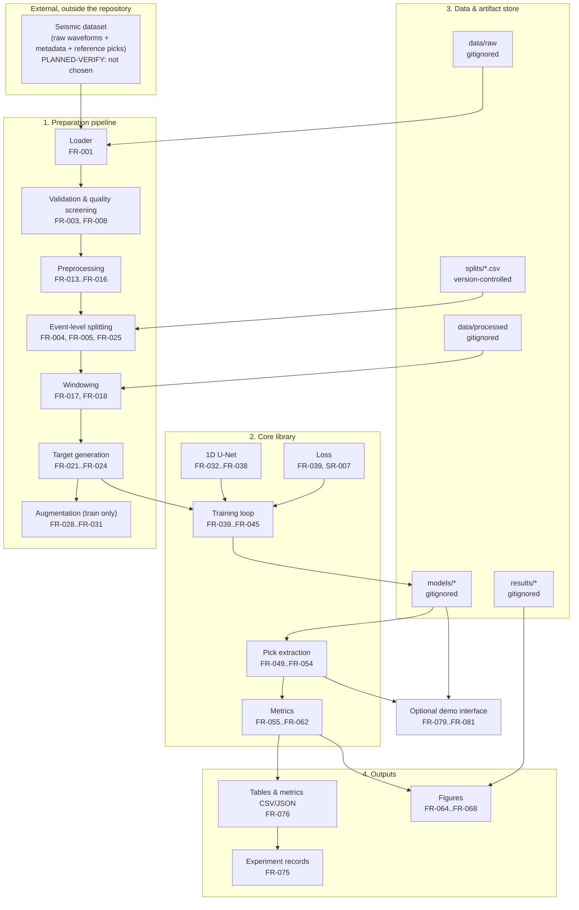
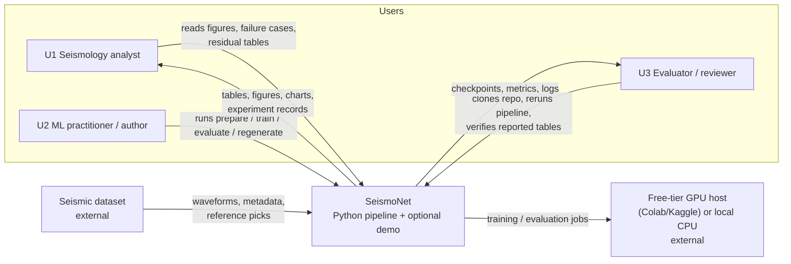
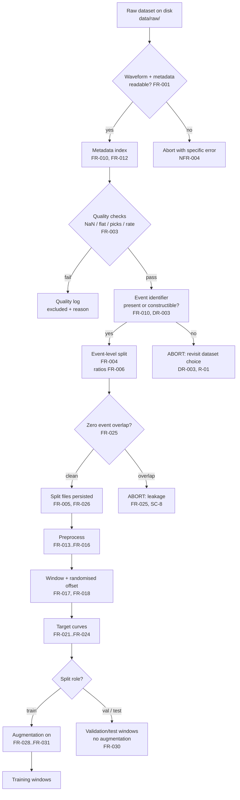
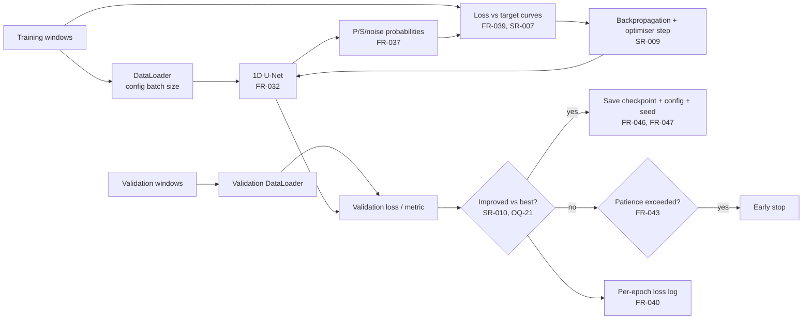
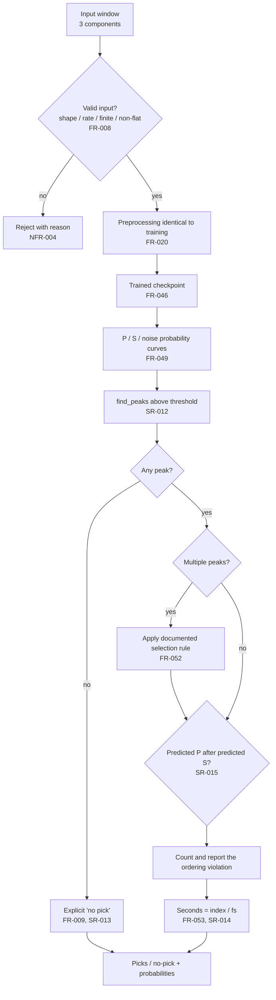
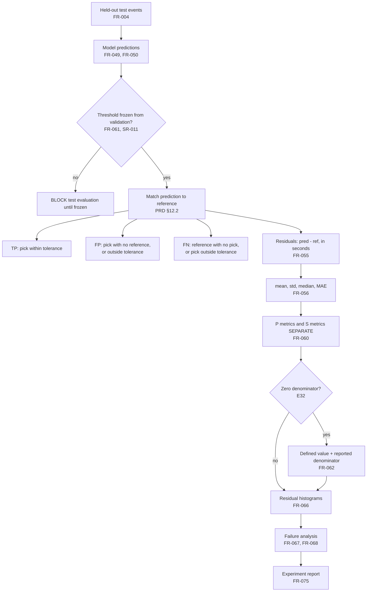
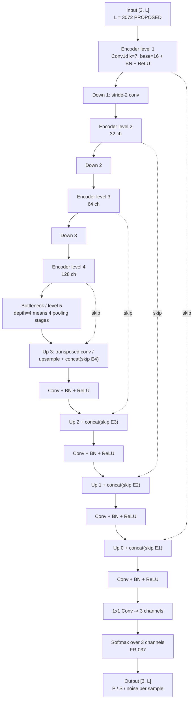

# SeismoNet — Technical Architecture

**Document ID:** ARCH-001
**Version:** 1.0
**Date:** 2026-10-17
**Status:** Design specification. **Nothing described here is implemented.** See `PROJECT_STATUS.md`.

---

## 0. Status and how to read this document

This document specifies the architecture SeismoNet **should** have. At the time of writing the repository contains only Markdown (`PRD.md`, `README.md`, `tech.md` and `docs/`); there is no `src/`, no tests, no configuration and no data. See `AUDIT_REPORT.md` §4.

Consequently, every component below is labelled:

- **[PROPOSED]** — a design decision awaiting implementation.
- **[PLANNED-VERIFY]** — proposed, but contingent on a fact that has not been established (most commonly the dataset choice, `OQ-3`).
- **[DECIDED]** — a constraint that is genuinely fixed because it comes from the problem statement (for example: the output is P/S/noise probabilities per time step).

There are currently **no** `[IMPLEMENTED]` components. When implementation begins, this document must be updated alongside the code, with the label changed per component, and the change recorded in `change-log/`.

Requirement identifiers (`FR-*`, `NFR-*`, `SR-*`, `DR-*`) refer to `../PRD.md`. Edge-case identifiers (`E*`) refer to `../docs/archive/PRD-v0.1-original.md` §9.

---

## 1. Architecture overview

SeismoNet is a **single-process, single-machine Python research pipeline**. It is deliberately not a service.

Three pipelines share one set of components:

1. **A preparation pipeline** that turns a raw labelled dataset into reproducible, event-split, windowed, labelled tensors.
2. **A training pipeline** that fits a 1D U-Net on those tensors and produces a checkpoint with a configuration snapshot.
3. **An evaluation pipeline** that consumes a checkpoint and produces picks, metrics, figures and failure analyses.

An optional fourth pipeline — a demonstration interface — wraps the evaluation/inference components only, and is built last.

**Reading of the diagram.** Everything left of the dashed boundary between "External" and the rest is supplied by the project owner, not by the code. `data/raw` and the chosen dataset are `[PLANNED-VERIFY]`.

---

## 2. Architecture principles

These principles justify the shape of the rest of the document. Each is a decision with a rationale; the fuller argument, including alternatives, is in `REASONING_AND_DECISIONS.md`.

| # | Principle | Consequence |
|---|---|---|
| P-1 | **One language, one process, one machine.** | No services, no inter-process protocol, no database, no scheduler. A pipeline is a sequence of function calls and CLI entry points. |
| P-2 | **The scientific parameters live in configuration, not in code.** | Everything in `SR-001`…`SR-017` is a config field (`FR-077`). An experiment is a config file, not a code branch. |
| P-3 | **The label, metric and picking logic must be testable without the dataset.** | These modules take arrays and return arrays; a synthetic fixture with a known P and S onset replaces the dataset in tests (`NFR-010`, `TESTING_STRATEGY.md`). |
| P-4 | **Reproducibility is a property of the artifact set, not of the code alone.** | A checkpoint is meaningful only with its config snapshot, seed, split identity and code commit (`FR-042`, `FR-047`). |
| P-5 | **The split is a first-class artifact and a hard gate.** | Split files are written to disk and version-controlled, and a zero-overlap check runs both as a test and as a guard at training start (`FR-005`, `FR-025`). |
| P-6 | **Test-time data must be untouchable until the protocol is frozen.** | Threshold selection happens on validation only; test evaluation is one shot with a frozen config (`FR-061`, `SR-011`). |
| P-7 | **Optimise for inspectability over abstraction.** | A ~50-line training loop, plain functions, and readable config files beat a framework that hides the science. |
| P-8 | **Do not add infrastructure without a stated requirement.** | No database, no container orchestration, no message queue, no cloud storage. If a requirement later demands one, the change goes through an ADR. |
| P-9 | **Fail loudly and specifically.** | No silent exception swallowing in data or model paths (`NFR-004`). An event-overlap breach or an incompatible window length aborts with a specific message. |
| P-10 | **Artifacts are traceable.** | Every figure and table can be traced to a config, a checkpoint, a split file and a command (`SC-10`). |

---

## 3. System context

**External interfaces, in full.** This list is exhaustive on purpose; anything not on it is out of scope by construction (§7.2 of `../PRD.md`).

| Interface | Direction | Purpose | Status |
|---|---|---|---|
| Dataset files on disk | in | waveforms, metadata, reference picks | `[PLANNED-VERIFY]` (`OQ-3`) |
| Dataset download (direct or via SeisBench) | in | acquisition | `[PROPOSED]`, may require registration (`R-01`) |
| Free-tier or local compute | out | training and evaluation execution | `[PROPOSED]` (`A6`) |
| Filesystem (configs, splits, checkpoints, results) | in/out | persistence | `[DECIDED]` |
| Git/GitHub | in/out | source, documents, small split/metadata files | `[DECIDED]` |
| Optional demo interface (browser, local) | in/out | interactive inspection | `[PROPOSED]`, optional |
| **No** network service, **no** database, **no** message broker, **no** external API | — | — | `[DECIDED]` by scope |

---

## 4. Major components

Proposed module boundaries. Names are indicative; the *boundaries* are the architectural decision, not the filenames.

| Component | Proposed path | Responsibility | Requirement IDs | Status |
|---|---|---|---|---|
| Configuration | `src/config.py`, `configs/*.yaml` | Load, validate, snapshot and hash experiment configuration | `FR-077`, `FR-042`, `FR-047` | `[PROPOSED]` |
| Dataset access | `src/data/load.py` | Read a dataset into waveforms + metadata + picks | `FR-001`, `FR-002` | `[PLANNED-VERIFY]` |
| Quality screening | `src/data/quality.py` | Detect NaN/Inf, flat, missing picks, rate mismatch; write quality log | `FR-003` | `[PROPOSED]` |
| Metadata handling | `src/data/metadata.py` | Event-ID construction/normalisation, metadata index, stratification fields | `FR-010`, `FR-011`, `FR-012` | `[PROPOSED]` |
| Splitting | `src/data/split.py` | Event-level split, persistence, zero-overlap verification | `FR-004`, `FR-005`, `FR-025`, `FR-026`, `FR-027` | `[PROPOSED]` |
| Preprocessing | `src/data/preprocess.py` | Detrend, demean, normalise, optional filter, optional resample | `FR-013`…`FR-016`, `FR-020` | `[PROPOSED]` |
| Windowing and targets | `src/data/window.py`, `src/data/labels.py` | Fixed-length windows, randomised offsets, Gaussian targets, noise remainder | `FR-017`…`FR-024` | `[PROPOSED]` |
| Augmentation | `src/data/augment.py` | Independently switchable, training-only, label-consistent augmentation | `FR-028`…`FR-031`, `FR-071` | `[PROPOSED]` |
| PyTorch dataset glue | `src/data/dataset.py` | `Dataset`/`DataLoader` adapters | `FR-017` | `[PROPOSED]` |
| Model | `src/model/unet1d.py` | 1D U-Net; shape/depth assertions; softmax output | `FR-032`…`FR-038` | `[PROPOSED]` |
| Loss | `src/model/losses.py` | Probability-aware loss against target curves | `FR-039`, `SR-007` | `[PROPOSED]` |
| Training loop | `src/train.py` | Seeding, training, validation monitoring, checkpoint selection, early stopping | `FR-039`…`FR-048` | `[PROPOSED]` |
| Inference | `src/predict.py` | Load checkpoint, validate input, produce probability curves, extract picks | `FR-008`, `FR-009`, `FR-049`…`FR-054` | `[PROPOSED]` |
| Metrics | `src/eval/metrics.py` | TP/FP/FN matching, residuals, P/S-separated precision/recall/F1 | `FR-055`…`FR-063` | `[PROPOSED]` |
| Experiment driver | `src/experiments/*` | Noise sweep, one-factor ablation, seed repeats; experiment records | `FR-069`…`FR-075` | `[PROPOSED]` |
| Reporting | `src/report/figures.py`, `src/report/tables.py` | Waveform/pick/probability figures, residual histograms, galleries, CSV/JSON export | `FR-064`…`FR-068`, `FR-076`, `FR-078` | `[PROPOSED]` |
| Optional interface | `app/` | Streamlit/Gradio viewer | `FR-079`…`FR-081` | `[PROPOSED]`, optional, last |

---

## 5. Component responsibilities and contracts

For each component, four things matter architecturally: what it receives, what it returns, what it must never do, and what it may assume.

| Component | Input | Output | Must never | May assume |
|---|---|---|---|---|
| Config | YAML path, optional overrides | Validated config object + snapshot file + hash | Invent a scientific default silently; read a value not declared in the schema | Every scientific parameter is declared |
| Loader | Dataset root path, subset limit | Waveforms (`[3, L]`, float32), sampling rate, pick indices, metadata records | Modify raw files in place; assume a sampling rate it has not read | Raw data is read-only (`NFR-009`) |
| Quality screening | Records from loader | Kept records; quality log with per-record reason | Silently drop a record without a log entry | Nothing about label quality |
| Splitting | Metadata index, ratios, seed | Split files; overlap verdict | Fall back to trace-level splitting if event IDs are missing | Event IDs exist (else abort, `DR-003`) |
| Preprocess | Waveform, config | Preprocessed waveform, same shape | Use dataset-global statistics computed across splits (`SR-005`) | Per-window statistics are sufficient |
| Windowing/targets | Preprocessed trace + picks + config | Window tensors + three target curves | Emit a target whose P+S+noise ≠ 1 (`FR-023`) | Picks are indices into the trace |
| Augmentation | Window + targets + config toggles | Augmented window + consistently moved targets | Apply to validation/test (except the noise experiment) | Each toggle is independent |
| Model | `[batch, 3, L]` | `[batch, 3, L]` logits/probabilities | Accept `L` incompatible with depth (`FR-036`) | `L` divisible by `2^depth` |
| Training | DataLoaders, model, config | Checkpoint + config + logs | Select the checkpoint by a criterion chosen after training | Validation data is not test data |
| Inference | Checkpoint, validated window, config | Three probability curves; P/S picks or explicit "no pick" | Fabricate a pick below threshold (`FR-009`) | Preprocessing matches training (`FR-020`) |
| Metrics | Predicted picks, reference picks, tolerance | Per-phase residuals and precision/recall/F1 with denominators | Report a combined-only P+S score (`FR-060`) | The matching rule is the documented one |
| Reporting | Metrics, predictions, waveform | Figures, CSV/JSON, galleries | Emit a table without its tolerance, threshold and rule (`FR-058`, `NFR-002`) | — |
| Optional interface | Checkpoint, user-selected recording | Rendered waveform + picks + curves | Persist uploads by default (`FR-080`) | Input validation is the same as CLI |

---

## 6. Data flow

### 6.1 Preparation data flow (detailed)

Notes that matter:

- **Preprocessing occurs before splitting, but split assignment occurs before any statistics are computed.** Normalisation statistics are per-window (`SR-005`), so ordering here is safe. A future change to dataset-global normalisation would have to move preprocessing after splitting, and that would be an architectural change requiring an ADR.
- **The split is decided on metadata, before windows exist**, so that random window offsets cannot leak a neighbouring window of a test event into training.
- **Masking for resampling:** if resampling is used, pick indices must be converted via time, not scaled as integers (`R-12`, `FR-016`).

### 6.2 Training data flow

### 6.3 Inference data flow

### 6.4 Evaluation data flow

**Ordering constraint (important).** The evaluation pipeline is *not* run on test data until the threshold, tolerance and matching rule are frozen and recorded. Enforced by process and by a config assertion (`FR-061`).

---

## 7. Model architecture

`[PROPOSED]`. Depth, width and kernel size are configuration values (`SR-008`, `FR-035`); the structure below is the baseline proposal, not a fixed commitment.

### 7.1 Structure

### 7.2 Architectural requirements

| Aspect | Requirement | Rationale |
|---|---|---|
| Input shape | `[3, L]`, float32, channels `(Z, N, E)` | `SR-001`, `FR-033` |
| Output shape | `[3, L]`, probabilities summing to 1 per sample | `FR-034`, `FR-037` |
| Skip connections | Between every encoder level and its matching decoder level | Preserves per-sample timing precision; the reason a U-Net suits picking (`REASONING_AND_DECISIONS.md` D-01) |
| Depth compatibility | `L` must be divisible by `2^depth`; assert and fail with a specific message | `FR-036`; `L = 3072 = 3 × 1024` satisfies depth 4 |
| Configurability | Depth, base channels, kernel size all config-driven | `FR-035`; required for EX-2 |
| Downsampling | Stride-2 convolutions (proposal), not pooling | Keeps the implementation explicit and the length arithmetic simple |
| Normalisation | BatchNorm per level | Standard; aids optimisation on small batches |
| Activation | ReLU in hidden layers; softmax only at output | `FR-037` |
| Parameter count | Logged at training start | `FR-038`, and needed to weigh any EX-2 gain against cost |

### 7.3 Why headline numbers are *not* in this section

Depth, width and kernel size are `[PROPOSED]` values with a stated rationale (`SR-008`) and are ablated in EX-2. Nothing in this document claims they are optimal, because no experiment has been run. `OQ-12` records that the ablation factor list itself is still open.

---

## 8. Training architecture

`[PROPOSED]`. See `SYSTEM_FLOW.md` Workflow A for the stage-by-stage contract.

| Aspect | Baseline proposal | Requirement | Decision status |
|---|---|---|---|
| Optimiser | Adam or AdamW, `lr = 1e-3` | `SR-009` | `[PROPOSED]` |
| LR schedule | `ReduceLROnPlateau` on validation loss | `SR-009` | `[PROPOSED]` |
| Loss | Soft cross-entropy against Gaussian targets | `SR-007`, `FR-039` | `[PROPOSED]`, `OQ-9` |
| Batch size | not fixed | `SR-009` | `[OPEN]`, budget-dependent |
| Epoch budget | not fixed; early stopping configured | `FR-043` | `[OPEN]`, `OQ-20` |
| Validation cadence | every epoch | `FR-040` | `[PROPOSED]` |
| Checkpoint criterion | lowest validation loss (alt: best validation P/S F1) | `SR-010` | `[OPEN]`, `OQ-021` |
| Checkpoint format | weights-only, safe serialisation | `FR-046` | `[PROPOSED]` |
| Checkpoint metadata | config, seed, split id, selecting metric, code commit | `FR-047` | `[PROPOSED]` |
| Precision | AMP if a CUDA device is available; otherwise full precision | `NFR-006` | `[PROPOSED]`; note the audit finding that the installed torch is CPU-only |
| Seeding | Python, NumPy, PyTorch (and CUDA where applicable) | `FR-041` | `[PROPOSED]` |
| Augmentation | switchable per type; noise separable; training only | `FR-028`…`FR-031` | `[PROPOSED]` |
| Sanity gate | overfit a tiny batch before the real run | `FR-044` | `[PROPOSED]` |

**Mandatory pre-training guards** (fail loudly, `NFR-004`):

1. Zero event-ID overlap across splits (`FR-025`).
2. Window length divisible by `2^depth` (`FR-036`).
3. All scientific config fields present and in range (`FR-077`).
4. Config snapshot written before the first optimiser step (`FR-042`).

**Anti-collapse monitoring.** Per-class output statistics and P/S metrics are logged, not just total loss; a model that predicts all-noise is a training failure, not a result (`E30`, `E31`).

---

## 9. Inference architecture

`[PROPOSED]`. See `SYSTEM_FLOW.md` Workflow B.

| Stage | Rule | Requirement |
|---|---|---|
| Input validation | exactly 3 components; expected sampling rate; expected length; finite values; non-flat | `FR-008` |
| Preprocessing | identical to training, except no augmentation | `FR-020` |
| Forward pass | checkpoint → `[3, L]` probability curves | `FR-049` |
| Peak finding | `find_peaks` above the frozen threshold, per phase channel | `SR-012`, `FR-050` |
| Multi-peak rule | documented deterministic rule; baseline is highest peak above threshold | `FR-052`, `OQ-10` |
| No peak | explicit "no pick" object, never a fabricated value | `FR-009`, `SR-013` |
| Ordering | count and report P-after-S; enforcement is `[OPEN]` | `SR-015`, `OQ-17` |
| Units | `seconds = sample_index / sampling_rate`; absolute time only if a trace start time exists | `FR-053`, `SR-014` |
| Batching | deterministic ordering so results are comparable across runs | `FR-026` |
| Threshold provenance | the value must be identifiable as validation-selected | `FR-051`, `FR-061` |

**Interface note.** The inference entry point is designed to be callable both from the CLI and from the optional demo interface, so that the interface never re-implements validation or picking logic. That single-call-path decision is what makes the optional app cheap and safe (`FR-081`).

---

## 10. Evaluation architecture

`[PROPOSED]`. See `SYSTEM_FLOW.md` Workflow C.

| Aspect | Rule | Requirement |
|---|---|---|
| Residual definition | `pred − ref`, in seconds, sign convention stated | `FR-055` |
| Statistics | mean, standard deviation, median, MAE per phase | `FR-056` |
| Metrics | precision, recall, F1 at a declared tolerance | `FR-057` |
| Tolerance | configurable; stated in every table; frozen before test | `FR-058`, `SR-016` |
| Matching rule | declared TP/FP/FN, including that an out-of-tolerance pick counts as both FP and FN | `FR-059` (`../PRD.md` §12.2) |
| Phase separation | P and S reported separately; never combined-only | `FR-060` |
| Test discipline | test evaluated once, after model and threshold selection | `FR-061`, `NFR-003` |
| Degenerate cases | defined return value plus reported denominator | `FR-062`, `E32` |
| Assumption disclosure | at most one P and one S pick per window, stated in the report | `FR-063`, `A4` |
| Stratification | by SNR / distance / magnitude where the metadata exists | `FR-011`, `FR-046` |
| Traceability | each table records tolerance, threshold, rule, split id, checkpoint id, window count | `NFR-002`, `SC-10` |

**Why a separate module.** Metrics are the most-tested component in the project precisely because they are the least forgiving: an off-by-one in the matching rule changes every reported number while the pipeline still "runs" (`TESTING_STRATEGY.md`).

---

## 11. Storage and artifact management

| Artifact | Proposed location | Size class | Version-controlled? | Requirement |
|---|---|---|---|---|
| Raw dataset | `data/raw/` | large | **No** — gitignored | `NFR-009`, `FR-048` |
| Generated windows/targets | `data/processed/` | large | **No** — regenerable | `FR-048` |
| Metadata index | `data/metadata/*.csv` | small | Yes | `FR-012` |
| Split files | `splits/*.csv` | small | **Yes** — the split is a result | `FR-005`, `FR-026` |
| Quality log | `results/quality/*.csv` | small | Yes (it is evidence) | `FR-003`, `SC-9` |
| Config snapshots | `models/<run_id>/config.yaml` | tiny | Yes (tiny and essential) | `FR-042` |
| Checkpoints | `models/<run_id>/weights.*` | medium | **No** — gitignored | `FR-046` |
| Training logs | `models/<run_id>/log.csv` | small | Yes | `FR-040` |
| Predictions | `results/<run_id>/*.csv` | medium | **No** | `FR-076` |
| Metrics tables | `results/<run_id>/metrics.csv` | small | Yes | `FR-076` |
| Figures | `results/<run_id>/figures/*` | medium | Regenerate, do not commit | `FR-078` |
| Experiment records | `reports/experiments/*.md` | small | Yes | `FR-075` |
| Notices | `NOTICE` | small | Yes | `DR-005`, `NFR-013` |

**Rationale for the split between committed and ignored.** Anything that is (a) small, (b) not reproducible without a long run or a download, and (c) needed to interpret a number, is committed. Anything large or cheaply regenerable is ignored. Split files are on the committed side because a different split makes every downstream number incomparable — the split *is* part of the result (`FR-005`).

**`.gitignore` does not exist yet.** It is the first action of roadmap phase P0 (`R-16`, `FR-048`).

**No database.** The dataset format already carries waveforms and metadata; splits, metrics and results are small tabular files that pandas reads directly. A database would duplicate existing structure and add a dependency with no requirement behind it (`P-8`; `TECH_STACK.md`).

---

## 12. Configuration management

**One YAML file per run.** Plain YAML is used rather than a configuration framework, because a mini-project's config surface is small and inspectable; Hydra/OmegaConf is listed as a later option if ablations multiply (`TECH_STACK.md`, `tech.md` §1).

Proposed config sections and their sources. **No default below is a stakeholder requirement; each traces to `SR-*` and is ablatable.**

| Section | Representative fields | Requirement |
|---|---|---|
| `data` | dataset path, subset limit, component order, expected sampling rate | `FR-001`, `FR-007`, `SR-001`, `SR-002` |
| `split` | ratios, seed, split file path, event-ID construction rule | `FR-004`…`FR-006`, `FR-026` |
| `preprocess` | detrend, demean, normalise method, filter on/off + corners, resample target rate | `FR-013`…`FR-016`, `SR-005` |
| `windowing` | window length, randomise offset, noise-window fraction | `FR-017`…`FR-019`, `SR-004` |
| `labels` | target shape, Gaussian σ, clipping rule | `FR-021`…`FR-024`, `SR-006` |
| `augment` | one boolean per augmentation; noise addition separate | `FR-028`…`FR-031` |
| `model` | depth, base channels, kernel size | `FR-035`, `SR-008` |
| `train` | optimiser, lr, scheduler, batch size, epochs, patience, seed, checkpoint criterion | `FR-039`…`FR-043`, `SR-009`, `SR-010` |
| `loss` | loss name and parameters | `FR-039`, `SR-007` |
| `pick` | threshold source, threshold value, minimum separation, multi-peak rule | `FR-050`…`FR-052`, `SR-011`, `SR-012` |
| `eval` | tolerances, matching rule id, stratification bins | `FR-055`…`FR-059`, `SR-016` |
| `noise` | noise type, SNR definition, levels, noise seed | `FR-069`…`FR-071`, `SR-016` |
| `experiment` | run id, factors varied, seed list, output dir | `FR-073`…`FR-075` |
| `repro` | code commit, dependency lockfile reference | `FR-082`, `NFR-001` |

**Rules.**

1. Config is **schema-validated** on load; an unknown key or an out-of-range value fails loudly (`NFR-004`).
2. The config is **snapshotted** next to the checkpoint before training starts (`FR-042`).
3. The config is **hashed**; the hash is stored with the checkpoint (`FR-047`).
4. **No scientific parameter may be hard-coded** in a module (`FR-077`). A reviewer changing σ from 10 to 20 must edit YAML only.
5. A config that produced a reported number is **preserved** even if later superseded (`change-log` rules).

---

## 13. Error handling

**Principle: fail loudly, specifically, and early** (`NFR-004`, `P-9`).

| Failure | Detection point | Behaviour | Requirement |
|---|---|---|---|
| Dataset path missing / unreadable | loader | Abort with the path and the reason | `FR-001` |
| Component count ≠ 3 | loader / inference validation | Exclude (load) or reject (inference) with reason | `FR-008`, `SR-001` |
| Component order not identifiable | loader | Exclude; never guess | `SR-002` |
| NaN / Inf samples | quality screening | Exclude, log trace id and reason | `FR-003`, `E10` |
| Flat / zero-variance trace or channel | quality screening / normalisation | Exclude dead traces; never divide by zero | `FR-003`, `E11` |
| Sampling rate mismatch | loader / quality screening | Resample with anti-aliasing or exclude; log which | `FR-016`, `E18` |
| Missing reference pick | quality screening | Exclude from the phase's evaluation; log count | `FR-003`, `E7` |
| S ≤ P in reference picks | quality screening | Flag as data-quality error and log | `E5` |
| Event IDs unavailable | splitting | **Abort** with a message pointing at `DR-003` | `FR-010`, `DR-003` |
| Event overlap across splits | training-start guard | **Abort**; this is a correctness failure, not a warning | `FR-025`, `SC-8` |
| Window length not divisible by `2^depth` | model construction | Raise a specific error naming both values | `FR-036` |
| Config value missing / out of range | config load | Fail loudly, no silent default | `FR-077` |
| No peak above threshold | inference | Explicit "no pick"; not an exception | `FR-009` |
| Checkpoint incompatible with config/model | inference | Abort; never partially load | `FR-046` |
| Test evaluation attempted before protocol freeze | evaluation driver | Refuse to run | `FR-061` |
| Training collapse to all-noise | monitoring | Flag as a training failure, not a result | `E30` |
| Metric denominator zero | metrics | Defined value plus reported denominator | `FR-062`, `E32` |

**What is deliberately *not* an error:** a pick outside tolerance, a missed phase, a P-after-S prediction. These are measured outcomes and are counted and reported (`FR-054`), not raised.

---

## 14. Logging and monitoring

`[PROPOSED]`. Deliberately file-based; no logging service.

| Log | Contents | Location | Requirement |
|---|---|---|---|
| Data-quality log | trace id, exclusion reason, sampling rate, pick availability | `results/quality/*.csv` | `FR-003`, `SC-9` |
| Split manifest | event id → split, ratios, seed | `splits/*.csv` | `FR-005` |
| Training log | epoch, train loss, validation loss, LR, per-class output statistics, elapsed time | `models/<run_id>/log.csv` | `FR-040` |
| Run manifest | config hash, seed, dependency lockfile reference, code commit | `models/<run_id>/run.json` | `FR-047` |
| Inference summary | counts of no-pick, multi-peak and P-after-S cases per run | `results/<run_id>/summary.json` | `FR-054` |
| Experiment record | hypothesis, config, seed, metrics, interpretation | `reports/experiments/*.md` | `FR-075` |

**Monitoring during training** is limited to what a research mini-project needs: loss curves, learning rate, per-class output statistics (to detect collapse), and wall-clock time. There is no alerting, no dashboard and no metrics server, because no requirement asks for them (`P-8`).

**One monitoring rule is non-negotiable:** total loss alone is not sufficient evidence of a working model, because a large majority of samples are noise. Per-class statistics and P/S metrics must be inspected (`E31`).

---

## 15. Testing strategy

Full detail is in `TESTING_STRATEGY.md`. The architectural points:

| Level | Architectural implication |
|---|---|
| Unit tests on labels, metrics, picking, conversion | These modules must be **pure array-in / array-out functions**, not tangled with file I/O or training state (`P-3`). This is the strongest structural constraint in the design. |
| Synthetic fixture | A small hand-built 3-component waveform with a known P and a later known S is the ground truth for the whole chain. It must be constructible without the real dataset. |
| Integration test on the data path | Loader → screening → split → window → target must be runnable on the synthetic fixture. |
| Shape and depth assertion tests | The model's length arithmetic must be verifiable without training. |
| Zero-overlap leakage test | The split module must expose an overlap check callable as a pure function, so it can be both a test and a training-start guard. |
| Training smoke test | Overfit a tiny batch (`FR-044`) — the cheapest end-to-end check of the loss, optimiser and shape wiring. |
| Determinism test | Seeding must be centralised in one place (config → training entry point) so it cannot be applied inconsistently. |
| Regeneration test | The reporting layer must be deterministic and independent of training, so `FR-078` is testable without retraining. |

**Layer coupling rule.** `src/data`, `src/model`, `src/eval` must not import each other's internals. Training and inference are the composition layer; reporting consumes persisted artifacts only. This keeps the optional interface (`app/`) a thin wrapper (`FR-081`) and keeps unit tests cheap.

---

## 16. Reproducibility

Full detail is in `REPRODUCIBILITY.md`. Architectural implications:

1. **Seeding is centralised** at the training entry point, covering Python, NumPy and PyTorch, and is recorded in config (`FR-041`).
2. **The split is persisted and committed**, so it cannot silently change (`FR-005`, `FR-026`).
3. **A checkpoint is an artifact *set***, never a bare weights file: weights + config snapshot + seed + split id + selecting metric + code commit (`FR-047`).
4. **The reporting layer is deterministic** and runs from saved artifacts, so regeneration is independent of retraining (`FR-078`, `SC-6`).
5. **Dependencies are pinned** in a lockfile (`FR-082`). Note the audit finding that the installed PyTorch is CPU-only and the Python version is 3.14.3 while `tech.md` recommends 3.11/3.12 — this must be resolved at P0 or reproducibility claims are premature (`R-15`).
6. **GPU non-determinism is disclosed, not hidden**: the reported tolerance for "same result" must state what residual variation remains (`NFR-001`, `US-07`).

---

## 17. Security and data integrity

The threat surface is small because there is no service, no database and no multi-user access. The realistic risks are file-borne.

| Risk | Mitigation | Requirement |
|---|---|---|
| Malicious pickle in a downloaded checkpoint (a known PyTorch hazard) | Store and load weights only; use a safe serialisation format; never load checkpoints from untrusted sources | `FR-046`, `NFR-015` |
| Oversized or malformed waveform input (optional interface) | Enforce size limits, component/rate/length checks and finite-value checks **before** parsing or inference | `FR-008`, `FR-080` |
| Vulnerability in a pinned dependency | Lockfile plus a dependency audit step in CI | `FR-082`, `NFR-015` |
| Committed secrets | No credentials anywhere; environment variables only; a repository scan before publishing | `NFR-015` |
| **Accidental commit of a large dataset or checkpoint** (real risk here: `.gitignore` does not exist) | Add `.gitignore` before any data work | `FR-048`, `R-16` |
| Dataset licence violation | Record licence and attribution terms before use | `DR-005`, `NFR-013` |
| Raw data mutated in place | Read-only treatment of `data/raw/`; all derived data written elsewhere | `NFR-009` |

**No secrets are present in the repository**, and none should be. The audit confirmed the working tree is clean and contains only Markdown.

---

## 18. Performance considerations

No performance target is set, because none can be justified before a baseline exists (`NFR-006` is **TBD**). What is architecturally relevant:

| Consideration | Position | Requirement |
|---|---|---|
| Compute budget | One free-tier GPU or an equivalent CPU fallback; dataset subset support | `FR-007`, `A6`, `OQ-20` |
| Local hardware reality | RTX 2050 with 4 GiB VRAM, but the installed PyTorch is CPU-only, so local training is currently CPU-bound | audit §7.3, `R-06` |
| Model size | Deliberately small (depth 4, base 16, kernel 7) so it fits a small device; parameter count reported | `FR-038`, `SR-008` |
| Memory controls | Configurable batch size; window length fixed and modest; AMP when a CUDA device exists | `NFR-007`, `SR-009` |
| Data loading | Read once, cache derived windows to `data/processed/` rather than recomputing per epoch | `NFR-006` |
| Inference cost | Small model, CPU inference is acceptable; ONNX conversion is an optimisation deliberately deferred | `TECH_STACK.md` |
| What is *not* optimised | No distributed training, no gradient accumulation tuning, no mixed precision on CPU, no memory profiling harness. None is required by the scope. | `P-8` |
| Measurement point | Actual training time and peak memory are recorded at the first baseline run and reported alongside any ablated gain, so a "better" configuration with a large cost is visible as such | `EXPERIMENT_PLAN.md` |

---

## 19. Deployment and demo strategy

**The core project is not deployed.** It runs locally or on a free-tier notebook host. This is a scope decision (`NG1`, `NG3`), not an oversight.

| Tier | Content | Position |
|---|---|---|
| Tier 1 — Core | Local/free-tier Python pipeline, filesystem artifacts | **Required** |
| Tier 2 — Optional demo | A single Streamlit (preferred) or Gradio app wrapping the inference entry point | **Optional**, built last (`FR-081`, `SCO-5`) |
| Tier 2 — Optional API | FastAPI + Uvicorn wrapping the same entry point, if an upload-and-predict demo is wanted | **Optional**, only if Streamlit is insufficient |
| Tier 3 — Scale-up | PostgreSQL, object storage, job queue, ONNX/TorchServe, container orchestration | **Not needed now** (`P-8`); would require an ADR and a stated requirement |

**Why Streamlit before any API.** Streamlit is Python-only, calls the inference function in-process, and renders existing Matplotlib/Plotly figures directly. An API would add a second runtime surface, a validation layer and serialisation concerns for a demo that has no multi-user requirement (`TECH_STACK.md`, `REASONING_AND_DECISIONS.md` D-10).

**Demo hosting.** If hosted at all, a free static-friendly host for a Streamlit/Gradio app is sufficient; a container-hosted API is only justified if the API tier is actually built. Kubernetes is not justified under any current requirement.

**Demo constraints carried from the rest of the design.** The app must reuse the CLI validation and picking code (`FR-008`, `FR-050`) rather than reimplementing it, must not persist uploads by default (`FR-080`), and must never be presented as an operational tool (`NFR-014`).

---

## 20. Architectural decisions and trade-offs

Each decision below is argued in full in `REASONING_AND_DECISIONS.md`, which also records alternatives, evidence needed to validate the choice, and conditions that would justify changing it.

| ID | Decision | Chosen because | Main alternative rejected | Trade-off accepted | Status |
|---|---|---|---|---|---|
| D-01 | 1D U-Net with per-sample three-class output | Skip connections preserve onset timing; the task is per-sample classification with long context | RNN/Transformer; sliding-window CNN classifier | More parameters than a threshold detector; needs labelled data | `[DECIDED]` by the problem statement; parameters `[PROPOSED]` |
| D-02 | P / S / noise as three classes | Noise must be represented explicitly so a quiet window produces no pick; matches the "probability of arrival" framing | Binary P and separate binary S | A single softmax couples the classes | `[DECIDED]` |
| D-03 | Gaussian target curves rather than exact indices | Reference onsets carry ±few-sample uncertainty; Gaussian targets tolerate it and yield peak-pickable curves | Hard one-hot labels; direct regression of pick time | σ is an extra parameter to tune and ablate | `[PROPOSED]` (`OQ-8`) |
| D-04 | Per-window normalisation | Removes instrument/unit scale without requiring instrument-response removal (out of scope) | Dataset-global statistics; no normalisation | Per-window statistics are noisy for very short windows | `[PROPOSED]` (`SR-005`) |
| D-05 | One common sampling rate, with anti-aliased resampling when needed | Sample indices, labels and tolerances are all rate-dependent | Mixed rates with per-trace bookkeeping | Resampling costs information and a conversion step | `[PROPOSED]` (`SR-003`, `R-12`) |
| D-06 | Event-level split, persisted and verified | The single largest source of inflated results in this problem class is event leakage | Random trace-level split | Requires event IDs (`DR-003`); can shrink per-class event counts | `[PROPOSED]`, effectively forced by rigour |
| D-07 | P and S reported separately | S is the common weak point and averaging hides it | Single combined score | More tables; no single headline number | `[PROPOSED]` (`FR-060`, `R-05`) |
| D-08 | Threshold and tolerance selected on validation and frozen before test | Prevents the test set from becoming a tuning set | Selecting the operating point on test | Requires a validation set large enough to be meaningful | `[PROPOSED]` (`FR-061`, `SR-011`) |
| D-09 | Controlled, fixed-seed noise experiments with a documented SNR | Isolates one variable and makes the sweep comparable | Testing on naturally varying noise | White Gaussian noise is not realistic seismic noise (`E35`) | `[PROPOSED]` (`FR-069`…`FR-071`) |
| D-10 | Streamlit (optional) after core validation; no API, no database, no orchestration | No requirement asks for a service; the science is the deliverable | FastAPI + Postgres + container orchestration from the start | No multi-user demo | `[PROPOSED]` (`P-8`) |
| D-11 | Config files + saved splits + checkpoint sets + pinned dependencies | Reproducibility is the project's own stated goal and success criterion `SC-6` | "Git commit is enough" | Small ongoing documentation overhead per run | `[PROPOSED]` (`FR-082`…`FR-084`) |
| D-12 | Plain PyTorch training loop, not Lightning | A ~50-line loop is transparent and explainable in a report | PyTorch Lightning | Loses built-in conveniences; must write the loop and checkpointing | `[PROPOSED]` |
| D-13 | File-based artifacts, no database | The dataset format already holds waveforms; splits and metrics are small tables | SQLite/Postgres for metadata and results | Manual file hygiene; `.gitignore` discipline required | `[PROPOSED]` (`TECH_STACK.md` §4) |
| D-14 | Two-phase order: data path before model, protocol freeze before experiments | The data path is where correctness hides; the protocol is what makes numbers meaningful | Start with the model, tune evaluation later | Slower to a "demo" moment | `[PROPOSED]` (`ROADMAP-001`) |

**Decisions that remain provisional and could change on evidence:** D-03 (σ), the model parameters under D-01, the checkpoint criterion, the loss function, the tolerance values, the SNR definition, and the entire optional tier. Each has an explicit `OQ-*` entry or an EX experiment that would resolve it.
