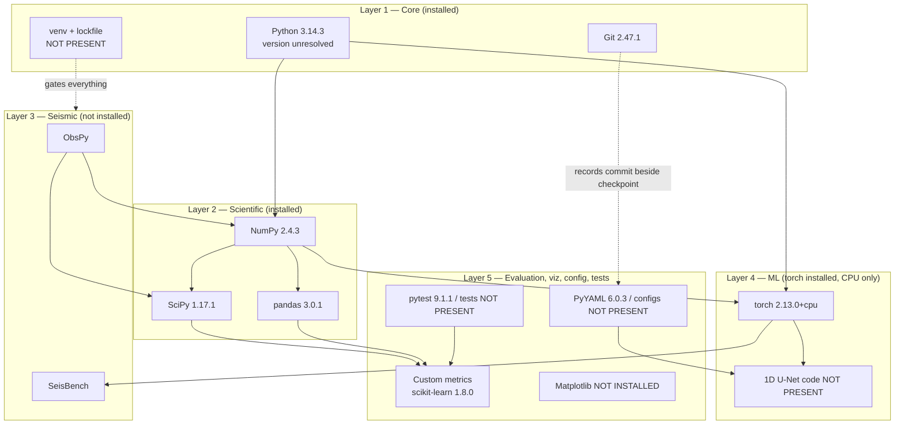

# SeismoNet — Technology Stack Specification

| Field | Value |
|---|---|
| **Document ID** | TECH-001 |
| **Version** | 1.0 |
| **Date** | 2026-10-17 |
| **Status** | Draft for review. Specification only. No technology in this document has been selected by installation. |
| **Purpose** | The canonical, layered technology stack specification for SeismoNet. |
| **Governing requirements** | [`FR-082`](../PRD.md) (pinned dependencies), [`FR-046`](../PRD.md) / [`FR-047`](../PRD.md) (safe checkpoints and their metadata), [`FR-077`](../PRD.md) (config-driven operation), [`FR-078`](../PRD.md) (documented regeneration command), [`NFR-001`](../PRD.md) / [`NFR-006`](../PRD.md) / [`NFR-007`](../PRD.md) / [`NFR-015`](../PRD.md), [`SR-007`](../PRD.md) / [`SR-008`](../PRD.md) / [`SR-009`](../PRD.md) |
| **Predecessor** | [`../tech.md`](../tech.md) — original tech stack recommendation v0.1, preserved unmodified. See §"Relationship to the original tech.md". |
| **Companion documents** | [TECHNICAL_ARCHITECTURE.md](TECHNICAL_ARCHITECTURE.md), [SYSTEM_FLOW.md](SYSTEM_FLOW.md), [REASONING_AND_DECISIONS.md](REASONING_AND_DECISIONS.md), [DEVELOPMENT_ROADMAP.md](DEVELOPMENT_ROADMAP.md), [TESTING_STRATEGY.md](TESTING_STRATEGY.md), [EXPERIMENT_PLAN.md](EXPERIMENT_PLAN.md), [DATASET_GUIDE.md](DATASET_GUIDE.md), [REPRODUCIBILITY.md](REPRODUCIBILITY.md), [PROJECT_STATUS.md](PROJECT_STATUS.md), [AUDIT_REPORT.md](AUDIT_REPORT.md), [change-log/CURRENT_STATUS.md](change-log/CURRENT_STATUS.md) |

---

## How to read this document

This document specifies what SeismoNet **proposes to use**, layer by layer, and records — for every item — whether that proposal has been verified in the actual environment. It does not describe a running system. At the time of writing the repository contains documentation only: no source code, no dependency manifest, no tests, no data, no models ([AUDIT_REPORT.md](AUDIT_REPORT.md) §4, implementation completeness 0 of 13 layers).

**Status labels used throughout (exact set, no others):**

| Label | Meaning |
|---|---|
| **Installed (verified)** | Present in the audit environment and confirmed by package introspection. Version as stated. |
| **Declared in documentation, not installed** | Named in `tech.md`, `README.md` or `PRD.md`, and **confirmed absent** from the audit environment. |
| **Proposed** | Recommended by this document as the intended choice. Installation state was **not verified** by the audit, so no claim is made either way. |
| **Not present** | A repository artifact (file, directory, workflow) that verifiably does not exist in the repository. |

No version number appears in this document unless it was verified by introspection. Every version that must be chosen later is marked **pin at implementation time**.

---

## Core development (Python, Git/GitHub, virtual environment + dependency management)

### Python

| Attribute | Detail |
|---|---|
| Purpose | The single implementation language for data loading, preprocessing, model, training, evaluation, visualisation and tests. |
| Why it is suitable | The seismology and ML ecosystem is Python-first: ObsPy, SeisBench and PyTorch are Python libraries. A single language keeps the pipeline small and reviewable (`NFR-005`). |
| Status | **Installed (verified)** — Python 3.14.3 (64-bit). This is **not** the version recommended by [`../tech.md`](../tech.md) (3.11 or 3.12). The discrepancy is unresolved; see "Environment reality check". |
| Depends on | The operating system (Windows, win32, PowerShell 5.1). |
| Depended on by | Every other item in this document. |
| Alternatives | Python 3.11 or 3.12 (recommended by `tech.md`); conda-provided interpreters. |
| Trade-offs | Python 3.14 is the newest line and wheel availability for the seismology stack (ObsPy, SeisBench) on it is **unverified**. Dropping to 3.11/3.12 costs a re-install but removes the largest known installation risk. The choice is roadmap Phase **P0** and assumption [`A-11`](../PRD.md) / risk [`R-15`](../PRD.md). |
| Requirement link | [`NFR-008`](../PRD.md) (portability), [`FR-082`](../PRD.md) |

### Git and GitHub

| Attribute | Detail |
|---|---|
| Purpose | Version control of source, tests, configuration and documentation; remote hosting for review and for the clean-clone reproduction path. |
| Why it is suitable | The repository already lives on GitHub; `NFR-012` and `SC-6` require a reviewer to go from a clean clone to a reproduced result, which presumes Git. |
| Status | **Installed (verified)** — git 2.47.1.windows.2. Remote `origin https://github.com/jahnavi-957/SeismoNet.git`, branch `main`, HEAD `eddb3b9`, working tree clean (audit §2). |
| Depends on | The local operating system. |
| Depended on by | CI (proposed), the regeneration procedure in [REPRODUCIBILITY.md](REPRODUCIBILITY.md), code-commit recording next to checkpoints ([`FR-047`](../PRD.md)). |
| Alternatives | Mercurial, no remote hosting. Neither is realistic here. |
| Trade-offs | Git does not store large artifacts well; datasets and checkpoints must be excluded via `.gitignore` ([`FR-048`](../PRD.md)), which **does not exist yet** (`Not present`). |
| Requirement link | [`FR-048`](../PRD.md), [`NFR-012`](../PRD.md), [`SC-6`](../PRD.md) |

### Virtual environment and dependency management

| Attribute | Detail |
|---|---|
| Purpose | Isolate the project's interpreter and packages from the system interpreter, and record exactly which package versions the project uses. |
| Why it is suitable | A pinned, isolated environment is the mechanism behind [`FR-082`](../PRD.md) and [`NFR-001`](../PRD.md): without it, a second machine cannot be brought to the same state. |
| Status | **Proposed.** `python -m venv` is part of the installed Python standard library, but **no project virtual environment was verified**: the audit did not establish whether the audited packages sit inside a venv, and no `venv/` or `.venv/` directory exists in the repository. `uv` and `pip-tools` are named in `tech.md` §6 but their presence was **not checked** by the audit, so they are labelled Proposed rather than installed or absent. |
| Depends on | Python 3.14.3 (or the version chosen at P0); for `uv`, a standalone binary that must be installed. |
| Depended on by | The lockfile, CI, the Docker image, and every reproduction step in [REPRODUCIBILITY.md](REPRODUCIBILITY.md). |
| Alternatives | `venv` + `pip` with a hand-maintained `requirements.txt`; `conda`/`mamba`; `poetry`; `uv`; `pip-tools`. |
| Trade-offs | `uv` and `pip-tools` give a true lockfile (exact transitive versions) with little effort; plain `pip freeze` output is fragile because it records irrelevant local packages. `conda` helps with native scientific wheels but adds a second package manager. **Decision is P0.** |
| Requirement link | [`FR-082`](../PRD.md), [`NFR-001`](../PRD.md), [`NFR-008`](../PRD.md) |

**Repository artifacts in this layer, all `Not present`:** `requirements.txt`, `pyproject.toml`, `uv.lock` / `requirements.lock`, `.python-version`, `environment.yml`, `setup.py` (audit §8: *no dependency manifest exists*).

---

## Scientific computing (NumPy, SciPy, pandas)

These three are the numerical substrate of the whole pipeline. All three are **Installed (verified)**, which is the strongest verified position of any layer in this document.

### NumPy

| Attribute | Detail |
|---|---|
| Purpose | N-dimensional arrays for waveforms, labels and probability tensors; RNG for seeded augmentation and splitting; file I/O for `.npy`. |
| Why it is suitable | Universal interchange format for the scientific Python stack; every other library here accepts or produces NumPy arrays. |
| Status | **Installed (verified)** — numpy 2.4.3. |
| Depends on | Python 3.14.3; native linear-algebra libraries bundled with the wheel (not verified in detail). |
| Depended on by | SciPy, pandas, scikit-learn, PyTorch (interop), ObsPy, SeisBench, Matplotlib, all SeismoNet code. |
| Alternatives | JAX arrays, plain Python lists/tuples (rejected: no vectorised maths). |
| Trade-offs | NumPy 2.x removed some deprecated APIs older libraries still touch; if ObsPy or SeisBench pin below NumPy 2, a conflict must be resolved at P0 — **unverified**. |
| Requirement link | [`FR-041`](../PRD.md) (seeding), [`SR-001`](../PRD.md) (window representation) |

### SciPy

| Attribute | Detail |
|---|---|
| Purpose | `scipy.signal` for filtering and `find_peaks` (the proposed peak detector), `scipy.stats` for residual statistics, `scipy.interpolate` where needed. |
| Why it is suitable | `find_peaks` is exactly the primitive [`FR-050`](../PRD.md) / [`SR-012`](../PRD.md) need: threshold plus peak-selection over a probability channel. Statistical tests on residuals come free. |
| Status | **Installed (verified)** — scipy 1.17.1. |
| Depends on | NumPy 2.4.3, Python 3.14.3. |
| Depended on by | ObsPy (declared dependency — verify at install time), scikit-learn, SeismoNet pick extraction and residual statistics. |
| Alternatives | Implement peak picking by hand (rejected: reinventing tested code); MNE-style toolboxes (out of scope). |
| Trade-offs | `find_peaks` returns all peaks; the multi-peak tie-break rule (`SR-012`, [`OQ-10`](../PRD.md)) is a project decision, not something SciPy decides for us. |
| Requirement link | [`FR-050`](../PRD.md), [`FR-052`](../PRD.md), [`FR-056`](../PRD.md), [`SR-007`](../PRD.md) |

### pandas

| Attribute | Detail |
|---|---|
| Purpose | Metadata tables (trace index, picks, event IDs), result tables, stratified reporting, CSV/Parquet round-trip. |
| Why it is suitable | [`FR-076`](../PRD.md) requires results export to CSV/JSON that "load cleanly in pandas"; split files and data-quality logs are tabular by nature. |
| Status | **Installed (verified)** — pandas 3.0.1. |
| Depends on | NumPy 2.4.3, Python 3.14.3. |
| Depended on by | SeisBench metadata handling (declared — verify), result export, MLflow run tables (optional), reporting code. |
| Alternatives | Polars, plain CSV with the `csv` module, SQLite. |
| Trade-offs | pandas 3.0 is a major release with behaviour changes relative to 1.x/2.x; any library that pins `pandas<3` will conflict. **Compatibility with the rest of the stack is unverified.** |
| Requirement link | [`FR-076`](../PRD.md), [`FR-011`](../PRD.md), [`FR-027`](../PRD.md) |

---

## Seismic data processing (ObsPy, SeisBench)

**Neither library in this layer is installed.** This is the largest gap between the plan and the environment.

### ObsPy

| Attribute | Detail |
|---|---|
| Purpose | Reading seismic waveform formats (miniSEED, SAC, and others), trace/time handling, and the classical STA/LTA baseline (`O-Opt1`). |
| Why it is suitable | The de-facto standard for seismic I/O; without it every supported format needs a hand-written parser. |
| Status | **Declared in documentation, not installed** — confirmed absent from the audit environment (audit §7.2, verified-absent list). |
| Depends on | Python, NumPy, SciPy; its plotting module additionally requires Matplotlib, which is also not installed. **ObsPy's own dependency pins were not verified.** |
| Depended on by | The waveform loader ([`FR-001`](../PRD.md)), the optional STA/LTA baseline ([`O-Opt1`](../PRD.md), `EX-7`), time conversion helpers ([`SR-014`](../PRD.md)). |
| Alternatives | Hand-written readers for the one format the chosen dataset uses; `h5py` directly if the dataset is HDF5; SeisBench's own loaders. |
| Trade-offs | **Compatibility with Python 3.14 is unknown** and is explicitly flagged by the audit (§7.3 discrepancy 1) as a plausible installation blocker. If the chosen dataset is HDF5-only (e.g. a SeisBench-native set), ObsPy may be needed only for the optional baseline — which would let it be deferred. |
| Requirement link | [`FR-001`](../PRD.md), [`DR-006`](../PRD.md), [`NFR-008`](../PRD.md) |

### SeisBench

| Attribute | Detail |
|---|---|
| Purpose | Standardised seismic dataset access, ready-made loader utilities, and pretrained picker implementations (PhaseNet lineage) for optional baselines. |
| Why it is suitable | Avoids hand-writing dataset loaders and provides a fair external reference model for `O-Opt2` / `EX-7`. |
| Status | **Declared in documentation, not installed** — confirmed absent from the audit environment (audit §7.2). |
| Depends on | PyTorch, pandas, NumPy, an HDF5 backend, and network access to download datasets. **Exact dependency set not verified.** |
| Depended on by | Dataset ingestion ([`FR-001`](../PRD.md)) *if* the chosen dataset is reached through SeisBench; optional pretrained-pick baselines. |
| Alternatives | Download a dataset directly (STEAD, INSTANCE, ETHZ) and write a small loader; use ObsPy only. |
| Trade-offs | SeisBench is the largest single addition to the environment and pulls in the most transitive dependencies. **Its compatibility with Python 3.14 and with the installed `torch 2.13.0+cpu` is unknown.** It also becomes unnecessary if [`OQ-3`](../PRD.md) selects a dataset reachable without it. |
| Requirement link | [`FR-001`](../PRD.md), [`DR-001`](../PRD.md)–[`DR-003`](../PRD.md), [`OQ-3`](../PRD.md) |

---

## Machine learning (PyTorch, 1D U-Net, loss functions, optimizers/schedulers, AMP)

### PyTorch

| Attribute | Detail |
|---|---|
| Purpose | Tensor computation, automatic differentiation, the `Dataset`/`DataLoader` machinery, model definition, checkpointing and inference. |
| Why it is suitable | `tech.md` §1 and the PRD both name it; SeisBench and the published pickers are PyTorch-native, so interoperability is straightforward. |
| Status | **Installed (verified)** — `torch 2.13.0+cpu`. **CUDA NOT available.** |
| Depends on | Python 3.14.3, NumPy 2.4.3. For a GPU build: an NVIDIA driver compatible with the selected CUDA wheels, plus the physical GPU. |
| Depended on by | The 1D U-Net ([`SR-008`](../PRD.md)), training loop ([`SR-009`](../PRD.md)), inference ([`FR-049`](../PRD.md)), SeisBench (if used), optional MLflow PyTorch autologging. |
| Alternatives | TensorFlow (confirmed **not installed**), JAX, plain NumPy (rejected: no autograd), PyTorch Lightning (rejected by `tech.md` §1 for transparency). |
| Trade-offs | The installed build is **CPU-only despite a physical NVIDIA GeForce RTX 2050 (4096 MiB VRAM, driver 592.27)**. Training therefore cannot use the GPU until a CUDA build is installed — a Phase **P0** decision (audit §7.3 discrepancy 2, risk [`R-15`](../PRD.md)). AMP is only meaningful once a CUDA build exists; on CPU it offers no benefit. Reinstalling a CUDA build changes the environment and therefore the reproducibility baseline — record whichever build is chosen in the lockfile. |
| Requirement link | [`NFR-006`](../PRD.md) (performance), [`NFR-007`](../PRD.md) (memory), [`NFR-001`](../PRD.md) (reproducibility), [`SR-009`](../PRD.md) |

### 1D U-Net (model architecture)

| Attribute | Detail |
|---|---|
| Purpose | Map a `[3, L]` three-component window to three per-sample class probabilities (P, S, noise). |
| Why it is suitable | The problem statement specifies a 1D U-Net inspired by PhaseNet `[GIVEN]`; skip connections preserve the fine timing precision a per-sample decision requires ([`SR-008`](../PRD.md)). |
| Status | **Proposed.** The architecture exists only as a specification: there is no `model.py` and no checkpoint anywhere in the repository (audit §10). Proposed baseline: depth 4, base 16 channels, kernel 7, BatchNorm + ReLU, softmax over three channels. |
| Depends on | PyTorch (`Conv1d`, `BatchNorm1d`, `Upsample`/transposed convolution). |
| Depended on by | Training, inference, every metric and figure. |
| Alternatives | A shallower encoder without skip connections; PhaseNet as a pretrained model rather than a re-implementation; EQTransformer (larger, heavier). |
| Trade-offs | Depth/base/kernel are all configurable because they are ablation factors ([`FR-035`](../PRD.md), [`OQ-12`](../PRD.md)). Window length `L` must be divisible by `2^depth` or construction must fail loudly ([`FR-036`](../PRD.md)); the proposed 3072 @ 100 Hz satisfies this but depends on [`OQ-4`](../PRD.md) closing. |
| Requirement link | [`SR-008`](../PRD.md), [`FR-032`](../PRD.md)–[`FR-038`](../PRD.md) |

### Loss functions

| Attribute | Detail |
|---|---|
| Purpose | Train the network against Gaussian-shaped soft targets rather than one-hot labels. |
| Why it is suitable | The targets are probability-shaped ([`SR-006`](../PRD.md)), so soft cross-entropy is the natural objective and the PhaseNet-lineage choice; MSE is retained as an ablation because it tends to over-smooth peaks. |
| Status | **Proposed** — baseline **soft cross-entropy**, ablation **MSE**. The choice is `[OPEN]` as [`OQ-9`](../PRD.md) and must be stated in config, not hard-coded ([`FR-077`](../PRD.md)). No loss function has been implemented or run. |
| Depends on | PyTorch (`F.cross_entropy` supports soft targets in current releases — **verify against the pinned version at implementation time**). |
| Depended on by | The training loop ([`FR-039`](../PRD.md)), the ablation experiment (`EX-2`). |
| Alternatives | MSE, focal loss, Dice-style losses, per-class weighted cross-entropy. |
| Trade-offs | Per-class weighting must be added **only if** an all-noise collapse is observed ([`R-08`](../PRD.md)), otherwise it tunes a problem that has not been shown to exist. |
| Requirement link | [`SR-007`](../PRD.md), [`FR-039`](../PRD.md), [`OQ-9`](../PRD.md) |

### Optimizers and schedulers

| Attribute | Detail |
|---|---|
| Purpose | Parameter updates and learning-rate control during training. |
| Why it is suitable | Adam/AdamW is the reliable default for this network family; a plateau scheduler removes the need to hand-design a decay schedule. |
| Status | **Proposed** — Adam or AdamW at lr 1e-3 with `ReduceLROnPlateau`. Batch size and epoch budget are **TBD** pending [`OQ-20`](../PRD.md) (compute budget) and [`NFR-006`](../PRD.md). Nothing has been trained. |
| Depends on | PyTorch optim and lr-scheduler modules. |
| Depended on by | The training loop, the checkpoint-selection criterion ([`SR-010`](../PRD.md)), early stopping ([`FR-043`](../PRD.md)). |
| Alternatives | SGD with momentum; cosine annealing; OneCycle; a hand-tuned step schedule. |
| Trade-offs | `ReduceLROnPlateau` depends on the validation signal, so it inherits any non-determinism in validation evaluation; AdamW decouples weight decay and is the safer default if regularisation is added. Exact values are config fields ([`FR-077`](../PRD.md)). |
| Requirement link | [`SR-009`](../PRD.md), [`SR-010`](../PRD.md), [`NFR-006`](../PRD.md) |

### Automatic mixed precision (AMP)

| Attribute | Detail |
|---|---|
| Purpose | Train faster and use less memory by computing in fp16/bf16 where safe. |
| Why it is suitable | `tech.md` §1 proposes it as a low-code speed-up; it maps to the compute and memory non-functional requirements. |
| Status | **Proposed, currently unusable.** The installed PyTorch is CPU-only, so the CUDA autocast path that AMP targets is not available. Usability depends entirely on the P0 decision to install a CUDA build. |
| Depends on | PyTorch AMP API; for meaningful speed-up, a CUDA-capable device. |
| Depended on by | Training time ([`NFR-006`](../PRD.md)) and peak memory ([`NFR-007`](../PRD.md)) — both targets are **TBD**, to be measured at milestone M4. |
| Alternatives | Full fp32 training (the default and the safest for reproducibility); `torch.compile` (not proposed). |
| Trade-offs | Mixed precision introduces hardware-dependent floating-point differences, which directly interacts with [`NFR-001`](../PRD.md): an AMP run is harder to reproduce bit-for-bit and must be disclosed. **No benchmark numbers are claimed here.** |
| Requirement link | [`NFR-006`](../PRD.md), [`NFR-007`](../PRD.md), [`NFR-001`](../PRD.md) |

---

## Evaluation (scikit-learn where suitable, custom seismic picking metrics, statistical analysis)

### scikit-learn

| Attribute | Detail |
|---|---|
| Purpose | Where it fits: confusion-matrix accounting, precision/recall/F1 over already-decoded per-window decisions, and general statistical helpers. |
| Why it is suitable | Well-tested implementations of standard classification metrics; `README.md` already lists it as planned tooling. |
| Status | **Installed (verified)** — scikit-learn 1.8.0. |
| Depends on | NumPy 2.4.3, SciPy 1.17.1, joblib. |
| Depended on by | Evaluation code — **only after** picks have been matched under the project's time-tolerance rule. |
| Alternatives | Implement precision/recall/F1 by hand; `torchmetrics`. |
| Trade-offs | **scikit-learn cannot compute the project's headline metric directly.** Its classifiers operate on class labels per sample; SeismoNet's metric matches *predicted pick times* against *reference pick times* within a tolerance, with a one-pick-per-phase-per-window assumption ([`A-04`](../PRD.md)). That matching logic is necessarily **custom** (`docs/TESTING_STRATEGY.md`), and scikit-learn's `precision_recall_fscore_support` may only be used on the resulting TP/FP/FN counts — never as a substitute for the matching rule. Using it naively would silently change the metric definition. |
| Requirement link | [`FR-057`](../PRD.md), [`FR-062`](../PRD.md), [`NFR-002`](../PRD.md) |

### Custom seismic picking metrics

| Attribute | Detail |
|---|---|
| Purpose | Arrival-time residuals (mean, std, median, MAE, MedAE) and tolerance-based precision/recall/F1, computed separately for P and S. |
| Why it is suitable | The matching rule (`§12.2` of the PRD: an out-of-tolerance pick counts as both FP and FN) and the tolerance policy are project-specific and must be frozen before test evaluation. |
| Status | **Proposed.** No evaluation code exists (audit §11). Tolerance (`OQ-11`) and threshold (`OQ-10`) are still open. |
| Depends on | NumPy for array maths, SciPy for distributions/histogram binning, pandas for table output, and — critically — the frozen protocol. |
| Depended on by | `EX-1`…`EX-6`, every results table, `SC-2` and `SC-10`. |
| Alternatives | `obspy` pick comparison helpers; third-party evaluation harnesses. |
| Trade-offs | Custom code must be unit-tested against hand-computed cases, including zero denominators ([`FR-062`](../PRD.md), edge case `E32`); that cost is unavoidable because the metric definition itself is a deliverable ([`FR-059`](../PRD.md), [`NFR-002`](../PRD.md)). |
| Requirement link | [`FR-055`](../PRD.md)–[`FR-063`](../PRD.md), [`SR-016`](../PRD.md), [`NFR-002`](../PRD.md) |

### Statistical analysis

| Attribute | Detail |
|---|---|
| Purpose | Residual distribution summaries, seed-to-seed spread (`EX-5`), and any hypothesis-style comparison across ablation rows. |
| Why it is suitable | Reporting bias *and* spread is required ([`FR-056`](../PRD.md)); a mean alone hides systematic offset, a spread alone hides bias. |
| Status | **Installed (verified)** at the library level — SciPy 1.17.1 (`scipy.stats`) and NumPy 2.4.3 provide the primitives. The *analysis code itself* does not exist (**Not present**). |
| Depends on | NumPy, SciPy. |
| Depended on by | Residual histograms ([`FR-066`](../PRD.md)), `EX-5`, the report's limitations discussion. |
| Alternatives | pandas-only aggregation; statsmodels (not proposed — adds a dependency for little gain at this scope). |
| Trade-offs | No significance testing is required by the PRD; inventing p-values without a pre-declared hypothesis would risk over-claiming. Differences below seed-to-seed variability are explicitly *not* to be treated as real (`EX-2` interpretation criteria). |
| Requirement link | [`FR-056`](../PRD.md), [`FR-066`](../PRD.md), [`NFR-002`](../PRD.md) |

---

## Visualization (Matplotlib, optional Plotly)

### Matplotlib

| Attribute | Detail |
|---|---|
| Purpose | Static, publication-quality figures: waveform + reference/predicted picks + probability curves, residual histograms, success/failure galleries, loss curves. |
| Why it is suitable | The default for static scientific figures; renders headlessly (Agg backend) in CI, which is what figure-regeneration needs. |
| Status | **Declared in documentation, not installed** — confirmed absent from the audit environment (audit §7.2). |
| Depends on | NumPy; its normal dependencies (pillow, kiwisolver, fonttools, cycler, pyparsing, python-dateutil) were not verified. |
| Depended on by | All of `FR-064`–`FR-068`, loss logging visualisation, and — indirectly — **ObsPy's plotting module**, so installing ObsPy will very likely pull Matplotlib in transitively (verify at install time). |
| Alternatives | Plotly for static export; seaborn (adds a dependency); raw PNG writing. |
| Trade-offs | Matplotlib figures are static, so the optional interactive demo would want Plotly. Headless backend must be set explicitly in CI or figures will fail on a machine without a display. |
| Requirement link | [`FR-064`](../PRD.md)–[`FR-068`](../PRD.md), [`FR-078`](../PRD.md), [`SC-3`](../PRD.md) |

### Plotly (optional)

| Attribute | Detail |
|---|---|
| Purpose | Interactive zoom/pan on waveforms in the optional demonstration interface (`O-Opt5`, [`FR-079`](../PRD.md)). |
| Why it is suitable | `tech.md` §2 proposes Plotly for the app and Matplotlib for report figures; interactive inspection helps the failure-analysis workflow `UC-5`. |
| Status | **Declared in documentation, not installed** — confirmed absent from the audit environment (audit §7.2). Effectively **Optional**: no requirement depends on it. |
| Depends on | NumPy, and a rendering stack (narwhals/plotly.js) — not verified. |
| Depended on by | The optional Streamlit/Gradio demo only. |
| Alternatives | Matplotlib's own `ipympl`/Bokeh; render Matplotlib inside Streamlit and skip Plotly entirely. |
| Trade-offs | Adds a second figure library and a second visual style to keep consistent. Deferring it costs nothing because [`FR-081`](../PRD.md) places the interface after core validation. |
| Requirement link | [`FR-079`](../PRD.md) (optional), [`O-Opt5`](../PRD.md) |

---

## Configuration and experiments (YAML config, seeds, CSV/JSON result export, experiment logs/checkpoint metadata, optional MLflow)

### YAML configuration

| Attribute | Detail |
|---|---|
| Purpose | Hold every scientific parameter — preprocessing, windowing, labels, architecture, optimiser, tolerance, threshold, seeds, split ratios — so that changing a value never requires a code edit. |
| Why it is suitable | Human-readable and diff-able; one file per run can be copied beside its checkpoint ([`FR-042`](../PRD.md)); satisfies the config-driven requirement directly. |
| Status | **Installed (verified)** for the parser — PyYAML 6.0.3 — **but no configuration file exists in the repository** (`Not present`). |
| Depends on | Python, PyYAML. |
| Depended on by | Training, evaluation, experiments, config-hash recording ([`FR-047`](../PRD.md)), checkpoint metadata, and the regeneration command ([`FR-078`](../PRD.md)). |
| Alternatives | Hydra / OmegaConf (declared in `tech.md` §1, **Proposed** — adds sweep machinery useful only once many ablation runs exist); TOML (`pyproject.toml`-style); JSON. |
| Trade-offs | Plain YAML is enough for one-factor-at-a-time runs but has no type validation; a schema check (pandera/Pydantic, see Testing layer) is the cheap mitigation. Hydra gives composed configs and sweeps but introduces indirection that a reviewer must learn. **No config schema has been written yet.** |
| Requirement link | [`FR-077`](../PRD.md), [`FR-042`](../PRD.md), [`FR-047`](../PRD.md), [`NFR-001`](../PRD.md) |

### Random seeds

| Attribute | Detail |
|---|---|
| Purpose | One recorded integer drives Python `random`, NumPy and PyTorch (CPU and CUDA) initialisation, data shuffling and augmentation. |
| Why it is suitable | [`FR-041`](../PRD.md) requires seeds be set and recorded; seeds are the first half of [`NFR-001`](../PRD.md). |
| Status | **Proposed** — no seeding code exists (`Not present`). The mechanism is specified in [REPRODUCIBILITY.md](REPRODUCIBILITY.md) §5. |
| Depends on | Python's `random`, NumPy 2.4.3, PyTorch 2.13.0. |
| Depended on by | Split determinism ([`FR-026`](../PRD.md)), augmentation, training, the noise-realisation seed ([`FR-071`](../PRD.md)), `EX-5`. |
| Alternatives | A single framework-only seed (rejected: does not cover NumPy-based preprocessing); per-run seeds from a master seed list. |
| Trade-offs | Seeding does not make GPU execution deterministic by default; cuDNN benchmarking and atomics can still vary results. See [REPRODUCIBILITY.md](REPRODUCIBILITY.md) §5 and [`NFR-001`](../PRD.md)'s stated tolerance approach. |
| Requirement link | [`FR-041`](../PRD.md), [`FR-026`](../PRD.md), [`FR-071`](../PRD.md), [`NFR-001`](../PRD.md) |

### CSV/JSON result export

| Attribute | Detail |
|---|---|
| Purpose | Machine-readable per-sample predictions and aggregate metrics, loadable without project code. |
| Why it is suitable | [`FR-076`](../PRD.md) mandates it; CSV/JSON survive tooling changes and are trivially diff-able in Git. |
| Status | **Installed (verified)** for the underlying libraries (pandas 3.0.1 for CSV/Parquet; the standard `json` module for JSON) — **but no exporter and no output files exist** (`Not present`). |
| Depends on | pandas, Python `json`. |
| Depended on by | Reported tables, the regeneration procedure ([`FR-078`](../PRD.md)), `SC-10` traceability. |
| Alternatives | Parquet (better typed, worse for hand inspection), HDF5, MLflow's run store. |
| Trade-offs | CSV loses type information and cannot store nested structures; JSON is lossless but verbose. Exported tables must carry tolerance, threshold and matching rule as columns or headers ([`NFR-002`](../PRD.md)). |
| Requirement link | [`FR-076`](../PRD.md), [`FR-078`](../PRD.md), [`NFR-002`](../PRD.md) |

### Experiment logs and checkpoint metadata

| Attribute | Detail |
|---|---|
| Purpose | Record, per run: hypothesis, config hash, seed, dataset/split identifier, selecting validation metric, metrics, and code commit. |
| Why it is suitable | [`FR-075`](../PRD.md) requires an experiment record per run; [`FR-047`](../PRD.md) requires four specific fields recoverable from the checkpoint directory alone. |
| Status | **Proposed.** Minimum viable implementation: a `run.json` beside each checkpoint. No experiment records exist (`Not present`). |
| Depends on | Python `json`, the config system, Git for the commit hash. |
| Depended on by | Checkpoint selection ([`SR-010`](../PRD.md)), reproducibility audits, `SC-10`. |
| Alternatives | MLflow (below); plain Markdown run sheets; a results CSV as the single record. |
| Trade-offs | Structured JSON is greppable and machine-checkable but must be kept in step with the config schema; Markdown is readable but not parseable. |
| Requirement link | [`FR-047`](../PRD.md), [`FR-075`](../PRD.md), [`FR-045`](../PRD.md) |

### MLflow (optional)

| Attribute | Detail |
|---|---|
| Purpose | Local experiment tracking: parameters, metrics, artefact paths, run comparison. |
| Why it is suitable | `tech.md` §1 recommends MLflow running locally with a SQLite backend — free, no account, data stays on the machine (a `tech.md` §7 security consideration). |
| Status | **Declared in documentation, not installed** — confirmed absent from the audit environment (audit §7.2). **Optional**: the PRD does not require an experiment tracker, only that records exist ([`FR-075`](../PRD.md)). |
| Depends on | pandas, SQLAlchemy, protobuf, and a growing transitive set — **not verified**. |
| Depended on by | Experiment comparison UI; nothing mandatory. |
| Alternatives | Plain JSON/CSV records (sufficient at this scope); Weights & Biases (rejected by `tech.md`: sends data to a third-party service); DVC (declared optional for data versioning). |
| Trade-offs | MLflow adds a server/daemon, a database file and a dependency tree for what a `run.json` can do. Adopt it only if the ablation count (`EX-2`, [`OQ-12`](../PRD.md)) makes manual comparison painful. **Compatibility with Python 3.14 is unknown.** |
| Requirement link | [`FR-075`](../PRD.md), [`NFR-001`](../PRD.md) |

---

## Testing, linting and CI (pytest, ruff, GitHub Actions, optional pandera/hypothesis)

### pytest

| Attribute | Detail |
|---|---|
| Purpose | Unit and integration tests: labels, shapes, softmax sums, split leakage, metric arithmetic on hand-computed cases, edge cases `E1`–`E38`, the tiny-batch overfit sanity check. |
| Why it is suitable | The PRD makes tests a verification method for a large fraction of its requirements (UT/IT columns throughout §8); `NFR-010` requires core logic to be testable without the full dataset. |
| Status | **Installed (verified)** — pytest 9.1.1 — **but there are no tests**: no `tests/` directory, no fixtures (`Not present`; audit §12). |
| Depends on | Python 3.14.3; `pluggy`, `packaging`, `iniconfig` (not verified individually). |
| Depended on by | CI (proposed), the leakage guard at training start ([`FR-025`](../PRD.md)), the overfit sanity check ([`FR-044`](../PRD.md)). |
| Alternatives | `unittest` (stdlib, more verbose); `nose` (unmaintained). |
| Trade-offs | pytest 9.x is a very recent major line; whether all plugins the project might want are 9-compatible is **unverified**. Tests must run without downloading the dataset (synthetic fixtures), or CI becomes slow and flaky. |
| Requirement link | [`NFR-010`](../PRD.md), [`FR-025`](../PRD.md), [`FR-044`](../PRD.md), [`SC-8`](../PRD.md) |

### ruff

| Attribute | Detail |
|---|---|
| Purpose | Linting and formatting in one fast tool; catches simple errors before they become test failures. |
| Why it is suitable | `tech.md` §5 proposes it; it replaces flake8 + isort + black with one dependency and one config block. |
| Status | **Declared in documentation, not installed** — confirmed absent from the audit environment (audit §7.2). |
| Depends on | A standalone binary (Rust); Python only as a consumer — verify install method at P0. |
| Depended on by | CI (proposed), the pre-commit hook if one is added. |
| Alternatives | flake8 + black + isort; Pylint; mypy for types (`tech.md` lists mypy as optional — **Proposed**, not verified as installed). |
| Trade-offs | Zero project code exists yet, so linting currently has nothing to act on; introducing ruff at P0 with a minimal rule set is cheaper than retrofitting later. **Python 3.14 support in the chosen ruff version is unverified.** |
| Requirement link | [`NFR-005`](../PRD.md) (maintainability), [`NFR-010`](../PRD.md) |

### GitHub Actions

| Attribute | Detail |
|---|---|
| Purpose | Run lint and tests on every push on a clean Linux runner — the earliest possible signal that [`NFR-008`](../PRD.md)'s "Windows (author) and Linux (CI)" portability claim holds. |
| Why it is suitable | The repository is already hosted on GitHub; a workflow file is all that is needed. |
| Status | **Not present** — the repository contains no `.github/workflows/` directory (verified by file listing; audit §3). Declared as a proposal in `tech.md` §5. |
| Depends on | The GitHub remote; a pinned dependency spec ([`FR-082`](../PRD.md)) to install from; pytest and ruff. |
| Depended on by | `SCO-7` (container image and CI running lint plus tests on a tiny fixture); `OQ-23` asks whether CI is wanted at all. |
| Alternatives | GitLab CI, pre-commit.ci, local-only `make check`. |
| Trade-offs | CI must not download the full dataset (`tech.md` §5); it therefore depends on synthetic fixtures existing first. Whether CI is in scope is an open question ([`OQ-23`](../PRD.md)). |
| Requirement link | [`NFR-008`](../PRD.md), [`NFR-010`](../PRD.md), [`OQ-23`](../PRD.md) |

### pandera (optional) and hypothesis (optional)

| Attribute | Detail |
|---|---|
| Purpose | pandera: declarative schema validation on DataFrame load (component order, sampling rate, required columns). hypothesis: property-based generation of edge cases (NaN, flat, wrong-shape, edge-position picks). |
| Why it is suitable | [`FR-003`](../PRD.md) and [`FR-008`](../PRD.md) are exactly schema checks; property testing covers the combinatorics of edge cases `E5`/`E6`/`E10`–`E12` that hand-written cases miss. |
| Status | pandera: **Declared in documentation, not installed** (confirmed absent, audit §7.2). hypothesis: **Proposed** — it is mentioned in `tech.md` §5 as optional, but the audit **did not check** whether it is installed, so no claim is made. |
| Depends on | pandera: pandas, numpy. hypothesis: Python, plus a number of transitives. **Neither dependency set is verified.** |
| Depended on by | Data-quality logging ([`FR-003`](../PRD.md)), edge-case test suites in `docs/TESTING_STRATEGY.md`. |
| Alternatives | Pydantic models; plain `assert` checks inside the loader; parametrised pytest cases only. |
| Trade-offs | Both add dependency surface for tests that can be written with plain pytest asserts. **Compatibility with Python 3.14 and with pandas 3.0.1 is unverified for both.** Defer until the loader exists. |
| Requirement link | [`FR-003`](../PRD.md), [`FR-008`](../PRD.md), [`NFR-010`](../PRD.md) |

---

## Packaging, reproducibility and deployment (lockfile/uv/pip-tools, Docker, Makefile/just, optional Streamlit, optional FastAPI)

### Lockfile via uv / pip-tools

| Attribute | Detail |
|---|---|
| Purpose | Pin every direct **and transitive** dependency to an exact version so a second machine resolves to the same environment. |
| Why it is suitable | This is the concrete mechanism for [`FR-082`](../PRD.md) ("a dependency file lists pinned versions; a fresh environment installs from it") and the primary mitigation for risk [`R-14`](../PRD.md). |
| Status | **Proposed** (`uv`, `pip-tools`) — installation not verified by the audit. The lockfile artifact itself is **Not present**: no `requirements.txt`, `pyproject.toml`, `uv.lock` or `poetry.lock` exists (audit §8). |
| Depends on | The chosen Python interpreter; the package index. |
| Depended on by | Reproduction ([REPRODUCIBILITY.md](REPRODUCIBILITY.md) §3–§4), Docker builds, CI installs. |
| Alternatives | `pip freeze > requirements.txt`; conda `environment.yml` with an explicit spec; Poetry. |
| Trade-offs | `pip freeze` records only what is installed in *that* environment and is easily polluted; a resolver-generated lock (`uv.lock`, `pip-compile` output) is reproducible but must be regenerated deliberately whenever inputs change. **No version can be pinned in this document** — the policy is to pin exact versions at P0 and record them ([REPRODUCIBILITY.md](REPRODUCIBILITY.md) §4). |
| Requirement link | [`FR-082`](../PRD.md), [`NFR-001`](../PRD.md), [`R-14`](../PRD.md) |

### Docker

| Attribute | Detail |
|---|---|
| Purpose | Package interpreter, system libraries and pinned dependencies into an image so a reviewer runs the same environment regardless of host OS. |
| Why it is suitable | Directly serves `SC-6` (a third party regenerates the reported tables/figures) and `NFR-012`. |
| Status | **Not present** — no `Dockerfile` or container config exists in the repository (verified by file listing). The `docker` CLI itself was **not checked** by the audit, so the tool is **Proposed**, not declared absent. |
| Depends on | Docker Engine on the host (unverified), the lockfile, and a base image. |
| Depended on by | The reproduction path on non-Windows machines; `SCO-7`. |
| Alternatives | A documented bare-metal install ([REPRODUCIBILITY.md](REPRODUCIBILITY.md) §3); `conda-pack`; a devcontainer. |
| Trade-offs | Images are large and GPU pass-through (`--gpus`) adds NVIDIA Container Toolkit complexity — relevant because the local GPU is currently unusable even natively. Docker is *not* required by the PRD; it is an insurance policy for `SC-6`. |
| Requirement link | [`SC-6`](../PRD.md), [`NFR-012`](../PRD.md), [`NFR-008`](../PRD.md), `SCO-7` |

### Makefile / just

| Attribute | Detail |
|---|---|
| Purpose | One memorable command per stage — `make data`, `make train`, `make eval`, `make figures` — so the regeneration sequence is copy-pasteable rather than reconstructed from prose. |
| Why it is suitable | `tech.md` §6 proposes it as the entry-point layer; it is the natural home for [`FR-078`](../PRD.md)'s "single documented command sequence". |
| Status | **Not present** — no `Makefile` or `justfile` exists (verified by file listing). Declared in `tech.md` §6, so the artifact is Not present while the tool is **Proposed**. |
| Depends on | `make` (preinstalled on most Linux/macOS; **on Windows this typically requires Git for Windows' bundled GNU make or another toolchain — unverified**). |
| Depended on by | The reproduction procedure, CI, documentation. |
| Alternatives | `just`; a `scripts/` directory of shell/PowerShell scripts; `nox`/`tox`; plain documented Python `-m` invocations. |
| Trade-offs | A Makefile is the weakest portability link on Windows, the author's OS (NFR-008). `just` or a Python-based runner may be more portable; whichever is chosen must work in PowerShell 5.1. |
| Requirement link | [`FR-078`](../PRD.md), [`SC-6`](../PRD.md), [`NFR-008`](../PRD.md) |

### Streamlit (optional)

| Attribute | Detail |
|---|---|
| Purpose | Lightweight demo interface to browse samples, view waveform + reference/predicted picks + probability curves, and adjust the pick threshold. |
| Why it is suitable | Python-only, no JavaScript build chain; renders Matplotlib/Plotly directly (`tech.md` §2). |
| Status | **Declared in documentation, not installed** — confirmed absent from the audit environment (audit §7.2). **Optional** and explicitly gated: [`FR-081`](../PRD.md) allows it only after core validation, i.e. roadmap phase **P9**. |
| Depends on | pandas, PyYAML (installed), plus its own web stack — not verified. |
| Depended on by | [`FR-079`](../PRD.md), [`FR-080`](../PRD.md), `O-Opt5`, `SCO-5`. |
| Alternatives | Gradio (declared in `tech.md`, **Proposed** — not verified as installed); a FastAPI service plus a thin front end; static figures only. |
| Trade-offs | Every hour spent here is an hour not spent on the data path or the evaluation protocol, both of which are on the critical path (`R-07`, [`OQ-20`](../PRD.md)). **Python 3.14 compatibility is unknown.** |
| Requirement link | [`FR-079`](../PRD.md)–[`FR-081`](../PRD.md), `O-Opt5` |

### FastAPI (optional)

| Attribute | Detail |
|---|---|
| Purpose | Wrap the trained model behind an HTTP endpoint that validates input shape, sampling rate, finiteness and size before predicting. |
| Why it is suitable | Pydantic-based validation maps directly onto [`FR-008`](../PRD.md)'s reject-or-explicitly-handle rule; auto-generated OpenAPI docs. |
| Status | **Proposed / Optional.** `tech.md` §3 declares it as Tier 2 optional; it was **not checked** by the audit, so no installation claim is made. There is no API code (`Not present`). |
| Depends on | Python, Starlette, Pydantic, uvicorn — not verified. |
| Depended on by | Nothing mandatory; the demo path only. |
| Alternatives | Call the model in-process from Streamlit and skip HTTP entirely (the simplest option, recommended by `tech.md` §3); Gradio. |
| Trade-offs | A service implies payload limits, error contracts and a security review (`tech.md` §7) — cost with no PRD requirement behind it. The PRD does not require a backend (`tech.md` §3, `NG1`/`NG3` exclude deployment claims). |
| Requirement link | [`FR-008`](../PRD.md), [`FR-080`](../PRD.md), [`NFR-014`](../PRD.md) (no deployment claims) |

---

## Summary table: layer -> choice -> status (Installed (verified) / Proposed / Optional / Not present) -> requirement link

**Label mapping.** Per-technology entries above use the full four-label set defined in "How to read this document". In this table: **Installed (verified)** = confirmed present; **Declared in documentation, not installed** = confirmed absent from the environment; **Proposed** = intended choice, installation state not verified; **Optional** = proposed *and* not required by the PRD; **Not present** = a repository artifact that does not exist.

| Layer | Choice | Status | Requirement link |
|---|---|---|---|
| Core development | Python | Installed (verified) — 3.14.3; **version choice unresolved** | `NFR-008`, `FR-082` |
| Core development | Git | Installed (verified) — 2.47.1.windows.2 | `FR-048`, `NFR-012` |
| Core development | GitHub remote | Installed (verified) — `jahnavi-957/SeismoNet`, `main` @ `eddb3b9` | `SC-6` |
| Core development | Virtual environment (venv) | Proposed | `FR-082`, `NFR-001` |
| Core development | `uv` / `pip-tools` | Proposed | `FR-082` |
| Core development | Dependency manifest (`requirements.txt` / `pyproject.toml`) | **Not present** | `FR-082` |
| Core development | Lockfile | **Not present** | `FR-082`, `R-14` |
| Scientific computing | NumPy | Installed (verified) — 2.4.3 | `SR-001`, `FR-041` |
| Scientific computing | SciPy | Installed (verified) — 1.17.1 | `FR-050`, `FR-056`, `SR-007` |
| Scientific computing | pandas | Installed (verified) — 3.0.1 | `FR-076`, `FR-011` |
| Seismic data processing | ObsPy | Declared in documentation, not installed | `FR-001`, `DR-006` |
| Seismic data processing | SeisBench | Declared in documentation, not installed | `FR-001`, `DR-001`–`DR-003` |
| Machine learning | PyTorch | Installed (verified) — `2.13.0+cpu`, **CUDA unavailable** | `NFR-006`, `NFR-007`, `SR-009` |
| Machine learning | 1D U-Net model code | **Not present** (architecture Proposed) | `SR-008`, `FR-032`–`FR-038` |
| Machine learning | Loss: soft cross-entropy (ablation MSE) | Proposed | `SR-007`, `FR-039` |
| Machine learning | Optimiser/scheduler: Adam(W) + `ReduceLROnPlateau` | Proposed | `SR-009`, `SR-010` |
| Machine learning | AMP (mixed precision) | Proposed — unusable until a CUDA build is installed | `NFR-006`, `NFR-007` |
| Machine learning | TensorFlow | Declared in documentation, not installed (not used) | — |
| Evaluation | scikit-learn | Installed (verified) — 1.8.0 (use only after custom matching) | `FR-057`, `NFR-002` |
| Evaluation | Custom picking metrics + residual statistics | Proposed (code **Not present**) | `FR-055`–`FR-063`, `SR-016` |
| Visualization | Matplotlib | Declared in documentation, not installed | `FR-064`–`FR-068` |
| Visualization | Plotly | Optional — declared in documentation, not installed | `FR-079`, `O-Opt5` |
| Configuration and experiments | YAML config (PyYAML) | Installed (verified) — PyYAML 6.0.3; config files **Not present** | `FR-077`, `FR-042` |
| Configuration and experiments | Seeds (`random` / NumPy / PyTorch) | Proposed (code **Not present**) | `FR-041`, `NFR-001` |
| Configuration and experiments | CSV/JSON result export | Proposed (exporter **Not present**) | `FR-076`, `FR-078` |
| Configuration and experiments | Checkpoint metadata / run records | Proposed (artifacts **Not present**) | `FR-047`, `FR-075` |
| Configuration and experiments | MLflow | Optional — declared in documentation, not installed | `FR-075` |
| Configuration and experiments | Hydra / OmegaConf | Optional — declared in documentation, not verified as installed | `FR-077` |
| Testing, linting and CI | pytest | Installed (verified) — 9.1.1; tests **Not present** | `NFR-010`, `FR-025`, `FR-044` |
| Testing, linting and CI | ruff | Declared in documentation, not installed | `NFR-005` |
| Testing, linting and CI | GitHub Actions workflow | **Not present** | `NFR-008`, `OQ-23` |
| Testing, linting and CI | pandera | Optional — declared in documentation, not installed | `FR-003` |
| Testing, linting and CI | hypothesis | Optional — declared in documentation, **not verified** | `FR-008`, `NFR-010` |
| Packaging / reproducibility | Lockfile (`uv`/pip-tools) | **Not present** | `FR-082` |
| Packaging / reproducibility | Dockerfile | **Not present** | `SC-6`, `NFR-012` |
| Packaging / reproducibility | Makefile / just | **Not present** | `FR-078`, `SC-6` |
| Packaging / reproducibility | `.gitignore` | **Not present** | `FR-048`, `R-16` |
| Packaging / reproducibility | Streamlit | Optional — declared in documentation, not installed; gated to P9 | `FR-079`–`FR-081` |
| Packaging / reproducibility | FastAPI | Optional — proposed, not verified | `FR-008`, `NFR-014` |

**Verified-installed technologies relevant to the plan: 10** — Python 3.14.3, git 2.47.1, torch 2.13.0+cpu, numpy 2.4.3, scipy 1.17.1, pandas 3.0.1, scikit-learn 1.8.0, pytest 9.1.1, PyYAML 6.0.3, safetensors 0.8.0. **Everything else in this table is a proposal or an absence.** The count is an inventory of the machine, not a set of project decisions (§"Relationship to the original tech.md").

### Layer dependency order

Solid arrows are declared dependencies; dotted arrows are process dependencies.

---

## Environment reality check

Everything below is **verified fact from the audit environment**, reproduced verbatim. Nothing here is inferred.

### Verified versions

| Component | Verified value |
|---|---|
| OS | Windows (win32) |
| Shell | PowerShell 5.1 |
| Git | 2.47.1.windows.2 |
| Python | 3.14.3 (64-bit) |
| torch | 2.13.0+cpu (**CUDA NOT available**) |
| numpy | 2.4.3 |
| pandas | 3.0.1 |
| scipy | 1.17.1 |
| scikit-learn | 1.8.0 |
| pytest | 9.1.1 |
| PyYAML | 6.0.3 |
| safetensors | 0.8.0 |
| **Not installed** | obspy, seisbench, matplotlib, streamlit, plotly, mlflow, ruff, pandera, tensorflow |
| GPU hardware | NVIDIA GeForce RTX 2050, 4096 MiB VRAM, driver 592.27 — **but the installed PyTorch is CPU-only, so the GPU is currently unusable for training** |
| Repository contents | Only `PRD.md`, `README.md`, `tech.md`, `docs/*`. **No code, no `requirements.txt`, no `pyproject.toml`, no `.gitignore`, no tests, no CI, no data, no models. Implementation completeness: 0.** |

### The three discrepancies

| # | Discrepancy | Why it matters | Requirement / risk link |
|---|---|---|---|
| 1 | **Python 3.14.3 vs 3.11/3.12.** `tech.md` recommends 3.11 or 3.12; the environment has 3.14.3. | Wheel availability for ObsPy and SeisBench on 3.14 is **unverified** and is a plausible hard installation blocker. **Compatibility with Python 3.14 is unknown for every library in this document that is not already installed.** | `A-11`, `R-15`, audit §7.3 |
| 2 | **CPU-only torch despite a physical GPU.** `torch 2.13.0+cpu` on a machine with an RTX 2050 (4096 MiB). | Training is CPU-bound today. AMP (a `tech.md` core proposal) has no CUDA path to accelerate. Installing a CUDA build **changes the environment** and therefore the reproducibility baseline, so it must be a deliberate, recorded P0 decision — not a silent upgrade. | `NFR-006`, `NFR-007`, `R-15`, `A-06` |
| 3 | **Missing core libraries.** obspy, seisbench and matplotlib are required by the plan and are confirmed absent; streamlit, plotly, mlflow, ruff, pandera and tensorflow are also absent. | The seismic layer and the entire figure pipeline cannot run. tensorflow's absence is irrelevant (it is not in the plan); the others are. | `FR-001`, `FR-064`, `FR-082` |

### What must be resolved at roadmap Phase P0

Phase **P0** ("Repository and environment setup") has these exit criteria — they are the gate for all stack decisions in this document:

1. **Fix the Python version** — decide 3.11/3.12 versus 3.14, and record the decision with its evidence (`A-11`).
2. **Fix the PyTorch build** — CPU-only versus a CUDA build matched to driver 592.27 and the 4096 MiB VRAM ceiling; record the choice (`R-15`, `NFR-007`).
3. **Attempt installation of ObsPy, SeisBench and Matplotlib** on the chosen interpreter and record pass/fail — this is the only way to convert "compatibility unknown" into a fact.
4. **Create `.gitignore` first** (`FR-048`, `R-16`) so that no dataset or checkpoint can be committed accidentally.
5. **Write the dependency manifest and lockfile with exact pinned versions** (`FR-082`); every version is **pin at implementation time** — none may be guessed.
6. **Create `src/` and `tests/` skeleton** with a trivial passing test, on Windows and on Linux (`NFR-008`).
7. **Record the dataset licence** (P0 exit criterion; `DR-005`, `NFR-013`).

Until steps 1–5 are done, **no statement about the stack in this document should be read as a working configuration.**

---

## Relationship to the original tech.md

`../tech.md` at the repository root is the **preserved v0.1 tech stack recommendation**. It is an original artifact of the project and is **not modified by this document** (audit §14: "Preserved unmodified: `tech.md` at the repository root"). It carries its own self-declared limitation, verbatim:

> "Versions are not pinned here because current releases could not be checked; pin them in a lockfile (FR-R1)."

This document — `docs/TECH_STACK.md` — is its **layered successor**: same substance, reorganised by architectural layer, with per-technology status, dependency, alternative and trade-off analysis added, and requirement IDs mapped to PRD **v1.0** (`FR-001`…`FR-084`) rather than the v0.1 identifiers `tech.md` still uses (`FR-R1`, `FR-M1`, `NFR-5`, …).

### Where they agree

| Area | Agreement |
|---|---|
| Scope discipline | Both refuse to invent requirements: no database, no Kubernetes, no React, no backend unless a demo needs one. |
| Language and framework | Python; plain PyTorch rather than PyTorch Lightning. |
| Scientific stack | NumPy, SciPy, pandas, Matplotlib. |
| Seismic layer | ObsPy for I/O and the STA/LTA baseline; SeisBench for datasets and pretrained references. |
| Model | 1D U-Net, PhaseNet-inspired, 3-channel softmax output. |
| Loss / optimiser / speed | Soft cross-entropy; Adam/AdamW; AMP; `ReduceLROnPlateau`. |
| Experiments | YAML config saved with each checkpoint; local MLflow as an option; seeds set and logged; safetensors for weights. |
| Testing | pytest, ruff, GitHub Actions on a tiny fixture, synthetic fixtures, determinism and leakage tests. |
| Packaging | uv/pip-tools lockfile, Docker, Makefile/just entry points. |
| Optional tiers | Streamlit (or Gradio) demo and FastAPI service remain Tier 2/optional. |
| Security | safetensors / `weights_only=True`; locked dependencies; no committed secrets. |

### What this document adds

| Addition | Reason |
|---|---|
| **Status labels per technology.** `tech.md` says what is *recommended*; it does not say what is *present*. The audit proved the two differ sharply (torch installed but CPU-only; obspy/seisbench/matplotlib absent). | An unlabelled recommendation reads as a decision. [`NFR-014`](../PRD.md) and the project's honesty policy forbid that. |
| **Verified version table** and the three environment discrepancies. | `tech.md` deliberately pinned nothing because versions "could not be checked". They have now been checked (audit §7.2). |
| **Explicit dependency direction** ("depends on" / "depended on by") per technology. | Lets a P0 installation failure be traced to what it blocks. |
| **Alternatives and trade-offs per technology**, including options `tech.md` did not weigh (plain `pip freeze`, `just`, statsmodels, polars). | Supports `OQ-23` and future re-decisions without rewriting the rationale. |
| **PRD v1.0 requirement mapping** (`FR-082`, `FR-046`/`FR-047`, `FR-077`, `FR-078`, `NFR-001`/`006`/`007`/`015`, `SR-007`/`008`/`009`). | `tech.md`'s IDs are v0.1 and no longer resolve in the current PRD. |
| **Python 3.14 incompatibility risk and the CPU/GPU gap.** Not knowable when `tech.md` was written. | These are now the two highest-severity environment risks (audit §13 items 3 and 4). |

### Governing statement

> **Nothing has been selected by installation.** The presence of a package in the audit environment is an accident of the machine, not a project decision. Every choice in this document is a **proposal governed by the PRD**, and each remains changeable until the project owner closes the relevant open question (`OQ-3`, `OQ-4`, `OQ-9`, `OQ-10`, `OQ-11`, `OQ-12`, `OQ-20`, `OQ-23`) and Phase **P0** records the environment decision.

---

*End of TECH-001 v1.0. Supersedes nothing; complements and does not modify [`../tech.md`](../tech.md). Change history for this document lives in [change-log/CURRENT_STATUS.md](change-log/CURRENT_STATUS.md).*
